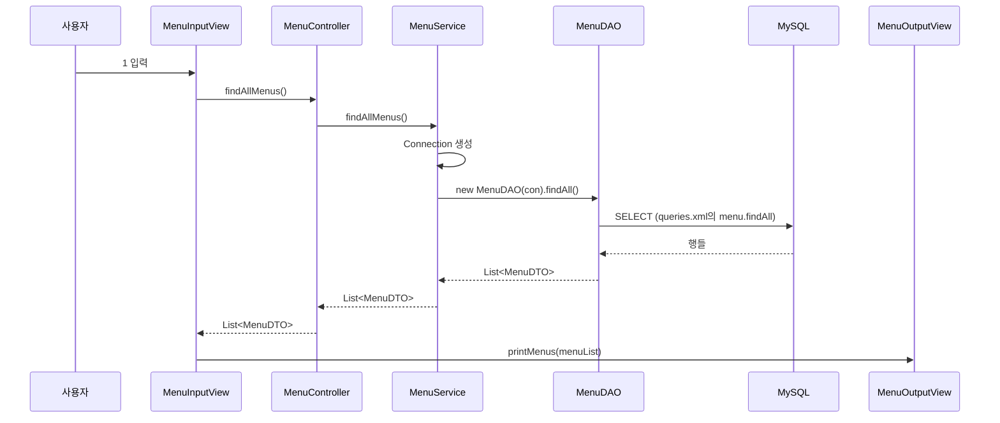

콘솔 프로그램을 만들다 보면 `main` 하나에 입력, 업무 판단, SQL, 출력이 전부 들어가기 쉽다.  
동작은 하지만 출력 모양 하나, 규칙 하나를 바꿀 때마다 어디를 고쳐야 할지 코드 전체를 뒤져야 한다.  
메뉴 전체 조회 기능을 `view` / `controller` / `model`로 나눈 실습 코드를 따라가며, 각 패키지가 **맡는 일과 맡지 않는 일**을 정리했다.

> **TL;DR**
> - 요청은 `InputView` → `Controller` → `Service` → `DAO` → DB로 내려가고, 결과(`List<MenuDTO>`)는 같은 길로 올라온다.
> - 입력은 View, 연결은 Controller, 업무 규칙과 `Connection`은 Service, SQL은 DAO, 데이터 운반은 DTO가 맡는다.
> - 객체는 `Application`에서 한 번에 조립하고, 필요한 객체는 생성자로 전달받는다.

환경: Java, MySQL, JDBC. 정확한 버전은 `확인 필요`.  
`static void main`을 `public` 없이 쓴 코드라 최신 Java에서만 실행된다. 버전 확인이 필요하다(`확인 필요`).  
코드는 수업 실습 코드를 정리한 것이다. 출력 결과는 실행 캡처가 아니라서 글에 싣지 않았다. 개념을 잡는 데는 "MVC 식당" 학습 자료(식당 비유)를 함께 참고했다.

## 1. 패키지는 어떻게 나뉘어 있을까?

```text
com.wanted.restaurant
├─ Application.java
├─ global
│  ├─ common   (QueryUtil)
│  └─ config   (JDBCTemplate)
└─ menu
   ├─ controller (MenuController)
   ├─ model
   │  ├─ dto     (MenuDTO)
   │  ├─ service (MenuService)
   │  └─ dao     (MenuDAO)
   └─ view
      ├─ input   (MenuInputView)
      └─ output  (MenuOutputView)
```

기능(`menu`) 단위로 먼저 묶고 그 안에서 계층을 나눈 구조다. 여러 기능이 함께 쓰는 `QueryUtil`, `JDBCTemplate`은 `global`에 둔다.

| 클래스 | 식당 비유 | 한 줄 책임 |
|---|---|---|
| `MenuInputView` | 주문 받는 직원 | 사용자 입력을 받고 흐름을 시작한다 |
| `MenuOutputView` | 서빙 직원 | 받은 결과를 출력한다 |
| `MenuController` | 홀 매니저 | View의 요청을 알맞은 Service에 연결한다 |
| `MenuService` | 주방장 | 업무 규칙, `Connection` 생성, 예외 처리를 맡는다 |
| `MenuDAO` | 냉장고 담당 | SQL을 실행하고 결과를 DTO로 바꾼다 |
| `MenuDTO` | 주문서와 접시 | 값을 담아 계층 사이로 옮긴다 |

## 2. 메뉴 전체 조회는 어떤 길로 지나갈까?



> Mermaid는 이 테마가 자체 렌더링하지 않는다. 배포된 페이지에서 그림으로 보이는지 확인이 필요하다(`확인 필요`).

수업 판서로 보면 흐름이 더 한눈에 들어온다. 손님(Client)이 `view`의 input에 "제육"을 입력하면(1), `controller`가 받아(2) `model`의 `service`에 넘기고(3), `service`가 `dao`에 재료 꺼내기를 시킨다(4). `dao`가 `db`에 다녀오면(5, 6) 결과가 `service`(7), `controller`(8), `output`(9), 손님(10) 순서로 되돌아온다.


> 이 판서는 9번에서 `controller`가 `output`을 호출하는 방식이다. 이 글의 실습 코드는 `InputView`가 `OutputView`를 호출하는 방식이라 위쪽 시퀀스 다이어그램과 약간 다르다. 아래 "헷갈리기 쉬운 지점"에서 다시 짚는다.

## 3. 객체는 누가 만들고 어떻게 연결할까? (Application)

```java
MenuService service = new MenuService();
MenuController controller = new MenuController(service);
MenuOutputView outputView = new MenuOutputView();
MenuInputView inputView = new MenuInputView(controller, outputView);

inputView.displayMainView();
```

각 클래스 안에서 `new MenuService()`를 직접 하지 않고, **`Application`이 객체를 조립해서 생성자로 넣어 준다.** 이렇게 하면 `Controller`가 어떤 `Service` 구현을 쓰는지 `Controller` 코드를 고치지 않고 바꿀 수 있다.  
실습 코드의 주석에 따르면 이는 이후에 배울 Spring이 자동으로 해 주는 일을 미리 손으로 해 보는 것이다. 이 방식을 의존성 주입(DI, Dependency Injection)이라고 부른다.

> 조립 순서가 곧 의존 방향이다. `Service`가 먼저 만들어져야 `Controller`에 넣을 수 있고, `Controller`가 있어야 `InputView`를 만들 수 있다.

## 4. 각 계층은 정확히 무엇을 할까?

### 4-1. View: 입력을 받고, 출력을 요청한다

```java
public void displayMainView() {
    System.out.println("1. 메뉴 전체 조회");
    System.out.print("메뉴를 입력해주세요 : ");
    int menu = sc.nextInt();

    switch (menu) {
        case 1:
            List<MenuDTO> menuList = menuController.findAllMenus();
            menuOutputView.printMenus(menuList);
            break;
    }
}
```

`MenuInputView`가 `Controller`와 `OutputView`를 둘 다 가진다. 입력을 받고, `Controller`에서 받은 결과를 `OutputView`에 넘겨 출력한다.  
View가 하면 안 되는 일은 SQL 작성, 업무 규칙 처리, `commit`/`rollback`이다.

### 4-2. Controller: 요청을 Service에 연결한다

```java
public List<MenuDTO> findAllMenus() {
    List<MenuDTO> menuList = menuService.findAllMenus();
    return menuList;
}
```

지금은 Service를 호출해서 그대로 돌려주는 것이 전부다. 그래도 존재하는 이유가 있다. 이후 기능이 늘면 입력값을 DTO로 조립하거나 간단한 유효성 검사를 하는 자리가 여기가 된다.  
Controller가 하면 안 되는 일은 `Scanner` 입력, 업무 규칙, SQL이다.

### 4-3. Service: 규칙, Connection, 예외 처리

```java
public List<MenuDTO> findAllMenus() {
    try (Connection con = JDBCTemplate.getConnection()) {
        return new MenuDAO(con).findAll();
    } catch (SQLException e) {
        throw new RuntimeException(e);
    }
}
```

이 코드에서 가장 눈에 띄는 점은 **`Connection`을 Service가 만들어서 DAO에 넘긴다**는 것이다(`new MenuDAO(con)`).  
이유는 트랜잭션 때문이다. 여러 DAO 작업(예: 메뉴 생성 시 카테고리도 삽입)을 하나의 `commit`/`rollback`으로 묶으려면 같은 `Connection`을 써야 한다. 그 경계를 정하는 곳이 업무 흐름을 아는 Service다.  
`try-with-resources`를 쓰므로 블록이 끝나면 `con`이 자동으로 닫힌다.

### 4-4. DAO: SQL 실행과 변환

```java
public List<MenuDTO> findAll() throws SQLException {
    String query = QueryUtil.getQuery("menu.findAll");
    List<MenuDTO> menus = new ArrayList<>();

    try (PreparedStatement pstmt = connection.prepareStatement(query)) {
        ResultSet rset = pstmt.executeQuery();

        while (rset.next()) {
            menus.add(new MenuDTO(
                    rset.getInt("MENU_CODE"),
                    rset.getString("MENU_NAME"),
                    rset.getInt("MENU_PRICE"),
                    rset.getInt("CATEGORY_CODE"),
                    rset.getString("ORDERABLE_STATUS")));
        }
    }
    return menus;
}
```

- `PreparedStatement`는 `try-with-resources`로 닫고, `ResultSet`은 따로 닫지 않는다. `Statement`를 닫으면 그에 딸린 `ResultSet`도 함께 닫히기 때문이다(공식 API 문서에 명시되어 있다).
- 행을 `MenuDTO`로 바꾸는 일까지 DAO 안에서 끝낸다. `ResultSet`이 DAO 밖으로 나가지 않는다.
- SQL 문자열은 코드에 직접 쓰지 않고 `QueryUtil.getQuery("menu.findAll")`로 가져온다.

### 4-5. DTO는 클래스의 "데이터" 부분만 가진 객체다

클래스는 데이터(필드)와 행위(메서드)로 이루어진다. 수업에서는 이 둘이 서로 다른 곳으로 이어진다고 정리했다. 데이터에 집중한 객체가 DTO이고, 행위(역할)를 나눠 맡기는 구조가 MVC 패턴이다.


`MenuDTO`가 정확히 그렇다. 필드, 생성자, getter/setter, `toString()`만 있고 판단이나 SQL은 없다.

> 판서에는 `Data Tranformation Object`라고 적혀 있지만, 일반적으로 쓰는 이름은 **Data Transfer Object**(데이터 전달 객체)다. 이 글은 Transfer로 적었다.

### 4-6. QueryUtil과 JDBCTemplate: 공통 설정

```java
static {
    try (InputStream inputStream =
                 QueryUtil.class.getClassLoader().getResourceAsStream("queries.xml")) {
        queries.loadFromXML(inputStream);
    } catch (Exception e) {
        throw new RuntimeException("쿼리 로딩 중 오류 발생", e);
    }
}
```

`static` 블록은 클래스가 처음 로드될 때 한 번만 실행된다. 그래서 `queries.xml`을 매번 읽지 않고, 처음 한 번 `Properties`에 올려 둔다.  
`JDBCTemplate`도 같은 방식으로 `db-info.properties`를 읽고, `getConnection()`을 호출할 때마다 `DriverManager`로 **새 연결**을 만든다. 커넥션 풀이 없어서 `close()`하면 실제로 DB 연결이 끊어진다.  
접속 정보를 코드가 아니라 `db-info.properties`에 두므로, 이 파일은 Git에 올리지 않도록 주의해야 한다(`확인 필요`: `.gitignore` 설정).

## 5. 헷갈리기 쉬운 지점

**Q. 호출 방향이 두 가지로 보이는데?**  
학습 자료(MVC 식당)에서는 `Controller`가 `InputView`와 `OutputView`를 모두 호출하는 구조였다. 이 실습 코드에서는 반대로 `InputView`가 `Controller`와 `OutputView`를 호출한다.  
둘 다 "View는 입출력만, 판단은 Service에" 라는 원칙은 같다. **누가 흐름의 시작점이냐**만 다르다. 어느 쪽이 맞는지가 아니라, 프로젝트가 정한 방식을 일관되게 따르는 것이 중요하다.

**Q. 단순 조회인데 Service와 Controller를 꼭 거쳐야 할까?**  
이 기능만 보면 둘 다 호출만 전달한다. 그래도 거치는 이유는 이후 규칙(예: 판매 불가 메뉴 숨기기)이 생겼을 때 넣을 자리를 정해 두기 위해서다. 계층을 건너뛰면 그 자리가 사라진다.

**Q. 이 구조가 항상 정답일까?**  
아니다. 계층 이름과 경계는 프로젝트와 프레임워크에 따라 달라진다. 이 글은 수업에서 쓴 한 가지 구조를 정리한 것이다.

## 6. 어기면 어떻게 될까?

| 어긴 경우 | 생기는 문제 |
|---|---|
| Controller나 View에 SQL이 들어간다 | 화면을 바꿀 때 DB 코드까지 고쳐야 한다 |
| 규칙이 Service 밖에 흩어진다 | 규칙 하나를 바꿀 때 고칠 곳을 찾아 헤맨다 |
| DAO가 각자 `Connection`을 만든다 | 여러 DAO 작업을 하나의 트랜잭션으로 묶을 수 없다 |
| 각 클래스가 다른 객체를 직접 `new`한다 | 구현을 바꿀 때 사용하는 쪽 코드를 모두 고쳐야 한다 |

공통점은 하나다. **같은 책임이 두 곳에 있으면 언젠가 한쪽만 고친다.**

## 7. 정리

- 요청은 View → Controller → Service → DAO → DB로 내려가고 `List<MenuDTO>`로 올라온다.
- View는 입출력, Controller는 연결, Service는 규칙과 `Connection`, DAO는 SQL, DTO는 운반만 맡는다.
- 객체 조립은 `Application`이 하고 생성자로 전달한다. Spring이 자동으로 해 줄 일을 먼저 손으로 해 본 셈이다.

다음에는 이 구조에 `INSERT`를 추가해 Service에서 `commit`/`rollback`을 처리해 보면 좋다.

## 더 학습하면 좋은 개념

- **의존성 주입(DI)과 제어의 역전(IoC)** — `Application`에서 객체를 조립하는 것이 이 개념의 가장 작은 형태다. Spring이 무엇을 자동화하는지 이해하는 출발점이다.
- **트랜잭션(Transaction)** — Service가 `Connection`을 갖는 이유다. 여러 DAO 작업을 하나로 묶고, 실패하면 `rollback`하는 원리를 알아야 구조의 의도가 보인다.
- **커넥션 풀(Connection Pool)** — `JDBCTemplate`은 호출마다 새 연결을 만든다. 연결 비용을 줄이는 다음 단계다.
- **계층형 아키텍처(Layered Architecture)** — 위 계층이 아래 계층만 호출하도록 의존 방향을 제한하는 설계다. 패키지를 나누는 기준이 된다.
- **Spring MVC** — `Controller`, `Service`, `Repository`(DAO 역할)로 같은 구조를 프레임워크가 지원한다. 이 글의 수동 구조를 해 보면 어노테이션이 대신해 주는 일이 보인다.

## 참고 자료
- [Java SE API - Statement (close와 ResultSet)](https://docs.oracle.com/en/java/javase/21/docs/api/java.sql/java/sql/Statement.html)
- [Oracle - JDBC Basics: Using Prepared Statements](https://docs.oracle.com/javase/tutorial/jdbc/basics/prepared.html)
- [Oracle - The try-with-resources Statement](https://docs.oracle.com/javase/tutorial/essential/exceptions/tryResourceClose.html)
- [Spring Framework 공식 문서 - Web MVC](https://docs.spring.io/spring-framework/reference/web/webmvc.html)
