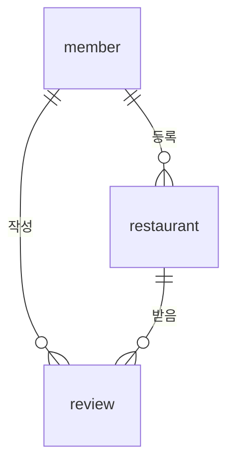

맛집 정보와 후기가 여러 곳에 흩어져 있어 비교하기 어렵다는 문제에서 출발한 Java 콘솔 프로그램이다.  
3명이 회원·맛집·리뷰 테이블을 하나씩 맡아 만들었고, 나는 리뷰(F-07~F-09)를 담당했다. 프로젝트 전체 구조와 내가 맡은 부분, 협업하면서 막혔던 곳, 그리고 아쉬운 점을 한 번에 정리했다.

> **TL;DR**
> - 맛집로그는 Java + MySQL(JDBC) + MVC로 만든 콘솔 프로그램이다. 가게당 1인 1리뷰를 DB의 `UNIQUE` 제약으로도 보장한다.
> - 나는 `review` 테이블 담당(F-07 리뷰 작성, F-08 맛집 상세 조회, F-09 내 리뷰 수정·삭제)이다. Service는 결과를 `enum`으로 돌려주고, 남의 리뷰는 SQL의 `WHERE`에서 막았다.
> - 가장 크게 막힌 곳은 `MainController` 한 파일에서 난 충돌 두 번이었다. 선택 기능 6개(검색, 페이징, 비밀번호 해시 등)는 구현하지 못했다.

환경: Java 17 이상, MySQL 8.0, MySQL Connector/J 9.1.0, Gradle(Wrapper 포함). 코드와 설명은 저장소의 README, `docs/기획서.md`, 실제 소스에서 가져왔고, 일부 코드는 길이 때문에 줄였다.

## 1. 프로젝트 소개

| 항목 | 내용 |
|---|---|
| 프로젝트명 | 맛집로그 (MatLog) |
| 개발 기간 | `확인 필요` |
| 팀 구성 | 3명 (A: 회원, B: 맛집, C: 리뷰) — 나는 C |
| 개발 목적 | 맛집 등록, 별점·리뷰 작성, 가게별 평균 별점 확인 |

### 기획 배경

- 맛집 정보와 후기가 여러 곳에 흩어져 있어, 한 곳에서 확인하고 비교하기 어렵다.
- 후기 글만으로는 가게 수준을 한눈에 알기 어렵다. 별점을 평균으로 집계해 보여주고, 가게당 1인 1리뷰로 한 사람이 평점을 부풀리는 것을 막는다.

### 주요 기능

| ID | 기능 | 담당 |
|---|---|---|
| F-01 ~ F-03 | 회원 가입, 로그인/로그아웃, 내 정보 수정·탈퇴 | A |
| F-04 ~ F-06 | 맛집 등록, 목록 조회, 내 맛집 수정·삭제 | B |
| F-07 ~ F-09 | 리뷰 작성, 맛집 상세 조회, 내 리뷰 수정·삭제 | C (나) |

가입과 로그인을 제외한 모든 기능은 로그인 후에만 쓸 수 있다.

## 2. 기술 스택

| 구분 | 기술 | 사용 목적 |
|---|---|---|
| Language | Java 17 이상 | 콘솔 프로그램 구현 |
| Database | MySQL 8.0 | 회원·맛집·리뷰 저장, 평균 별점 집계 |
| 연결 | JDBC (Connector/J 9.1.0) | `PreparedStatement`로 SQL 실행 |
| 빌드 | Gradle (Wrapper) | `./gradlew run`으로 실행, UTF-8 설정 |
| 협업 | GitHub | 브랜치·PR로 기능 단위 통합 |

## 3. 담당 역할

- **담당 기능**: F-07 리뷰 작성, F-08 맛집 상세 조회, F-09 내 리뷰 수정·삭제
- **담당 테이블**: `review` (ERD 작성과 스키마·샘플 데이터 SQL에도 참여)
- **구현한 클래스**: `ReviewController`, `ReviewService`, `ReviewDAO`, `ReviewInputView`, `ReviewOutputView`
- **협업에서 맡은 역할**: 기능 하나가 끝날 때마다 `feature/review-write`, `feature/review-detail`, `feature/review-manage` 브랜치에서 PR을 올렸다.

## 4. 시스템 및 코드 구조

```text
foodreview/
├── docs/                     기획서, ERD
├── sql/                      schema.sql, sample-data.sql
└── src/main/java/foodreview/
    ├── Main.java
    ├── controller/           메뉴 흐름 제어 (View 와 Service 연결)
    ├── service/              업무 규칙 (검증, 중복 확인)
    ├── dao/                  SQL 실행, ResultSet → DTO 변환
    ├── dto/                  계층 사이 데이터 전달
    ├── view/                 콘솔 입력·출력
    └── util/                 DBUtil, ConsoleInput, LoginSession
```

| 계층 | 하는 일 | 하지 않는 일 |
|---|---|---|
| view | 입력받기, 결과 출력 | SQL 실행, 업무 판단 |
| controller | 메뉴 흐름 제어 | SQL 작성 |
| service | 업무 규칙(검증, 중복 검사) | 입출력 |
| dao | SQL 실행 | 사용자 입출력 |

테이블은 `member`, `restaurant`, `review` 3개다.



- `review`는 (회원, 맛집) 쌍이 `UNIQUE`라서 가게당 1인 1리뷰를 DB에서도 보장한다.
- 맛집을 삭제하면 그 가게의 리뷰도 함께 삭제된다(`ON DELETE CASCADE`).
- 회원 탈퇴는 행을 지우지 않고 `member.withdrawn_at`에 시각을 기록한다. 탈퇴한 회원의 리뷰와 맛집은 그대로 남는다.

## 5. 주요 기능 구현: 리뷰 기능 (F-07 ~ F-09)

### 구현 목표

리뷰 기능은 실패하는 경우가 많다. 별점 범위 오류, 빈 내용, 이미 쓴 리뷰, 없는 가게, DB 오류까지 여섯 가지다. 이 결과를 계층 규칙(Service는 입출력 금지)을 지키면서 화면까지 전달하는 것이 목표였다. 자세한 비교는 [MVC 계층 규칙과 enum 결과 반환]({{ site.baseurl }}/java-mvc-review-feature-enum-result.html)에 정리했다.

### 구현 과정

1. `ReviewService`가 결과를 `enum`으로 돌려주고, 문구는 `ReviewOutputView`가 정한다.
2. 평균 별점은 가게 조회 SQL에 `LEFT JOIN`과 `GROUP BY`를 붙여 한 번에 구한다. 리뷰가 없으면 `AVG`가 `NULL`이라 "평점 없음"으로 연결된다.
3. 수정·삭제 SQL의 `WHERE`에 `member_id`를 함께 걸어, 남의 리뷰는 DB 단계에서 반영되지 않게 했다.

### 핵심 코드

```java
/** 리뷰 작성 결과 */
public enum WriteResult {
    SUCCESS, INVALID_INPUT, INVALID_RATING, ALREADY_REVIEWED, RESTAURANT_NOT_FOUND, DB_ERROR
}

/** F-07 리뷰 작성 */
public WriteResult writeReview(ReviewDTO review) {
    if (review.getRating() < 1 || review.getRating() > 5) {
        return WriteResult.INVALID_RATING;
    }
    if (review.getContent() == null || review.getContent().isBlank()) {
        return WriteResult.INVALID_INPUT;
    }
    try {
        if (reviewDAO.existsByMemberAndRestaurant(review.getMemberId(), review.getRestaurantId())) {
            return WriteResult.ALREADY_REVIEWED;
        }
        reviewDAO.insert(review);
        return WriteResult.SUCCESS;
    } catch (SQLException e) {
        return switch (e.getErrorCode()) {
            case ERR_NO_PARENT -> WriteResult.RESTAURANT_NOT_FOUND;   // 1452
            case ERR_DUPLICATE -> WriteResult.ALREADY_REVIEWED;       // 1062
            default -> WriteResult.DB_ERROR;
        };
    }
}
```

```java
// ReviewDAO: 평균 별점과 리뷰 수를 한 번에 집계
"SELECT r.restaurant_id, ..., AVG(v.rating) AS avg_rating, COUNT(v.review_id) AS review_count "
        + "FROM restaurant r LEFT JOIN review v ON r.restaurant_id = v.restaurant_id "
        + "WHERE r.restaurant_id = ? GROUP BY r.restaurant_id, ..."

// ReviewDAO: 남의 리뷰는 0행이 반영된다
"UPDATE review SET rating = ?, content = ? WHERE review_id = ? AND member_id = ?"
```

### 코드 설명

| 부분 | 역할 |
|---|---|
| `WriteResult` | 실패 이유를 구분해서 돌려주는 결과값. 문구는 View가 정한다 |
| `existsByMemberAndRestaurant` | 저장 전에 중복을 먼저 확인한다 |
| `ERR_DUPLICATE` (1062) | 확인 뒤 저장 사이에 같은 리뷰가 들어와 `UNIQUE`에 걸려도 같은 결과로 처리한다 |
| `ERR_NO_PARENT` (1452) | 참조할 가게가 없을 때 "존재하지 않는 가게입니다"로 연결한다 |
| `update`/`delete`의 반환값 | 반영된 행 수가 0이면 `NOT_FOUND`로 본다 |

### 실행 결과

리뷰가 있는 가게와 없는 가게의 상세 조회 화면이다. `>` 뒤가 입력한 값이다. (샘플 데이터 기준)

```text
가게 번호 > 1

===== 할매국밥 =====
카테고리: 한식
평균 ★4.7 (리뷰 3개)

--- 리뷰 ---
[미식가] ★4 (2026-10-20)
  맛있지만 조금 짰어요.
```

```text
가게 번호 > 3

===== 불맛곱창 =====
평점 없음

--- 리뷰 ---
작성된 리뷰가 없습니다
```

## 6. 트러블슈팅

### 문제 상황

PR을 올리기 직전에 "충돌 없음"을 확인했는데, 올리고 나니 충돌이 났다. `MainController.java` 한 파일에서 두 번 겪었다.

### 원인 분석

메뉴 분기를 `MainController` 한 파일에 모아 두고 팀원이 자기 기능의 줄만 바꾸는 구조였는데, 담당자가 다른 줄이 **서로 붙어 있었다**. Git은 한 파일의 붙어 있는 줄을 여러 명이 고치면 기능이 달라도 충돌로 본다.

| 충돌 | 겹친 줄 | 원인 |
|---|---|---|
| 1번째 (리뷰 작성 PR) | 필드 선언 두 줄 | 나는 `reviewController`, A는 `memberView`를 같은 위치에 추가했다 |
| 2번째 (상세 조회 PR) | `case 1`, `case 2`, `case 3` 세 줄 | B는 `case 1`·`case 3`을, 나는 `case 2`를 바꿨다 |

### 해결 방법

- 첫 번째는 서로 다른 필드를 추가한 경우라 `Accept both changes`로 해결했다.
- 두 번째는 같은 위치의 줄을 서로 다르게 바꾼 경우라 줄마다 어느 쪽을 남길지 골랐다.

### 해결 결과

병합 직전에 `git merge-tree`로 충돌과 컴파일 여부를 다시 확인하는 습관을 만들었다. 충돌 확인은 확인한 그 순간에만 유효하다는 점도 이번에 알게 됐다. 자세한 과정은 [MainController 충돌과 병합 전 확인]({{ site.baseurl }}/git-merge-conflict-checking-before-push.html)에 있다.

### 그 밖에 겪은 문제

IDE에서 직접 실행하면 콘솔의 한글이 깨졌다. 팀에서 `build.gradle`에 UTF-8 설정을 넣어 `./gradlew run`에서는 해결됐고, IDE에서는 VM 옵션(`-Dfile.encoding=UTF-8 -Dstdout.encoding=UTF-8`)을 직접 추가해야 한다고 README에 적어 두었다.

## 7. 협업 과정

- **브랜치 규칙**: `main`은 발표용 완성본, `develop`은 통합본, `feature/기능-이름`은 개인 작업이다. feature → develop PR은 1명 이상 리뷰 후 병합한다.
- **PR 단위**: 기능 하나가 끝날 때마다 PR을 올렸다. 저장소에는 병합 커밋이 20개 있다.
- **커밋 규칙**: `feat|fix|docs|refactor|sql: 한글 설명`으로 맞췄다.
- **역할 분담**: 회원·맛집·리뷰 테이블을 한 명씩 맡아, 담당 테이블의 등록·조회·수정·삭제(CRUD)를 각자 끝내는 방식이었다.
- **코드 통합**: 공통 뼈대(DB 연결, 로그인 세션, 메인 메뉴)를 먼저 만들어 두고 각자 기능을 붙였다. 그 때문에 `MainController`가 모두가 건드리는 파일이 되어 충돌이 났다.

## 8. 프로젝트 회고

### 배운 점

- Service가 `System.out`을 못 쓰는 제약이 오히려 결과를 `enum`으로 정리하는 설계로 이어졌다.
- 권한 검사를 SQL의 `WHERE`에 넣으면, 반영된 행 수 하나로 "내 리뷰가 맞는지"까지 판단할 수 있다.
- PR 충돌은 코드 문제보다 **파일을 나누는 방식**의 문제일 때가 많다.

### 아쉬운 점

선택 기능 8개 중 2개(O-04 비밀번호 변경, O-08 카테고리 고정 목록)만 구현했다.

| 미구현 | 현재 상태 |
|---|---|
| O-05 비밀번호 해시 저장 | 비밀번호를 입력한 그대로 저장하고 비교한다 |
| O-01, O-02 검색·페이징 | 맛집이 많아지면 전체 목록이 길어진다 |
| O-03 목록의 평균 별점 | 평균 별점은 상세 조회에서만 볼 수 있다 |
| O-06 본인 가게 리뷰 금지 | 본인이 등록한 가게에도 리뷰를 쓸 수 있다 |
| O-07 맛집 중복 등록 방지 | 같은 이름·주소의 가게를 등록할 수 있다 |

### 향후 개선 방향

- 해시 변환을 공통 유틸 한 곳에 만들어 가입·로그인·비밀번호 변경·탈퇴 확인에 적용한다.
- 목록 SQL에 `LEFT JOIN review`와 `GROUP BY`를 더해 목록에서도 평균 별점을 보여준다.
- `MainController`의 메뉴 분기를 기능별로 나눠, 같은 파일을 동시에 고치지 않도록 한다.

## 더 학습하면 좋은 개념

- **비밀번호 해시와 솔트(Salt, bcrypt)** — 지금은 평문 저장이라 O-05의 핵심이다. 단순 SHA-256과 솔트를 쓰는 방식의 차이를 알아야 안전한 저장 방식을 고를 수 있다.
- **트랜잭션과 격리 수준** — 중복 확인 후 저장 사이에 다른 요청이 끼어드는 문제(경쟁 상태)를 `UNIQUE` 제약 말고도 다룰 수 있게 된다.
- **페이징(`LIMIT`/`OFFSET`)과 인덱스** — 맛집이 늘어났을 때 목록과 검색이 느려지는 이유와 해결 방법을 이해하게 된다.
- **Git 브랜치 전략과 코드 오너십** — 한 파일을 여러 명이 고치는 구조를 피하는 방법을 알면 충돌이 줄어든다.

## 9. 관련 자료

- GitHub 저장소: [pokachip-campus-calculator/foodreview](https://github.com/pokachip-campus-calculator/foodreview)
- 관련 기술 포스팅
  - [Java MVC 패키지 구조]({{ site.baseurl }}/java-mvc-package-responsibility.html)
  - [MVC 계층 규칙과 enum 결과 반환]({{ site.baseurl }}/java-mvc-review-feature-enum-result.html)
  - [MainController 충돌과 병합 전 확인]({{ site.baseurl }}/git-merge-conflict-checking-before-push.html)
- 프로젝트 시연 영상 또는 실행 화면: 위 5번 항목의 실행 결과 참고

## 참고 자료

- [MySQL 공식 문서 - Server Error Reference](https://dev.mysql.com/doc/mysql-errors/8.0/en/server-error-reference.html)
- [MySQL 공식 문서 - FOREIGN KEY Constraints](https://dev.mysql.com/doc/refman/8.0/en/create-table-foreign-keys.html)
- [Oracle 공식 문서 - JDBC PreparedStatement](https://docs.oracle.com/en/java/javase/17/docs/api/java.sql/java/sql/PreparedStatement.html)
