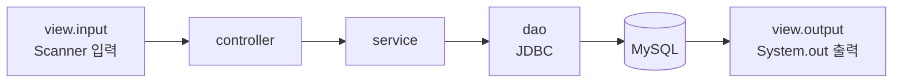
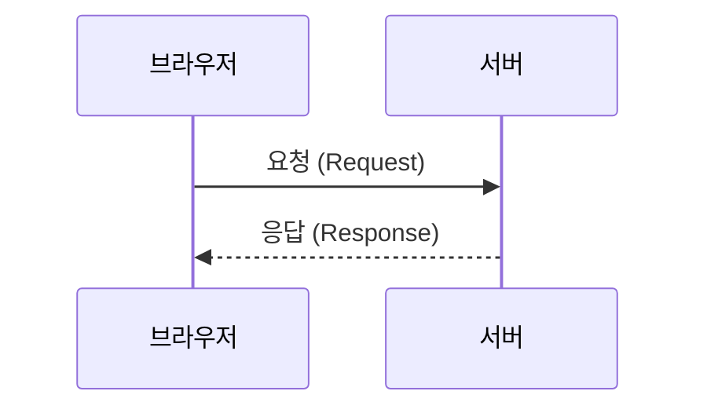
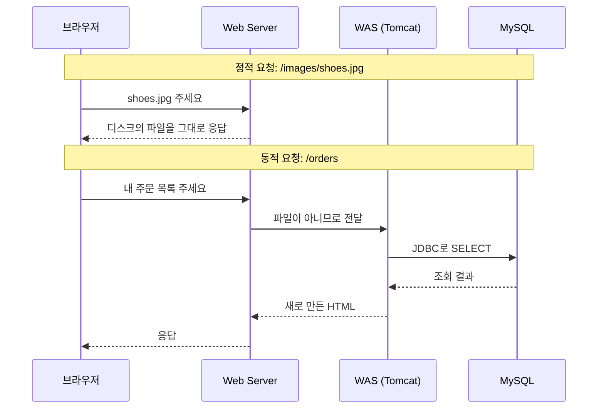

콘솔에서 만든 쇼핑몰 프로그램을 옆자리 친구도 쓰게 하려면 어떻게 해야 할까?  
친구 PC에 프로그램과 MySQL을 전부 설치하게 할 수도 있지만, 사용자가 늘수록 감당하기 어렵다. 웹 애플리케이션은 이 문제를 서버 한 곳에서 프로그램을 실행하고, 사용자는 브라우저와 주소(URL)만 쓰게 하는 방식으로 푼다.  
이 글은 요청 하나가 브라우저에서 출발해 어디를 거쳐 돌아오는지, 그리고 그 길 위에 왜 서버가 두 종류(Web Server, WAS)나 있는지를 정리했다.

> **TL;DR**
> - 콘솔 프로그램을 웹으로 옮기면 바뀌는 것은 view(입출력)뿐이고, service, dao, DB는 그대로 쓴다.
> - **Web Server**는 이미 있는 파일(정적)을 그대로 돌려주고, **WAS**는 Java 코드를 실행해 그때그때 결과(동적)를 만든다. Tomcat은 WAS다.
> - 둘을 나누는 이유는 역할 분담, 보안, 확장 세 가지다.

환경: Java, Tomcat. 이 글은 개념 정리라서 코드는 없다. 정확한 Tomcat 버전은 `확인 필요`.  
수업 자료(강사님이 제공한 "Servlet 들어가기 1편")를 바탕으로 정리했고, 공식 문서로 확인한 부분은 참고 자료에 링크했다.

## 1. 콘솔 프로그램과 웹 애플리케이션은 무엇이 다를까?

지금까지 만든 프로그램은 이런 흐름이었다.

웹으로 옮기면 입력과 출력의 통로만 콘솔에서 브라우저로 바뀐다.

| 구분 | 콘솔 프로그램 | 웹 애플리케이션 |
|---|---|---|
| 실행 위치 | 내 PC | 서버 한 대 |
| 사용자 | 나 혼자 | 여러 명이 동시에 |
| 사용자가 준비할 것 | 프로그램과 DB 설치 | 브라우저와 URL |
| 화면 | 콘솔 창 | 브라우저가 그리는 HTML |

그래서 service, dao, DB는 지금까지 만든 코드를 그대로 쓴다. 바뀌는 곳은 controller 앞뒤의 입출력이고, 이 자리를 뒤에서 볼 Servlet이 맡는다.

## 2. 요청과 응답: 웹의 기본 대화

브라우저(Client)가 요청(Request)을 보내면 서버(Server)가 응답(Response)을 돌려준다. 웹은 이 대화의 반복이다.

그런데 요청이라고 다 같은 요청은 아니다. 기준은 하나다. **요청할 때마다 결과가 달라질 수 있는가?**

| 구분 | 설명 | 예 |
|---|---|---|
| 정적 (Static) | 이미 파일로 있어서 누가 언제 요청해도 결과가 같다 | `shoes.jpg`, `about.html`, `style.css` |
| 동적 (Dynamic) | 요청이 올 때 프로그램이 실행되어 새로 만든다 | 내 장바구니, 상품 검색 결과, 내 주문 내역 |

수업 자료의 분류 문제에서 "오늘의 인기 상품 TOP 10"이 헷갈렸다. 누구에게나 같아 보여서 정적이라고 생각했다.  
하지만 시간이 지나면 순위가 바뀌고, 그 순위는 DB에서 집계해서 만든다. **보는 사람이 같아도 시간에 따라 달라지면 동적**이다.

## 3. Web Server와 WAS는 각각 무엇을 할까?

| 항목 | Web Server | WAS (Web Application Server) |
|---|---|---|
| 처리하는 요청 | 정적 (HTML, CSS, JS, 이미지) | 동적 (로그인, 장바구니, 주문 목록) |
| 하는 일 | 이미 있는 파일을 찾아서 돌려준다 | Java 코드를 실행하고 DB를 다녀와서 결과를 만든다 |
| DB 접근 | 하지 않는다 | JDBC로 한다 |
| 위치 | 사용자와 가장 가까운 앞단 | Web Server 뒤, 안쪽 |
| 대표 제품 | Nginx, Apache HTTP Server | **Tomcat**, Jetty, Undertow |

한 문장으로 줄이면 Web Server는 **있는 것을 주고**, WAS는 **없는 것을 만들어서** 준다.  
비유로 하면 Web Server는 병음료를 꺼내 주는 카운터 직원이고, WAS는 레시피대로 커피를 만드는 바리스타다.

요청이 두 서버를 어떻게 지나가는지 비교하면 차이가 분명하다. 아래는 수업 자료의 "요청 따라가기" 시뮬레이션 내용을 정리한 것이다.

정적 요청은 Web Server에서 끝나고, WAS와 MySQL은 한 번도 일하지 않는다.

## 4. WAS 하나로 다 하면 안 될까?

Tomcat도 정적 파일을 줄 수는 있다. 그런데 실제 서비스는 둘을 나눠서 둔다. 수업 자료는 세 가지 이유를 들었다.

| 이유 | 내용 |
|---|---|
| 역할 분담 | 요청의 상당수는 이미지나 CSS 같은 정적 파일이다. 이것을 Web Server가 빠르게 처리하면 WAS는 코드 실행과 DB 조회처럼 비싼 일에 집중한다. |
| 보안 | 밖에 공개되는 것은 Web Server뿐이다. 작성한 Java 코드와 DB 비밀번호가 있는 WAS와 DB는 안쪽에 숨겨서 외부에서 직접 접근하지 못하게 한다. |
| 확장과 안정 | 사용자가 늘면 WAS를 여러 대로 늘리고 Web Server가 요청을 나눠 보낸다(로드 밸런싱, Load Balancing). 한 대가 고장 나도 나머지가 일한다. |

다만 이 세 가지는 "일반적인 운영 구성"의 이유다. 오늘 수업에서는 Web Server 없이 Tomcat 하나만 띄워서 실습했을 것으로 보는데, 실제 구성은 `확인 필요`다.

## 5. 헷갈렸던 점

**"Tomcat은 Web Server 아닌가요?"**  
Tomcat도 정적 파일을 줄 수 있어서 Web Server처럼 보인다. 하지만 Tomcat의 핵심은 Java 코드(Servlet)를 실행하는 것이고, 그래서 이 수업에서는 WAS로 분류한다. Tomcat 공식 문서도 자신을 Jakarta Servlet 같은 사양의 구현체로 소개한다.

**"요청이 오면 항상 Web Server를 먼저 지나야 하나요?"**  
위 구성에서는 그렇다. 사용자와 가장 가까운 앞단이 Web Server이고, 파일이 아닌 요청만 WAS로 넘긴다.

## 정리

1. 콘솔에서 웹으로 옮길 때 바뀌는 것은 view뿐이고, service, dao, DB는 재사용한다.
2. 정적 요청은 Web Server에서 끝나고, 동적 요청은 WAS가 Java 코드를 실행해서 만든다.
3. 둘을 나누면 역할 분담, 보안, 확장에서 이득이 있다.

다음 글에서는 WAS 안으로 들어가, 요청을 받아 service를 호출해 주는 **Servlet**이 무엇인지 본다.

## 더 학습하면 좋은 개념

- **HTTP 메시지 구조** — 요청과 응답 안에 실제로 무엇이 들어 있는지 알아야 GET과 POST의 차이를 이해할 수 있다.
- **리버스 프록시(Reverse Proxy)** — Web Server가 요청을 WAS로 넘겨주는 방식의 이름이다. Nginx 설정에서 자주 만난다.
- **로드 밸런싱** — WAS를 여러 대 두었을 때 요청을 어떻게 나누는지, 세션 공유 문제와 함께 이어서 볼 만하다.

## 참고 자료

- [Apache Tomcat 공식 문서](https://tomcat.apache.org/tomcat-11.0-doc/)
- [Jakarta Servlet 6.1 사양](https://jakarta.ee/specifications/servlet/6.1/)
- 수업 자료: Servlet 들어가기 1편 (Web Server와 WAS)
- 다음 글: [Servlet 2: 생명주기와 요청 처리]({{ site.baseurl }}/servlet-2-lifecycle.html)
