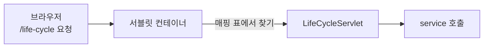

Servlet 클래스에는 `main()`이 없다. 그런데 브라우저에서 주소를 열면 코드가 실행된다.  
누가 객체를 만들고, 언제 어떤 메서드를 부르는 걸까? 직접 `println`을 넣은 서블릿 두 개로 이 흐름을 따라가 봤다.

> **TL;DR**
> - Servlet 객체는 **서블릿 컨테이너**(Tomcat 안의 관리자)가 만들고 호출한다. 객체는 하나만 만들어서 재사용한다.
> - 생명주기는 `init()`(한 번) → `service()`(요청마다) → `destroy()`(종료 때 한 번)다.
> - `HttpServlet`의 `service()`가 요청 방식을 보고 `doGet()`이나 `doPost()`로 나눠 호출한다. 그래서 우리는 `service()`가 아니라 `doGet`, `doPost`를 오버라이드한다.

환경: Java, Gradle(`war` 플러그인), `jakarta.servlet-api:6.1.0`(`compileOnly`), Tomcat. Tomcat 버전과 실제 콘솔 출력 결과는 `확인 필요`.  
코드는 이번 실습 프로젝트(`chap01-servlet`)에서 가져왔고, import 문은 일부 줄였다.

## 1. Servlet은 웹에서의 controller다

Servlet(서블릿)은 웹 요청을 받아 처리하고 응답을 돌려주는 Java 클래스다. 콘솔 프로그램의 controller가 하던 일을 웹에서 맡는다.

| 구분 | 콘솔 controller | Servlet |
|---|---|---|
| 누가 실행하나 | 내가 작성한 `main()`이 직접 호출 | 서블릿 컨테이너가 대신 호출 (`main()`이 없다) |
| 입력 받기 | `Scanner`로 키보드 입력 | 요청 객체(`request`)에서 꺼낸다 |
| 결과 보내기 | `System.out`으로 콘솔 출력 | 응답 객체(`response`)에 써서 브라우저로 보낸다 |
| 사용자 수 | 한 명 | 여러 명이 동시에 |


위 그림에서 Servlet(초록 상자)은 Client와 Application 사이의 입구에 서 있다. 요청을 가장 먼저 받고 응답을 마지막에 돌려주며, 안쪽에서는 JDBC가 DB와 데이터를 주고받는다.


수업에서는 Servlet 파트의 주의점으로 "Application의 `main()`에서 시작하는 방식이 아니라, Servlet은 `index.html`이 시작점"이라고 정리했다. 콘솔 프로그램은 `main()`을 실행해서 시작하지만, 웹 프로젝트에서는 사용자가 브라우저로 처음 여는 `index.html`에서 흐름이 출발한다는 뜻으로 이해했다. `main()`이 없다는 점은 이 글의 첫 문장과도 이어진다.

서블릿 컨테이너(Servlet Container)는 Tomcat 안에서 Servlet의 생성과 정리, URL에 맞는 Servlet 찾기, `request`와 `response` 객체 만들기, 요청마다 스레드 배정을 맡는다. 개발자는 Servlet을 만들어 두기만 하고 실행은 컨테이너가 한다.

## 2. URL 매핑: `@WebServlet`

컨테이너는 "어떤 주소는 어떤 Servlet이 맡는다"는 표를 가지고 있다. 이 표를 만드는 방법이 `@WebServlet` 어노테이션이다.

```java
@WebServlet(value = "/life-cycle")
public class LifeCycleServlet extends HttpServlet {
    // ... 생략
}
```

`/life-cycle` 요청이 오면 컨테이너가 이 클래스를 찾아 실행한다. `web.xml`에 서블릿을 등록하는 방식도 있지만, 이번 프로젝트의 `web.xml`은 비어 있고 어노테이션만 쓴다.




그림처럼 `/life-cycle` 요청이 오면 Web Server에는 이 이름의 파일이 없다. 그래서 요청이 WAS로 넘어가고, WAS 안의 여러 Servlet 중 `/life-cycle`을 맡은 Servlet이 실행된다. `index.html` 같은 정적 파일은 Web Server가 그대로 돌려준다.

## 3. 생명주기: init → service → destroy

```java
@WebServlet(value = "/life-cycle")
public class LifeCycleServlet extends HttpServlet {

    private int initCount = 1;
    private int serviceCount = 1;
    private int destroyCount = 1;

    public LifeCycleServlet() {
        System.out.println("기본생성자 호출됨...");
    }

    @Override
    public void init(ServletConfig config) throws ServletException {
        System.out.println("init() 호출됨... : " + initCount++);
    }

    @Override
    protected void service(HttpServletRequest req, HttpServletResponse resp) throws ServletException, IOException {
        System.out.println("service() 호출됨... : " + serviceCount++);
    }

    @Override
    public void destroy() {
        System.out.println("destory() 호출됨... : " + destroyCount++);
    }
}
```

| 메서드 | 호출 시점 | 횟수 |
|---|---|---|
| 생성자, `init()` | 객체가 만들어질 때 | 한 번 |
| `service()` | 요청이 올 때마다 | 요청 수만큼 |
| `destroy()` | 서버가 종료되거나 서블릿이 내려갈 때 | 한 번 |

새로고침을 여러 번 하면 `service()` 카운트만 올라가고 `init()`은 그대로여야 한다. 객체를 요청마다 새로 만들지 않고 **하나를 계속 재사용**하기 때문이다. 실제 콘솔 출력은 `확인 필요`다.

**헷갈렸던 점: `init()`은 서버를 켤 때 호출될까?**  
수업 자료에는 "첫 요청이 오면 컨테이너가 Servlet 객체를 만들고 `init()`을 호출한다"고 되어 있다. 서버만 켜고 `/life-cycle`에 접속하지 않으면 생성자와 `init()` 로그가 안 나온다는 뜻이다. 서버 시작 때 미리 만들게 하는 설정(`loadOnStartup`)도 있다고 알고 있는데, 이번 실습에서는 써 보지 않았다(`확인 필요`).

**브라우저에는 왜 아무것도 안 보일까?**  
위 코드는 `System.out.println`으로 콘솔에만 출력하고 `resp`에는 아무것도 쓰지 않는다. 브라우저에서 빈 화면이 나오는 것이 정상이다.

## 4. 동시에 여러 명이 요청하면 객체는 몇 개일까?

객체는 **하나**다. 대신 컨테이너가 요청마다 스레드(Thread, 일을 실행하는 흐름)를 하나씩 붙여서 같은 객체를 동시에 실행한다. Tomcat은 스레드를 미리 만들어 두고 빌려주는 스레드 풀(Thread Pool)을 쓰고, 최대 개수의 기본값은 200이다.

이 구조 때문에 **사용자마다 달라지는 값을 Servlet의 필드(멤버 변수)에 저장하면 안 된다.**

| 저장 위치 | 스레드 A, B가 동시에 접근하면 |
|---|---|
| Servlet 필드 | 같은 변수를 공유해서 B가 쓴 값을 A가 읽을 수 있다 (A 화면에 B의 장바구니) |
| 메서드 안 지역 변수 | 스레드마다 따로 생겨서 섞이지 않는다 |

`LifeCycleServlet`의 `serviceCount` 같은 필드는 이 관점에서 보면 모든 요청이 공유하는 값이다. 카운터 실습이라서 일부러 필드에 둔 것이고, 동시에 요청이 몰리면 값이 어긋날 수 있다. 사용자별 값은 지역 변수에 두거나, 이후 배울 세션(Session)을 쓴다.

## 5. service()는 doGet()과 doPost()로 나뉜다

컨테이너가 `service()`를 부르면, `HttpServlet`이 가진 `service()`가 요청 방식(GET, POST)을 확인해 알맞은 메서드로 넘긴다. 그래서 `service()`를 직접 오버라이드하지 않고 `doGet()`과 `doPost()`만 오버라이드한다.

```java
@WebServlet(value = "/request-service")
public class ServiceMethodServlet extends HttpServlet {

    @Override
    protected void doGet(HttpServletRequest req, HttpServletResponse resp) throws ServletException, IOException {
        System.out.println("GET 요청을 처리할 메소드 호출됨...");
    }

    @Override
    protected void doPost(HttpServletRequest req, HttpServletResponse resp) throws ServletException, IOException {
        System.out.println("POST 요청을 처리할 메소드 호출됨...");
    }
}
```

`service.html`에서 요청 방식을 바꿔 가며 확인했다.

| HTML | 요청 방식 | 호출되는 메서드 |
|---|---|---|
| `<a href="/request-service">` | GET | `doGet()` |
| `<form method="get">` | GET | `doGet()` |
| `<form method="post">` | POST | `doPost()` |

링크(`a` 태그)를 눌러 URL이 바뀌는 방식은 GET 요청이라는 점이 핵심이다. 반대로 `service()`를 직접 오버라이드하면 `super.service()`를 호출하지 않는 한 `doGet`, `doPost`는 호출되지 않는다.

## 6. 검색하다 만난 함정: javax와 jakarta

Servlet 패키지 이름이 중간에 바뀌었다. Tomcat 9 이하는 `javax.servlet`, Tomcat 10 이상은 `jakarta.servlet`이다. 예전 블로그 예제를 가져오면 `javax`로 되어 있어서 빨간 줄이 생긴다. 이번 프로젝트는 `jakarta.servlet-api:6.1.0`을 쓰고, 실행 시에는 Tomcat이 API를 제공하므로 `compileOnly`로 선언했다.

## 정리

1. Servlet은 컨테이너가 만들고 호출하며, 객체는 하나만 만들어 재사용한다.
2. 생명주기는 `init()` 한 번, `service()` 요청마다, `destroy()` 한 번이다.
3. 객체 하나를 여러 스레드가 함께 쓰므로 사용자별 값은 필드에 두지 않는다.

다음 글에서는 `request`에서 파라미터를 꺼내는 방법과 GET, POST의 차이를 본다.

## 더 학습하면 좋은 개념

- **스레드 안전성(Thread Safety)** — 객체 하나를 여러 스레드가 쓸 때 값이 꼬이지 않게 하는 방법이다. 필드에 카운터를 두는 코드가 왜 위험한지 이해하게 된다.
- **`loadOnStartup`** — Servlet을 첫 요청이 아니라 서버 시작 때 만들게 하는 설정이다. 초기화가 오래 걸리는 서블릿에 쓴다.
- **세션(Session)** — 사용자별 값을 안전하게 유지하는 방법이다. 필드에 저장하면 안 되는 이유의 해결책이다.

## 참고 자료

- [Jakarta Servlet 6.1 사양](https://jakarta.ee/specifications/servlet/6.1/)
- [Apache Tomcat 공식 문서](https://tomcat.apache.org/tomcat-11.0-doc/)
- 수업 자료: Servlet 들어가기 2편 (Servlet의 역할)
- 이전 글: [Servlet 1: Web Server와 WAS]({{ site.baseurl }}/servlet-1-web-server-was.html)
- 다음 글: [Servlet 3: 요청 파라미터]({{ site.baseurl }}/servlet-3-request-parameter.html)
