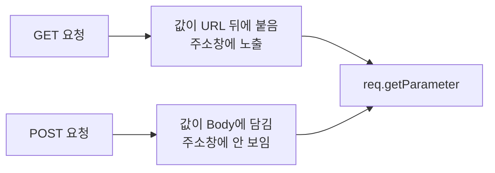

폼에 입력한 이름과 나이는 서블릿까지 어떤 모양으로 도착할까?  
같은 폼을 GET으로 보내면 주소창에 값이 보이고, POST로 보내면 보이지 않는다. 같은 `req.getParameter("name")`으로 두 방식의 값을 꺼내 보면서 차이를 정리했다.

> **TL;DR**
> - `req.getParameter("이름")`으로 값을 꺼내며, 반환 타입은 **항상 String**이다. 숫자가 필요하면 `Integer.parseInt()`로 직접 바꾼다.
> - GET은 값이 URL 뒤 쿼리스트링(`?name=...&age=...`)으로 가고, POST는 요청 Body(Payload)에 담겨 간다.
> - 체크박스처럼 값이 여러 개인 항목은 `getParameterValues()`를 써야 한다. 이번 실습 코드에는 아직 없다.

환경: Java, `jakarta.servlet-api:6.1.0`, Tomcat. Tomcat 버전과 실제 콘솔 출력은 `확인 필요`.  
코드는 이번 실습 프로젝트에서 가져왔고, import 문과 일부 주석은 줄였다.

## 1. 폼의 `name`이 곧 파라미터 이름이다

`parameter.html`의 폼은 이름, 나이, 생일, 성별, 국적, 취미를 보낸다. 서블릿에서 값을 꺼낼 때 쓰는 이름은 각 입력 태그의 `name` 속성이다.

| 입력 | 태그와 속성 | 파라미터 이름 | 값 |
|---|---|---|---|
| 이름 | `<input type="text" name="name">` | `name` | 입력한 글자 |
| 나이 | `<input type="number" name="age">` | `age` | 입력한 숫자 (문자열로 전달) |
| 생일 | `<input type="date" name="birthday">` | `birthday` | `2021-01-08` 형식 |
| 성별 | `<input type="radio" name="gender" value="M">` | `gender` | `M` 또는 `F` |
| 국적 | `<select name="national">` | `national` | `ko`, `ch`, `jp`, `etc` |
| 취미 | `<input type="checkbox" name="hobbies" value="movie">` | `hobbies` | 체크한 것 모두 |

화면에 보이는 라벨("이름")이 아니라 `name="name"`이 기준이라는 점을 처음에 놓쳤다. `value`는 radio, select, checkbox에서 서버로 가는 실제 값이다.

## 2. GET: 쿼리스트링으로 받기 (QueryStringServlet)

```java
@WebServlet(value = "/querystring")
public class QueryStringServlet extends HttpServlet {

    @Override
    protected void doGet(HttpServletRequest req, HttpServletResponse resp) throws ServletException, IOException {
        String name = req.getParameter("name");
        System.out.println("name = " + name);

        int age = Integer.parseInt(req.getParameter("age"));
        System.out.println("age = " + age);
    }
}
```

폼을 GET으로 제출하면 브라우저 주소가 이렇게 바뀐다(코드 주석에 적어 둔 예시다).

```text
http://localhost:8080/querystring?name=%EB%B0%95%EC%9C%A0%EC%88%98&age=3&birthday=2026-10-13&gender=F&national=ko&hobbies=movie&hobbies=music&hobbies=sleep
```

`?` 뒤가 쿼리스트링(Query String)이고, `이름=값`을 `&`로 이어 붙인다. 한글은 `%EB%B0%95...`처럼 URL 인코딩되어 전달되고, 서블릿에서는 원래 글자로 읽힌다. `hobbies`가 세 번 나오는 점도 눈여겨볼 만하다. 체크박스는 같은 이름으로 여러 번 전달된다.

링크(`a` 태그)에 쿼리스트링을 직접 써도 같은 GET 요청이 된다.

```html
<a href="/querystring?name=홍길동&age=20&gender=M&national=ko">쿼리스트링을 이용한 값 전달</a>
```

### 왜 `Integer.parseInt()`가 필요할까?

URL로 전달되는 데이터는 모두 문자열이라 `getParameter()`의 반환 타입이 `String`이다. 나이를 숫자로 쓰려면 직접 변환해야 한다.  
이 변환에는 위험이 있다. 나이 칸을 비운 채 제출하면 `getParameter("age")`가 빈 문자열을 돌려주고 `Integer.parseInt("")`에서 `NumberFormatException`이 날 것으로 보인다. 실제로 실행해 보지는 않았다(`확인 필요`).

## 3. POST: Body로 받기 (FormDataServlet)

```java
@WebServlet(value = "/formdata")
public class FormDataServlet extends HttpServlet {

    @Override
    protected void doPost(HttpServletRequest req, HttpServletResponse resp) throws ServletException, IOException {
        System.out.println("doPost() 호출됨...");
        String name = req.getParameter("name");
        System.out.println("name = " + name);
    }
}
```

`doGet`이 `doPost`로 바뀌었을 뿐, 값을 꺼내는 코드는 똑같다. 차이는 값이 **어디에 담겨 오는가**에 있다.



수업에서 정리한 두 방식의 차이는 다음과 같다.

| 항목 | GET | POST |
|---|---|---|
| 데이터 위치 | URL (쿼리스트링) | Payload(Body) |
| 노출 | 주소창에 보여서 보안상 취약할 수 있다 | URL에 노출되지 않는다 |
| 크기 | 제한이 있다 | GET보다 훨씬 크게 보낼 수 있다 |
| 용도 | 조회 (속도가 빠르다) | 게시글 등록 같은 데이터 전송 |

수업에서는 GET이 약 200자 안팎까지만 보낼 수 있다고 설명했다. 이 숫자는 브라우저와 서버마다 다르다고 알고 있어서, 정확한 한도는 `확인 필요`다. 또 "POST는 속도가 느리다"는 설명은 수업 내용 그대로 옮겼고, 체감 차이가 얼마나 되는지는 확인하지 않았다.

**POST는 안전한가?**  
Body에 담긴다고 암호화되는 것은 아니다. 주소창에 안 보일 뿐이고, HTTPS가 아니면 중간에서 읽힐 수 있다. 비밀번호 같은 값은 POST와 HTTPS를 함께 써야 한다.

## 4. 아직 처리하지 않은 것들

이번 실습 코드는 개념 확인용이라서 아래가 빠져 있다.

| 항목 | 현재 상태 | 해야 할 일 |
|---|---|---|
| `hobbies` | 코드에 없다 | `getParameterValues("hobbies")`로 `String[]`을 받는다 |
| POST 한글 | 인코딩 설정이 없다 | 값을 꺼내기 전에 `req.setCharacterEncoding("UTF-8")`을 호출한다. 깨지는지 여부는 Tomcat 버전에 따라 다를 수 있어 `확인 필요` |
| 빈 값 | `age`가 비면 예외 가능 | 빈 문자열을 먼저 검사한다 |
| 응답 | `resp`에 아무것도 쓰지 않는다 | 결과 화면을 `response`에 쓴다 |

다음 단계로 `getParameterValues()`를 추가해 체크박스 값을 출력해 보려 한다.

## 정리

1. `getParameter()`의 기준은 입력 태그의 `name`이고, 반환 타입은 항상 `String`이다.
2. GET은 URL로, POST는 Body로 값을 보내며, 서블릿에서 꺼내는 코드는 같다.
3. 값이 여러 개인 체크박스에는 `getParameterValues()`가 필요하다.

## 더 학습하면 좋은 개념

- **HTTP 메시지 구조** — 요청 라인, 헤더, Body가 어떻게 생겼는지 보면 GET과 POST의 위치 차이가 눈에 보인다.
- **URL 인코딩(퍼센트 인코딩)** — 한글이 `%EB%B0%95...`로 바뀌는 규칙이다. 문자 깨짐 문제를 이해하는 바탕이다.
- **입력값 검증(Validation)** — 빈 값이나 잘못된 숫자가 들어왔을 때 예외 대신 안내를 주는 방법이다.
- **PRG 패턴(Post/Redirect/Get)** — POST 후 새로고침하면 같은 요청이 다시 가는 문제를 푸는 방법이다.

## 참고 자료

- [Jakarta Servlet 6.1 사양](https://jakarta.ee/specifications/servlet/6.1/)
- [MDN - HTTP 요청 메서드 GET](https://developer.mozilla.org/en-US/docs/Web/HTTP/Methods/GET)
- [MDN - HTTP 요청 메서드 POST](https://developer.mozilla.org/en-US/docs/Web/HTTP/Methods/POST)
- 이전 글: [Servlet 2: 생명주기와 요청 처리]({{ site.baseurl }}/servlet-2-lifecycle.html)
