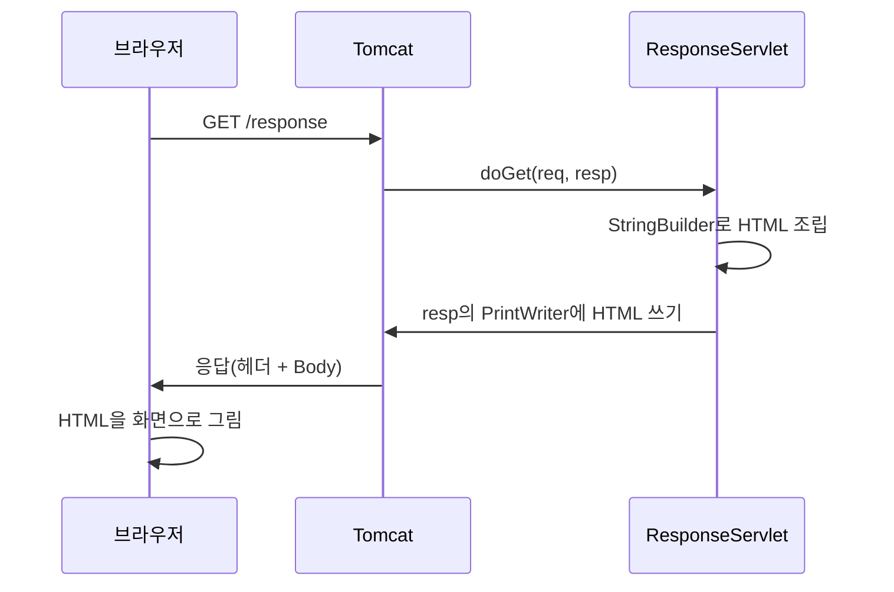

서블릿에서 `System.out.println("안녕")`을 실행하면 글자는 어디에 나올까? 브라우저가 아니라 IntelliJ의 콘솔에 나온다.  
브라우저 화면에 글자를 보여 주려면 `HttpServletResponse` 객체에 써야 한다. 가장 작은 예제로 응답이 만들어지는 과정과, 한글이 깨지는 이유를 하나씩 따라가 본다.

> **TL;DR**
> - 응답은 `resp.getWriter()`로 얻은 `PrintWriter`에 HTML 문자열을 쓰는 것으로 만든다.
> - 서블릿이 만드는 응답은 결국 문자열이라서, HTML을 `StringBuilder`로 직접 이어 붙여야 한다. 이 불편함이 JSP가 생긴 이유다.
> - 한글이 깨지면 `resp.setContentType("text/html; charset=UTF-8")`를 `getWriter()`보다 먼저 호출한다.

환경: Java 8 문법(`sourceCompatibility = '8'`), `jakarta.servlet-api:6.1.0`, Tomcat. 실제 브라우저 출력은 `확인 필요`.  
코드는 이번 실습 프로젝트에서 가져왔고, import 문과 일부 주석은 줄였다.

## 1. 먼저 알아둘 용어

이 글부터는 용어가 많이 나온다. 처음 보는 말은 아래 표로 확인하고 넘어가자.

| 용어 | 쉬운 설명 |
|---|---|
| 요청(Request) | 브라우저가 서버에게 "이 주소의 내용을 주세요"라고 보내는 메시지 |
| 응답(Response) | 서버가 요청에 대한 결과로 브라우저에게 돌려보내는 메시지 |
| `HttpServletRequest` (`req`) | 요청 메시지를 자바 객체로 만든 것. 값을 꺼낼 때 쓴다 |
| `HttpServletResponse` (`resp`) | 응답 메시지를 자바 객체로 만든 것. 값을 쓸 때 쓴다 |
| Body | 응답에서 실제 내용(HTML 같은 것)이 담기는 부분 |
| 인코딩(Encoding) | 글자를 컴퓨터가 저장하고 보낼 수 있는 숫자(바이트)로 바꾸는 규칙 |

`req`와 `resp`는 우리가 `new`로 만들지 않는다. 브라우저 요청이 오면 컨테이너(Tomcat)가 두 객체를 만들어서 `doGet()`의 매개변수로 넘겨 준다. 우리는 **받은 `req`에서 읽고, 받은 `resp`에 쓰기만** 하면 된다.

## 2. 서블릿의 역할 세 가지

수업에서 정리한 서블릿의 역할은 아래와 같다.

| 순서 | 역할 | 쓰는 객체 |
|---|---|---|
| 1 | 요청 전달받기 | `HttpServletRequest` (`getParameter()` 등) |
| 2 | Controller 역할 | 받은 데이터를 Service 계층에 전달 |
| 3 | 응답 전달하기 | `HttpServletResponse` |

앞 글에서 1번을 다뤘고, 이번 글은 3번이다.

## 3. 링크 하나를 눌렀을 때 일어나는 일

`response.html`에는 링크가 하나 있다.

```html
<li><a href="/response">응답해주삼!</a></li>
```

이 링크를 누르면 브라우저는 `/response` 주소로 **GET 요청**을 보낸다. `<a>` 링크는 항상 GET이라서 서블릿에서는 `doGet()`이 호출된다. (`doGet`과 `doPost`가 헷갈린다면 [Servlet 6]({{ site.baseurl }}/servlet-6-forward-redirect.html)의 비교표를 함께 보자.)

## 4. 코드를 한 줄씩 읽기

```java
@WebServlet("/response")
public class ResponseServlet extends HttpServlet {
    @Override
    protected void doGet(HttpServletRequest req, HttpServletResponse resp) throws ServletException, IOException {

        StringBuilder response = new StringBuilder();
        response.append("<!doctype html>\n")
                .append("<html>\n")
                .append("<body>\n")
                .append("<h1>Servlet 의 응답 결과!</h1>\n")
                .append("</body>\n")
                .append("</html>\n");

        PrintWriter out = resp.getWriter();
        out.print(response);
        out.flush();
        out.close();
    }
}
```

| 줄 | 하는 일 | 왜 필요한가 |
|---|---|---|
| `@WebServlet("/response")` | `/response` 주소를 이 클래스와 연결한다 | 어떤 주소로 요청이 왔을 때 이 서블릿을 실행할지 정해야 한다 |
| `StringBuilder response` | HTML 글자를 이어 붙일 그릇을 만든다 | 응답할 HTML을 문자열로 조립하기 위해서다 |
| `.append("<h1>...</h1>")` | HTML 한 줄을 그릇에 추가한다 | 브라우저가 읽을 화면의 내용이다 |
| `resp.getWriter()` | 응답 Body에 글자를 쓰는 도구(`PrintWriter`)를 받는다 | 여기에 쓴 내용이 브라우저로 간다 |
| `out.print(response)` | 조립한 HTML을 쓴다 | 이 줄에서 응답 내용이 정해진다 |
| `out.flush()` | 버퍼에 남은 글자를 밀어 내보낸다 | 모아 둔 글자가 아직 안 나갔을 수 있다 |
| `out.close()` | 쓰기 도구를 닫는다 | 다 썼다는 표시다 |

`print()`는 바로 브라우저로 가지 않고 먼저 **버퍼**(임시로 글자를 모아 두는 공간)에 쌓인다. `flush()`가 그 버퍼를 비우면서 내보낸다. 이 코드에서는 `close()`를 호출할 때도 남은 글자가 나가는 것으로 알고 있지만, `flush()`를 명시하는 습관을 들이면 의도가 분명해진다.

### 브라우저가 실제로 받는 것

서버가 보내는 응답은 대략 이런 모양이다. 아래는 이해를 돕기 위한 **예시**이며, 실제 헤더 값은 개발자 도구의 Network 탭에서 `확인 필요`다.

```text
HTTP/1.1 200
Content-Type: text/html;charset=UTF-8

<!doctype html>
<html>
<body>
<h1>Servlet 의 응답 결과!</h1>
</body>
</html>
```

위쪽의 상태 줄과 헤더는 "무슨 종류의 내용인지"를 알려 주고, 빈 줄 아래가 Body다. 우리가 `PrintWriter`로 쓴 글자가 바로 이 Body가 된다.



### 내 코드에서 찾은 오타

처음 작성한 코드에는 `<!doxtype html>`로 오타가 있었고, `<h1>` 태그도 닫지 않았다. 서블릿은 문자열을 그대로 내보내기만 하므로 컴파일러도 서버도 오류를 알려 주지 않는다. 브라우저가 문법 오류를 관대하게 해석해서 화면은 그럭저럭 나온다.  
위 코드는 그 부분을 고친 것이다. HTML 문법 오류를 Java 컴파일러가 잡아 주지 못한다는 점이 서블릿으로 화면을 만들 때의 첫 번째 불편함이었다.

## 5. 한글이 깨지는 이유

원래 코드에는 아래 줄이 주석 처리되어 있었다.

```java
// resp.setContentType("text/html; charset=UTF-8");
```

한글이 깨지는 과정을 단계로 나누면 이렇다.

1. 서블릿은 `"응답 결과"` 같은 글자를 `PrintWriter`에 쓴다.
2. 컴퓨터는 글자를 그대로 보낼 수 없어서 **인코딩 규칙**으로 바이트(숫자)로 바꾼다.
3. 브라우저는 받은 바이트를 **어떤 규칙으로 읽을지** 헤더(`Content-Type`)를 보고 정한다.
4. 서버가 바꾼 규칙과 브라우저가 읽는 규칙이 다르면 글자가 깨진다.

`setContentType("text/html; charset=UTF-8")`는 "이 응답은 HTML이고, UTF-8 규칙으로 바꿔서 보낸다"고 서버와 브라우저 양쪽에 알려 주는 설정이다.

| 설정 | 의미 |
|---|---|
| `text/html` | 응답 Body가 HTML이라고 브라우저에 알린다 |
| `charset=UTF-8` | 글자를 UTF-8 규칙으로 바꿔서 보낸다 |

설정하지 않았을 때의 기본 인코딩은 서블릿 버전과 Tomcat 설정에 따라 다르다. 오래된 환경에서는 한글을 표현하지 못하는 `ISO-8859-1`이 기본이라고 알고 있다(`확인 필요`).

### 호출 순서가 중요하다

| 순서 | 결과 |
|---|---|
| `setContentType()` → `getWriter()` | 인코딩이 반영된다 |
| `getWriter()` → `setContentType()` | 글자 인코딩 설정이 반영되지 않을 수 있다 |

`getWriter()`를 부르는 순간 글자를 어떤 인코딩으로 바꿀지 정해진다. 그 뒤에 `charset`을 바꿔도 이미 늦다. 그래서 응답을 쓰기 전, 가장 앞에서 설정한다.

원래 코드는 서블릿마다 이 줄을 반복해서 써야 했다. 반복을 없애는 방법은 [Servlet 8: 필터]({{ site.baseurl }}/servlet-8-filter.html)에서 다룬다.

### 직접 해보기

1. `ResponseServlet`에서 `setContentType` 줄을 주석으로 둔 채 실행해서 한글이 어떻게 보이는지 본다.
2. 줄의 주석을 풀고 다시 실행한다. 단, 이번 프로젝트에는 `EncodingFilter`가 있어서 주석을 두어도 한글이 정상일 수 있다. 필터를 끄고 비교해야 차이가 보인다(`확인 필요`).
3. 코드 맨 앞에 `System.out.println("response type : " + resp.getContentType());`를 두면 설정 전에는 값이 비어 있을 것으로 보인다. 실제 출력은 직접 확인해 본다.

## 6. 서블릿으로 HTML을 만들 때의 한계

| 항목 | 서블릿에서 직접 만들기 | 불편한 점 |
|---|---|---|
| HTML 작성 | `append("<h1>")` 문자열 이어 붙이기 | 오타를 컴파일러가 못 잡는다 |
| 따옴표 | `"<h3 align=\"center\">"`처럼 이스케이프 | 읽기 어렵다 |
| 수정 | HTML을 고치려면 Java 코드를 고치고 다시 배포 | 화면 담당자와 분업이 어렵다 |

그래서 화면 출력은 JSP 같은 템플릿에 맡기고, 서블릿은 요청 처리에 집중하게 된다. 이 구조가 [Servlet 6: forward와 redirect]({{ site.baseurl }}/servlet-6-forward-redirect.html)로 이어진다.

## 7. 정리

1. 응답은 `resp.getWriter()`로 얻은 `PrintWriter`에 문자열을 써서 만든다.
2. 한글은 `setContentType("text/html; charset=UTF-8")`를 `getWriter()`보다 먼저 호출해야 깨지지 않는다.
3. 문자열로 HTML을 만드는 방식은 오타와 유지보수에 약해서 JSP로 넘어간다.

## 더 학습하면 좋은 개념

- **HTTP 응답 메시지(상태 줄, 헤더, Body)** — `Content-Type`이 응답 헤더에 실린다는 것을 알면 `setContentType()`의 정체가 보인다.
- **UTF-8과 문자 인코딩** — 같은 글자가 인코딩마다 다른 바이트가 되는 이유를 이해하면 깨짐 문제의 원인을 스스로 찾을 수 있다.
- **`getOutputStream()`과 `getWriter()`의 차이** — 글자는 Writer, 이미지나 파일 같은 바이트는 OutputStream으로 보낸다. 한 응답에서 둘을 함께 쓸 수 없다.
- **JSP** — HTML 안에 Java 값을 넣는 템플릿이다. 이번 글의 불편함을 해결한다.

## 참고 자료

- [Jakarta Servlet 6.1 사양](https://jakarta.ee/specifications/servlet/6.1/)
- [MDN - Content-Type 헤더](https://developer.mozilla.org/en-US/docs/Web/HTTP/Headers/Content-Type)
- 이전 글: [Servlet 3: 요청 파라미터]({{ site.baseurl }}/servlet-3-request-parameter.html)
- 다음 글: [Servlet 5: 예외 처리]({{ site.baseurl }}/servlet-5-exception.html)
