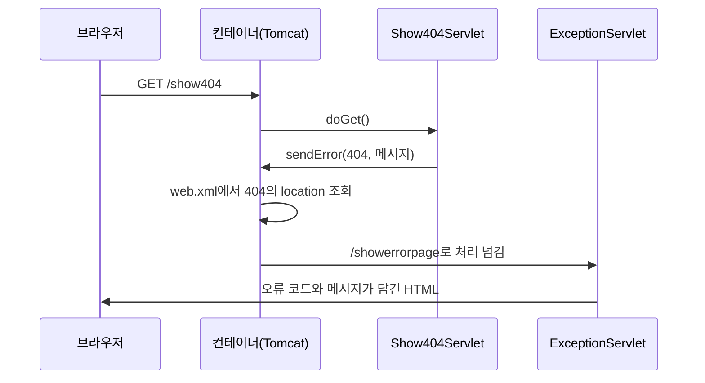

존재하지 않는 주소로 들어가면 Tomcat이 영어로 된 기본 오류 화면을 보여 준다. 이 화면을 직접 만든 페이지로 바꾸려면 어디를 고쳐야 할까?  
`web.xml`에 `error-page`를 등록하고, 오류 정보를 꺼내 응답하는 서블릿을 만들어 404와 500을 처리했다.

> **TL;DR**
> - `resp.sendError(코드, 메시지)`를 호출하면 컨테이너가 오류 응답을 만들고, `web.xml`의 `error-page`에 등록한 경로로 처리를 넘긴다.
> - 넘겨받은 서블릿은 `req.getAttribute("jakarta.servlet.error.status_code")` 같은 속성으로 오류 정보를 꺼낸다.
> - 오류 코드마다 서블릿을 만들지 않고, 하나의 서블릿이 404와 500을 함께 처리했다.

환경: `jakarta.servlet-api:6.1.0`, `web-app` 버전 6.1, Tomcat. 실제 화면은 `확인 필요`.  
코드는 이번 실습 프로젝트에서 가져왔고, import 문과 일부 주석은 줄였다.

## 1. 먼저 알아둘 용어

| 용어 | 쉬운 설명 |
|---|---|
| 상태 코드(Status Code) | 응답에 붙는 세 자리 숫자. 요청이 어떻게 처리됐는지 알려 준다 |
| 404 | 요청한 주소의 자원을 찾을 수 없다 (주소를 잘못 입력한 경우) |
| 500 | 서버 안에서 처리하다가 오류가 났다 (개발자 코드의 문제인 경우가 많다) |
| `web.xml` | `WEB-INF` 폴더 안에서 웹 애플리케이션 설정을 적는 XML 파일 |
| 속성(Attribute) | `req` 객체에 이름을 붙여 값을 넣어 두고 꺼내 쓰는 공간 |

속성은 이번 글에서 처음 본격적으로 쓴다. 파라미터(`getParameter`)는 브라우저가 보낸 값이고, 속성(`getAttribute`)은 **서버 쪽 코드가 `req`에 넣어 둔 값**이다. 이번에는 Tomcat이 오류 정보를 속성으로 넣어 준다.

## 2. 오류를 일부러 만드는 서블릿 두 개

`exception.html`에 두 링크를 두고, 각각 오류를 일으키는 서블릿으로 연결했다.

```html
<li><a href="/show404">404 Error</a></li>
<li><a href="/show500">500 Error</a></li>
```

```java
@WebServlet("/show404")
public class Show404Servlet extends HttpServlet {
    @Override
    protected void doGet(HttpServletRequest req, HttpServletResponse resp) throws ServletException, IOException {
        System.out.println("404 Servlet 호출됨");
        resp.sendError(404, "페이지가 없습니다.");
    }
}
```

```java
@WebServlet("/show500")
public class Show500Servlet extends HttpServlet {
    @Override
    protected void doGet(HttpServletRequest req, HttpServletResponse resp) throws ServletException, IOException {
        System.out.println("500 Servlet 호출됨");
        resp.sendError(500, "500번 대 Error 는 순전히 개발자의 잘못 ㅠㅠ");
    }
}
```

`sendError(코드, 메시지)`는 "이 요청은 오류로 끝났다"고 컨테이너에게 알리는 메서드다. 링크(`<a>`)로 들어오므로 GET이고, 그래서 `doGet()`에 썼다.

두 서블릿의 차이는 코드와 메시지뿐이다. 실제 서비스에서는 처리 중 예외가 잡히지 않으면 컨테이너가 자동으로 500을 만든다. 실습에서는 `sendError()`로 같은 상황을 흉내 냈다.

## 3. 오류가 나면 일어나는 일 (번호 순서)



1. 브라우저가 `/show404`를 요청한다.
2. `Show404Servlet`이 `sendError(404, ...)`를 호출한다.
3. 컨테이너는 `web.xml`에서 "404가 나면 어디로 보내라고 했지?"를 찾는다.
4. 등록된 `location`인 `/showerrorpage`의 서블릿(`ExceptionServlet`)이 실행된다.
5. 이 서블릿이 만든 HTML이 브라우저에 응답으로 간다.


수업에서 그린 흐름이다. `exception.html`(Web)에서 링크를 누르면 `/show404`가 호출되고, 이 서블릿이 `sendError(404)`를 보낸다. 컨테이너가 `web.xml`의 "404 → location `/showerrorpage`" 설정을 보고 `showerrorpage` 서블릿을 실행하며, 사용자는 이 서블릿의 응답을 받는다. `show500`도 같은 `showerrorpage`로 이어진다.

주소창에는 계속 `/show404`가 남아 있을 것으로 보인다. 서버 안에서 처리를 넘기기 때문이다(`확인 필요`).

## 4. web.xml에 오류 페이지 등록하기

```xml
<error-page>
    <error-code>404</error-code>
    <location>/showerrorpage</location>
</error-page>

<error-page>
    <error-code>500</error-code>
    <location>/showerrorpage</location>
</error-page>
```

| 태그 | 의미 |
|---|---|
| `<error-page>` | 오류 페이지 설정 한 건을 묶는다 |
| `<error-code>` | 이 숫자의 오류가 났을 때 적용한다 |
| `<location>` | 대신 처리할 경로 (서블릿 주소) |

두 코드를 같은 `location`으로 보내서 서블릿 하나가 404와 500을 모두 처리한다. 코드마다 다르게 보여 주고 싶다면 서블릿을 나누면 된다.

## 5. 오류 정보를 꺼내 응답하는 서블릿

```java
@WebServlet("/showerrorpage")
public class ExceptionServlet extends HttpServlet {
    @Override
    protected void doGet(HttpServletRequest req, HttpServletResponse resp) throws ServletException, IOException {

        String forwardUrl = req.getAttribute("jakarta.servlet.forward.request_uri").toString();
        System.out.println("forwardUrl = " + forwardUrl);

        int statusCode = (int) req.getAttribute("jakarta.servlet.error.status_code");
        String msg = req.getAttribute("jakarta.servlet.error.message").toString();

        StringBuilder responseBuilder = new StringBuilder();
        responseBuilder.append("<!doctype html>\n")
                .append("<html>\n")
                .append("<body>\n")
                .append("<h1>").append(statusCode).append(" - ").append(msg).append("</h1>")
                .append("</body>\n")
                .append("</html>\n");

        resp.setContentType("text/html; charset=UTF-8");
        PrintWriter out = resp.getWriter();
        out.print(responseBuilder);
        out.flush();
        out.close();
    }
}
```

| 속성 이름 | 내용 | 꺼내는 방법 |
|---|---|---|
| `jakarta.servlet.error.status_code` | 상태 코드 (404, 500) | `(int)`로 형변환 |
| `jakarta.servlet.error.message` | `sendError()`에 넘긴 메시지 | `.toString()` |
| `jakarta.servlet.forward.request_uri` | 처음 요청된 주소 (`/show404`) | `.toString()` |

### 왜 형변환이 필요할까?

`getAttribute()`의 반환 타입은 `Object`다. 어떤 타입의 값이든 넣을 수 있게 만든 대신, 꺼낼 때 원래 타입으로 돌려놓아야 한다.

| 코드 | 의미 |
|---|---|
| `(int) req.getAttribute(...)` | `Object`를 숫자(`int`)로 바꿔서 받는다 |
| `req.getAttribute(...).toString()` | `Object`를 글자(`String`)로 바꿔서 받는다 |

세 번째 줄의 `forward.request_uri`라는 이름 때문에 이 서블릿이 forward 방식으로 호출된 것처럼 보이지만, 오류 페이지에서 이 속성이 왜 들어 있는지는 공식 문서로 `확인 필요`다. 이 코드에서는 실제로 값을 꺼내 쓰고 있다.

### 직접 해보기

1. 서버를 실행하고 `exception.html`에서 두 링크를 차례로 눌러 본다.
2. `web.xml`에서 `<error-page>`를 지운 뒤 다시 눌러서 Tomcat 기본 화면과 비교한다.
3. 주소창에 `/showerrorpage`를 직접 입력해 본다. 오류 정보 속성이 없어서 서버 오류가 날 것으로 보인다(`확인 필요`).

### 주의할 점

이 코드는 속성이 없으면 `NullPointerException`이 난다. 컨테이너가 오류 정보를 넣어 주지 않는 상황, 즉 오류 없이 직접 `/showerrorpage`로 들어가는 경우가 그렇다. 또 `sendError()`에 메시지를 넘기지 않으면 `error.message`가 `null`일 수 있어서 `.toString()`에서 예외가 날 수 있다. 실제로는 `null` 검사를 먼저 해야 한다.

## 6. 직접 오류 처리 서블릿을 만드는 이유

| 방식 | 장점 | 단점 |
|---|---|---|
| Tomcat 기본 오류 화면 | 설정이 필요 없다 | 서버 종류와 버전 정보가 노출될 수 있다 (`확인 필요`) |
| `error-page` 등록 | 서비스 디자인에 맞는 안내를 줄 수 있다 | 오류 코드마다 등록해야 한다 |

사용자가 읽는 화면이 영어 오류 화면이라면 서비스에 대한 신뢰가 떨어진다. 그래서 오류 화면도 서비스의 일부로 만든다.

## 7. 정리

1. `sendError(코드, 메시지)`가 오류 응답을 시작하고, `error-page`가 처리 경로를 정한다.
2. 오류 정보는 `jakarta.servlet.error.*` 속성에서 꺼내며, `Object`라서 타입 변환이 필요하다.
3. 하나의 서블릿이 여러 오류 코드를 처리할 수 있다.

## 더 학습하면 좋은 개념

- **`error-page`의 `exception-type`** — 상태 코드가 아니라 예외 클래스(`java.lang.Exception` 등)로도 오류 페이지를 지정한다.
- **HTTP 상태 코드(2xx, 3xx, 4xx, 5xx)** — 코드의 대역마다 의미가 정해져 있어서, 어떤 코드를 돌려줄지 판단하는 기준이 된다.
- **`sendError()`와 `setStatus()`의 차이** — `sendError()`는 오류 페이지 처리를 일으키고, `setStatus()`는 코드만 바꾼다.

## 참고 자료

- [Jakarta Servlet 6.1 사양](https://jakarta.ee/specifications/servlet/6.1/)
- [MDN - HTTP 응답 상태 코드](https://developer.mozilla.org/en-US/docs/Web/HTTP/Status)
- 이전 글: [Servlet 4: 응답 객체]({{ site.baseurl }}/servlet-4-response.html)
- 다음 글: [Servlet 6: forward와 redirect]({{ site.baseurl }}/servlet-6-forward-redirect.html)
