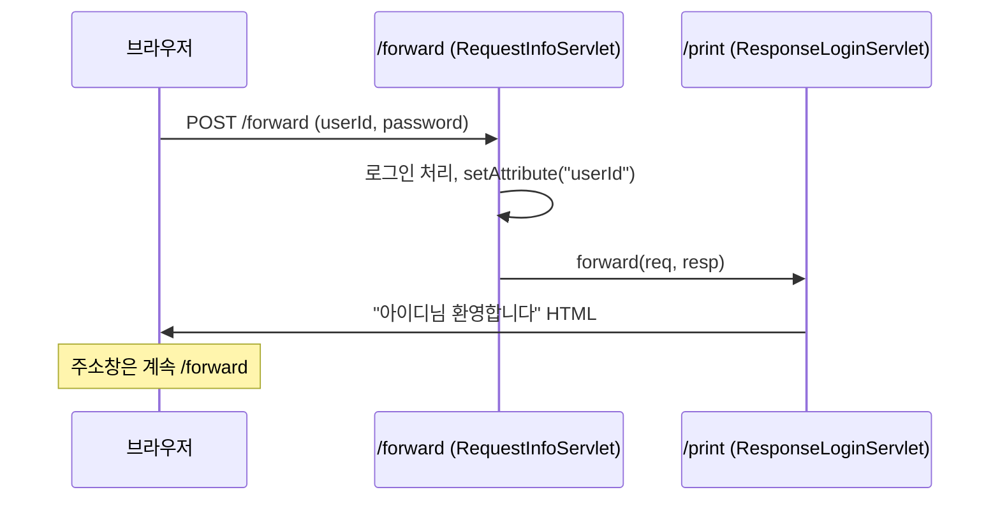
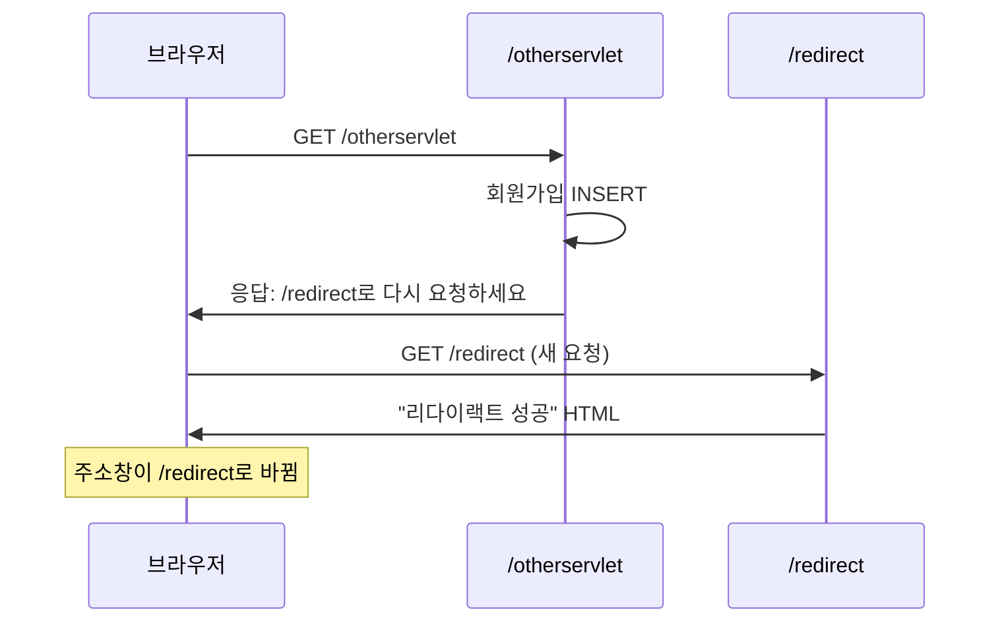

로그인 처리를 끝낸 서블릿이 "님 환영합니다" 화면까지 직접 만들어야 할까? 반대로 회원가입 직후 새로고침을 눌렀는데 같은 회원이 두 번 가입된다면?  
서블릿 사이에서 일을 넘기는 두 방식, forward와 redirect를 같은 서버에서 나란히 실행해 보며 차이를 정리했다.

> **TL;DR**
> - **forward**는 서버 안에서 `req`, `resp`를 그대로 넘긴다. 주소창 URL이 바뀌지 않고, `setAttribute()`로 값을 전달할 수 있다.
> - **redirect**는 브라우저에게 "이 주소로 다시 요청하라"고 응답한다. URL이 바뀌고, 이전 요청의 정보는 사라진다.
> - 조회(SELECT)는 forward, DB를 바꾸는 작업(INSERT, UPDATE, DELETE) 뒤에는 redirect를 쓴다.

환경: `jakarta.servlet-api:6.1.0`, Tomcat. 콘솔 출력과 브라우저 화면은 코드에서 읽은 내용이며 실제 실행은 `확인 필요`.  
코드는 이번 실습 프로젝트에서 가져왔고, import 문과 일부 주석은 줄였다.

## 1. 왜 서블릿끼리 일을 넘길까?

로그인 서블릿 하나가 모든 일을 하면 이런 일이 생긴다.

| 하는 일 | 성격 |
|---|---|
| 아이디, 비밀번호 꺼내기 | 요청 처리 |
| DB에서 회원 확인하기 | 비즈니스 로직 |
| "님 환영합니다" HTML 만들기 | 화면 응답 |

한 클래스가 책임을 너무 많이 가지면 고치기 어렵다. 그래서 **처리는 첫 번째 서블릿**이, **응답 화면은 두 번째 서블릿**이 맡도록 나누고 싶다. 이때 첫 번째 서블릿이 두 번째로 일을 넘기는 방법이 forward와 redirect다.

비유는 하나만 쓴다. forward는 접수 창구 직원이 **고객을 세워 둔 채 안쪽 부서에 서류를 넘겨서** 처리하고 결과만 전하는 것이다. 고객은 안쪽 부서가 있다는 것도 모른다. redirect는 직원이 "이 일은 3층 창구에서 하세요"라고 **안내하고, 고객이 직접 3층으로 가는** 것이다.

## 2. 먼저 알아둘 용어

| 용어 | 쉬운 설명 |
|---|---|
| 속성(Attribute) | `req`에 이름표를 붙여 넣어 둔 값. 서버 코드가 `setAttribute()`로 넣고 `getAttribute()`로 꺼낸다 |
| 파라미터(Parameter) | 브라우저가 폼이나 쿼리스트링으로 보낸 값. `getParameter()`로 꺼낸다 |
| 디스패처(`RequestDispatcher`) | 요청을 다른 서블릿이나 JSP로 넘겨 주는 객체 |
| 상태 코드 302 | "다른 주소로 이동하라"는 응답 코드 |

## 3. forward: 요청을 다른 서블릿에게 넘기기

`forward.html`의 로그인 폼은 `/forward`로 POST 요청을 보낸다.

```html
<form action="/forward" method="post">
    <input type="text" name="userId">
    <input type="password" name="password">
    <button type="submit">로그인</button>
</form>
```

비밀번호처럼 주소창에 보이면 안 되는 값을 보내니까 POST를 쓴다. 그래서 받는 서블릿은 `doPost()`다.

첫 번째 서블릿은 로그인 처리만 하고, 응답은 위임한다.

```java
@WebServlet("/forward")
public class RequestInfoServlet extends HttpServlet {
    @Override
    protected void doPost(HttpServletRequest req, HttpServletResponse resp) throws ServletException, IOException {
        String id = req.getParameter("userId");
        String pwd = req.getParameter("password");

        // memberService.login(id, pwd);  (실습에서는 호출하지 않음)

        // 전달해 줄 값 넣기
        req.setAttribute("userId", id);

        RequestDispatcher rd = req.getRequestDispatcher("/print");
        rd.forward(req, resp);
    }
}
```

| 줄 | 하는 일 |
|---|---|
| `req.getParameter("userId")` | 폼에서 보낸 아이디를 꺼낸다 |
| `req.setAttribute("userId", id)` | 다음 서블릿이 쓸 수 있게 `req`에 아이디를 넣는다 |
| `req.getRequestDispatcher("/print")` | `/print` 서블릿으로 넘겨 줄 디스패처를 얻는다 |
| `rd.forward(req, resp)` | `req`와 `resp`를 그대로 들고 `/print`로 이동한다 |

두 번째 서블릿은 받은 값으로 화면만 만든다.

```java
@WebServlet("/print")
public class ResponseLoginServlet extends HttpServlet {
    @Override
    protected void doPost(HttpServletRequest req, HttpServletResponse resp) throws ServletException, IOException {
        String id = req.getAttribute("userId").toString();

        StringBuilder responseText = new StringBuilder();
        responseText.append("<!doctype html>\n<html>\n<body>\n")
                .append("<h3 align=\"center\">").append(id).append("님 환영합니다.</h3>")
                .append("</body>\n</html>\n");

        PrintWriter out = resp.getWriter();
        out.print(responseText);
        out.flush();
        out.close();
    }
}
```


프로젝트 폴더를 보면 `d_response`, `e_exception`, `f_forward`마다 **응답을 맡는 서블릿**(주황색 상자)이 하나씩 있다. `ResponseServlet`, `ExceptionServlet`, `ResponseLoginServlet`이 그것이다. 요청을 받는 서블릿과 응답을 만드는 서블릿을 나누는 구조가 forward에서 가장 뚜렷하게 보인다.

### forward가 진행되는 순서



1. 브라우저가 `/forward`로 POST 요청을 **한 번** 보낸다.
2. `RequestInfoServlet`이 값을 꺼내고 처리한 뒤 `req`에 `userId`를 넣는다.
3. `forward()`로 `/print`에게 같은 `req`, `resp`를 넘긴다.
4. `ResponseLoginServlet`이 `req`에서 `userId`를 꺼내 HTML을 만들어 응답한다.
5. 브라우저는 응답만 받는다. `/print`가 있었다는 것도, 주소가 바뀌지 않은 이유도 모른다.

### forward의 핵심 세 가지

1. 두 서블릿이 같은 `req`, `resp`를 공유한다. 그래서 `setAttribute()`로 넣은 값을 `getAttribute()`로 꺼낼 수 있다.
2. 브라우저는 `/print`의 존재를 모른다. 요청이 한 번뿐이라 URL이 바뀌지 않는다.
3. forward는 원래 요청의 방식(POST)을 그대로 유지한다. 그래서 위임받는 `/print`도 `doGet()`이 아니라 `doPost()`를 오버라이드해야 한다.

### 파라미터와 속성은 다르다

| 구분 | 파라미터(`getParameter`) | 속성(`getAttribute`) |
|---|---|---|
| 값을 넣는 쪽 | 브라우저(폼, 쿼리스트링) | 서버 코드(`setAttribute`) |
| 타입 | 항상 `String` | `Object` (꺼낼 때 형변환) |
| 쓰는 곳 | 사용자 입력 받기 | 서블릿 사이에서 값 전달 |

## 4. redirect: 브라우저에게 다시 요청하게 하기

```java
@WebServlet("/otherservlet")
public class OtherServlet extends HttpServlet {
    @Override
    protected void doGet(HttpServletRequest req, HttpServletResponse resp) throws ServletException, IOException {
        // memberService.signUp();
        System.out.println("회원정보 DB 에 Insert 완료!");

        resp.sendRedirect("/redirect");
    }
}
```

`/redirect` 서블릿은 "리다이랙트 성공!" 화면을 응답한다. 링크(`<a href="/otherservlet">`)로 들어오기 때문에 GET이고, 그래서 `doGet()`이다.

### redirect가 진행되는 순서



1. 브라우저가 `/otherservlet`로 GET 요청을 보낸다.
2. 서블릿이 회원가입(INSERT)을 처리한다.
3. `sendRedirect("/redirect")`를 호출하면 서버는 화면을 만들지 않고, "`/redirect`로 다시 요청하라"는 응답을 보낸다. 이 응답의 상태 코드는 302로 알고 있고, 이동할 주소는 `Location` 헤더에 담긴다.
4. 브라우저가 그 주소로 **새 요청**을 보낸다.
5. `/redirect` 서블릿이 화면을 응답한다.

요청이 **두 번** 일어나므로 처음 요청의 `req`는 사라진다. 두 번째 요청은 주소를 눌러 이동한 것과 같아서 **항상 GET**이다. 실제 302와 `Location` 값은 개발자 도구(F12) Network 탭에서 `확인 필요`다.

## 5. forward와 redirect를 나란히 비교

| 항목 | forward | redirect |
|---|---|---|
| 누가 이동하는가 | 서버가 안에서 이동 | 브라우저가 새로 이동 |
| 요청 횟수 | 1번 | 2번 |
| 주소창 URL | 바뀌지 않음 | 바뀜 |
| `req`, `resp` | 공유함 | 공유하지 않음 |
| 값 전달 | `setAttribute()`로 가능 | 불가능 |
| 이동 후 요청 방식 | 원래 방식 유지 (POST면 POST) | 항상 GET |
| 새로고침 시 | 처음 요청(`/forward`)을 다시 보냄 | 바뀐 주소(`/redirect`)만 다시 요청 |
| 어울리는 작업 | 조회(SELECT) | 등록, 수정, 삭제(DML) |

## 6. 새로고침하면 어떻게 될까?

새로고침은 브라우저가 **마지막으로 보낸 요청을 그대로 다시 보내는** 동작이다.

**forward 뒤에 새로고침**

1. 마지막 요청은 `POST /forward`다.
2. 새로고침하면 `POST /forward`가 다시 서버로 간다.
3. 이 요청이 INSERT를 포함했다면 같은 데이터가 한 번 더 들어간다.

**redirect 뒤에 새로고침**

1. 마지막 요청은 redirect로 이동한 뒤의 `GET /redirect`다.
2. 새로고침하면 `GET /redirect`만 다시 간다.
3. `/otherservlet`의 INSERT는 다시 실행되지 않는다.

수업에서도 "DML을 forward로 구현하면 큰일난다"고 정리했다. 이렇게 POST 처리 뒤 redirect로 GET 화면을 보여 주는 흐름을 PRG 패턴(Post → Redirect → Get)이라고 부른다.

### redirect의 장점이 곧 단점이다

redirect는 이전 요청을 모른다. 그래서 위 예제에서 `userId`를 `setAttribute()`로 담아도 `/redirect`에서는 꺼낼 수 없다. redirect를 하면서도 정보를 이어 가고 싶을 때 쓰는 것이 쿠키와 세션이며, 다음 글에서 다룬다.

## 7. doGet과 doPost, 어느 쪽에 쓸까?

| 항목 | `doGet()` | `doPost()` |
|---|---|---|
| 요청이 오는 경우 | 주소창 입력, `<a>` 링크, `<form method="get">`, redirect 이후 | `<form method="post">` |
| 값이 있는 곳 | URL 뒤 쿼리스트링 | 요청 Body |
| 주로 하는 일 | 조회, 화면 보여 주기 | 로그인, 등록 같은 데이터 전송 |
| 이번 글의 예 | `/otherservlet`, `/redirect` | `/forward`, `/print` |

헷갈릴 때는 "**누가 어떤 방식으로 요청했는가**"를 먼저 본다.

1. 링크를 눌렀거나 redirect로 왔다면 GET이다. `doGet()`을 쓴다.
2. 폼에 `method="post"`가 있다면 POST다. `doPost()`를 쓴다.
3. forward로 넘겨받는 서블릿은 **원래 요청과 같은 방식**의 메서드를 쓴다.

메서드가 맞지 않으면(예: POST 폼을 `doGet()`만 있는 서블릿에 보내면) 405 오류(Method Not Allowed)가 날 것으로 알고 있다. 직접 확인하지는 않았다(`확인 필요`).

## 8. 헷갈렸던 점 모아 보기

| 질문 | 답 |
|---|---|
| forward 때 `/print`는 왜 `doPost()`일까? | forward는 `req`와 요청 방식을 그대로 넘기기 때문이다. 원래 POST였으니 POST로 받는다 |
| redirect에서 `setAttribute()`로 값을 보내면? | 두 번째 요청은 새 `req`라서 값이 없다. 쿠키나 세션을 써야 한다 |
| 둘 중 무엇이 더 안전한가? | 목적이 다르다. 화면 조회는 forward, DB를 바꾼 뒤에는 redirect다 |
| 주소창이 바뀌는 쪽은? | redirect다 |

### 경로를 쓸 때의 주의

`sendRedirect("/redirect")`처럼 `/`로 시작하는 경로는 컨텍스트 경로가 아니라 서버 루트(`/`) 기준으로 해석된다. 이번 실습은 컨텍스트 경로 없이 `/`에 배포했기 때문에 동작한다. 배포 경로가 `/chap01-servlet` 같은 이름으로 바뀌면 `req.getContextPath() + "/redirect"`로 써야 할 수 있다(`확인 필요`).

## 9. 정리

1. forward는 서버 안에서 `req`, `resp`를 넘기고 URL이 유지된다. redirect는 브라우저가 새로 요청하고 URL이 바뀐다.
2. DB를 바꾸는 작업 뒤에 forward를 쓰면 새로고침으로 같은 작업이 반복될 수 있다.
3. redirect는 값을 넘기지 못하므로 쿠키와 세션이 필요하다.

## 더 학습하면 좋은 개념

- **PRG 패턴(Post/Redirect/Get)** — POST 처리 뒤 redirect로 GET 화면을 보여 주는 정석 구조다.
- **HTTP 3xx 상태 코드(301, 302, 303, 307)** — 같은 redirect라도 이후 요청의 메서드를 유지하는지가 코드마다 다르다.
- **`RequestDispatcher.include()`** — forward처럼 처리를 넘기되, 응답을 합쳐서 보낸다.
- **MVC 패턴의 Controller와 View 분리** — 서블릿은 처리, JSP는 화면을 맡는 구조의 출발점이다.

## 참고 자료

- [Jakarta Servlet 6.1 사양](https://jakarta.ee/specifications/servlet/6.1/)
- [MDN - HTTP 리다이렉션](https://developer.mozilla.org/en-US/docs/Web/HTTP/Redirections)
- 이전 글: [Servlet 5: 예외 처리]({{ site.baseurl }}/servlet-5-exception.html)
- 다음 글: [Servlet 7: 쿠키와 세션]({{ site.baseurl }}/servlet-7-cookie-session.html)
