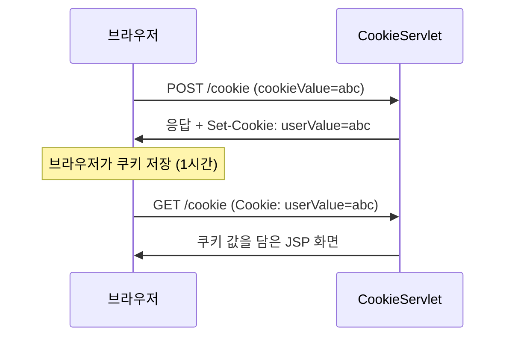
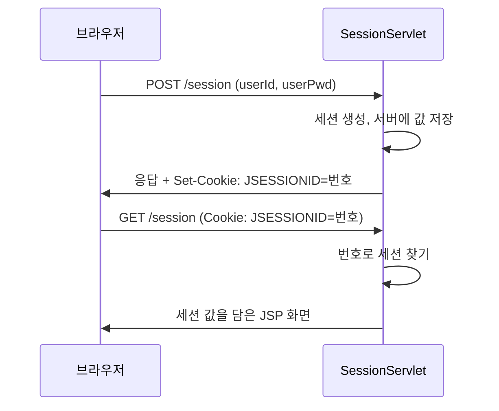

HTTP는 요청이 끝나면 상대를 잊어버린다. 로그인하고 다음 페이지로 이동했는데 서버는 어떻게 같은 사용자라는 것을 알까?  
쿠키는 브라우저에, 세션은 서버에 값을 저장하는 방식이다. 각각의 예제를 만들고 저장 위치와 만료 방식의 차이를 정리했다.

> **TL;DR**
> - **쿠키(Cookie)**는 값을 브라우저에 저장하고, 요청마다 서버로 보낸다. 서버는 `resp.addCookie()`로 심고 `req.getCookies()`로 읽는다.
> - **세션(Session)**은 값을 서버에 저장하고, 브라우저에는 세션을 구분하는 ID만 쿠키로 보낸다.
> - redirect에서 사라지는 정보를 이어 주는 것이 이 둘이다. 로그인 상태처럼 민감한 값은 세션에 둔다.

환경: `jakarta.servlet-api:6.1.0`, Tomcat, JSP(EL로 값 출력). 실제 화면은 `확인 필요`.  
코드는 이번 실습 프로젝트에서 가져왔고, import 문과 일부 주석은 줄였다.

## 1. 왜 쿠키와 세션이 필요할까?

HTTP는 **무상태(stateless)** 방식이다. 서버는 요청을 처리하고 나면 그 요청을 보낸 사람을 기억하지 않는다. 그래서 이런 일이 생긴다.

1. 사용자가 로그인 요청을 보낸다. 서버가 아이디와 비밀번호를 확인한다.
2. 사용자가 다음 페이지를 요청한다.
3. 서버는 이 요청이 방금 로그인한 사람의 것인지 알 방법이 없다.

앞 글에서 본 것처럼 redirect를 하면 `req`도 새로 만들어져서 이전 정보가 없다. 이 문제를 풀려면 **요청과 요청 사이에 값을 이어 줄 저장 공간**이 필요하다. 그 공간의 위치가 브라우저면 쿠키, 서버면 세션이다.

| 용어 | 쉬운 설명 |
|---|---|
| 무상태(stateless) | 서버가 이전 요청을 기억하지 않는 성질 |
| 쿠키 | 브라우저가 서버 대신 들고 있는 작은 값 |
| 세션 | 서버가 사용자별로 보관해 두는 값 |
| 세션 ID | 어느 세션이 누구 것인지 구분하는 번호표 |
| EL(`${...}`) | JSP 안에서 `req`에 담긴 속성 값을 출력하는 문법 |

## 2. 쿠키: 브라우저에 저장하기 (CookieServlet)

`cookie_session.html`의 폼에 값을 입력하면 `/cookie`로 POST 요청이 간다.

```html
<form action="/cookie" method="post">
    <input type="text" name="cookieValue" placeholder="값 입력해주세요..">
    <button type="submit">쿠키에 값 넣기</button>
</form>
```

```java
@WebServlet("/cookie")
public class CookieServlet extends HttpServlet {

    @Override
    protected void doPost(HttpServletRequest req, HttpServletResponse resp) throws ServletException, IOException {
        String cookieValue = req.getParameter("cookieValue");

        Cookie cookie = new Cookie("userValue", cookieValue);
        cookie.setMaxAge(60 * 60); // 만료 1시간(초 단위)

        resp.addCookie(cookie);

        doGet(req, resp);
    }

    @Override
    protected void doGet(HttpServletRequest req, HttpServletResponse resp) throws ServletException, IOException {
        String savedValue = "없음!";

        Cookie[] cookies = req.getCookies();
        if (cookies != null) {
            for (Cookie cookie : cookies) {
                if ("userValue".equals(cookie.getName())) {
                    savedValue = cookie.getValue();
                    break;
                }
            }
        }

        req.setAttribute("savedValue", savedValue);
        req.getRequestDispatcher("/h_cookie_session/cookie-result.jsp").forward(req, resp);
    }
}
```

```jsp
<h3> 쿠키에 저장된 값 : ${savedValue} </h3>
```


그림은 이번 실습의 전체 흐름이다. `cookie_session.html`(Web Server)에서 `/cookie`로 POST 요청을 보내면, Was Server의 `/cookie` 서블릿이 쿠키를 처리하고 `forward(req, resp)`로 `cookie-result.jsp`에 응답을 맡긴다.  
판서 위쪽 메모처럼 JSP는 **응답 전용 서블릿**이다. 서블릿 클래스로 응답하면 HTML 요소를 문자열로 하나하나 작성해야 해서 매우 번거롭기 때문에, 응답은 JSP가 맡는다.

### doPost: 쿠키를 만들어 브라우저에 보내기

| 줄 | 하는 일 |
|---|---|
| `req.getParameter("cookieValue")` | 폼에 입력한 값을 꺼낸다 |
| `new Cookie("userValue", cookieValue)` | 이름이 `userValue`이고 값이 입력값인 쿠키를 만든다 |
| `cookie.setMaxAge(60 * 60)` | 3600초(1시간) 동안 브라우저가 보관하게 한다 |
| `resp.addCookie(cookie)` | 응답에 쿠키를 실어서 브라우저에게 보낸다 |
| `doGet(req, resp)` | 결과 화면을 만드는 `doGet()`을 이어서 호출한다 |

### doGet: 브라우저가 보낸 쿠키 읽기

1. `req.getCookies()`는 브라우저가 이번 요청에 실어 보낸 쿠키 **전체를 배열**로 돌려준다.
2. 이름으로 하나를 바로 꺼내는 메서드는 없어서, 반복문으로 `getName()`을 비교해서 찾는다.
3. 쿠키가 하나도 없으면 배열이 아니라 `null`이 오므로 `null` 검사를 먼저 한다.
4. 찾은 값을 `req.setAttribute()`에 넣고, JSP로 forward해서 `${savedValue}`로 출력한다.

`"userValue".equals(cookie.getName())`처럼 상수를 앞에 쓰면 `getName()`이 `null`이어도 예외가 나지 않는다.

### 쿠키가 오가는 순서



1. 서버가 응답 헤더에 `Set-Cookie`로 쿠키를 실어 보낸다.
2. 브라우저는 쿠키를 저장해 둔다.
3. 이후 같은 서버에 요청할 때마다 브라우저가 `Cookie` 헤더로 쿠키를 자동으로 함께 보낸다.

예를 들어 헤더는 `Set-Cookie: userValue=abc; Max-Age=3600` 같은 모양일 것이다. 실제 헤더는 개발자 도구에서 `확인 필요`다.

### 처음 제출 직후에는 "없음!"이 나올까?

`doPost()`는 끝에서 `doGet()`을 직접 호출한다. 그런데 방금 `addCookie()`로 심은 쿠키는 이번 요청의 `req`에 들어 있지 않다. 쿠키는 응답에 실려 브라우저로 갔다가 **다음 요청**부터 돌아오기 때문이다. 그래서 처음 제출한 직후에는 화면에 "없음!"이 보일 것으로 추측하며, 직접 확인하지는 않았다(`확인 필요`).  
쿠키가 정말 저장됐는지 보려면 F12 → Application 탭 → Cookies에서 `userValue`를 확인하고, 주소창에 `/cookie`를 입력해 GET으로 다시 접속해 본다.

쿠키 값에 한글이나 공백, 세미콜론 같은 문자를 넣었을 때의 동작도 Tomcat 설정에 따라 다를 수 있어 `확인 필요`다.

## 3. 세션: 서버에 저장하기 (SessionServlet)

세션은 값을 서버 메모리에 두고, 브라우저에는 "당신의 보관함은 이 번호"라는 **세션 ID**만 쿠키로 준다.


그림처럼 브라우저 A, B, C가 같은 서버에 접속해도 서버는 사용자별로 칸(세션)을 따로 둔다. 브라우저 A가 로그인하면 서버의 A용 칸에 아이디와 비밀번호가 저장되고, A는 그 칸을 가리키는 번호만 가진다. B나 C의 요청은 각자의 칸으로 연결되어 서로 섞이지 않는다.

```java
@WebServlet("/session")
public class SessionServlet extends HttpServlet {

    @Override
    protected void doPost(HttpServletRequest req, HttpServletResponse resp) throws ServletException, IOException {
        String userId = req.getParameter("userId");
        String userPwd = req.getParameter("userPwd");

        if (userId != null && !userPwd.isEmpty()) {
            HttpSession session = req.getSession(true);

            session.setAttribute("loggedInUser", userId);
            session.setAttribute("userPwd", userPwd);
            session.setMaxInactiveInterval(30); // 30초

            doGet(req, resp);
        }
    }

    @Override
    protected void doGet(HttpServletRequest req, HttpServletResponse resp) throws ServletException, IOException {
        HttpSession session = req.getSession(false);

        String loggedInUser = null;
        String pwd = null;

        if (session != null) {
            loggedInUser = (String) session.getAttribute("loggedInUser");
            pwd = (String) session.getAttribute("userPwd");
        }

        req.setAttribute("loggedInUser", loggedInUser != null ? loggedInUser : "로그인 안됨!!");
        req.setAttribute("pwd", pwd != null ? pwd : "비밀번호 없음..");

        req.getRequestDispatcher("/h_cookie_session/session-result.jsp").forward(req, resp);
    }
}
```

위 코드는 실습 코드를 줄이고 일부를 고친 것이다. 원본의 `doPost()`에는 같은 사용자인지 비교하는 `if`/`else`가 있었는데, 두 분기의 동작이 같아서 하나로 합쳤다.

### doPost: 로그인(세션 만들기)

| 줄 | 하는 일 |
|---|---|
| `req.getSession(true)` | 세션을 가져오고, 없으면 새로 만든다 |
| `session.setAttribute("loggedInUser", userId)` | 세션 보관함에 아이디를 넣는다 |
| `session.setMaxInactiveInterval(30)` | 30초 동안 요청이 없으면 세션을 만료시킨다 |
| `doGet(req, resp)` | 결과 화면을 만드는 `doGet()`을 이어서 호출한다 |

### doGet: 세션 확인하기

| 줄 | 하는 일 |
|---|---|
| `req.getSession(false)` | 기존 세션만 가져온다. 없으면 `null` |
| `(String) session.getAttribute(...)` | 보관함에서 꺼내 `String`으로 바꾼다 |
| `loggedInUser != null ? ... : "로그인 안됨!!"` | 값이 없으면 안내 문구로 대신한다 |

### 세션이 오가는 순서



세션도 결국 브라우저가 세션 ID를 쿠키(보통 이름이 `JSESSIONID`)로 들고 다녀야 동작한다는 점은 공식 문서로 `확인 필요`다. 쿠키는 **값 자체**를 브라우저에 두고, 세션은 **번호표만** 브라우저에 두는 점이 다르다.

### getSession(true)와 getSession(false)

| 호출 | 세션이 없을 때 | 쓰는 곳 |
|---|---|---|
| `req.getSession(true)` (또는 인자 없이 `getSession()`) | 새로 만든다 | 로그인 처리 |
| `req.getSession(false)` | `null`을 돌려준다 | 확인, 로그아웃 |

확인만 하려고 `getSession()`을 호출했다가 세션이 의도치 않게 만들어지는 것을 막으려고 `false`를 쓴다.

### 형변환에서 만난 NPE 위험

원본 `doGet()`은 `session.getAttribute("loggedInUser").toString()`으로 꺼냈다. 세션은 있지만 이 속성이 없다면 `null`에 `toString()`을 호출해 `NullPointerException`이 난다. 수업에서 정리한 대로, `null`일 수 있는 값은 메서드 호출 대신 `(String)` 캐스트 연산자로 형변환하는 편이 안전하다. 캐스트는 `null`을 그대로 `null`로 둔다.

### 만료와 로그아웃

세션 유효 시간은 `setMaxInactiveInterval(30)`으로 정했다. 단위는 초이고, 마지막 요청 이후 30초 동안 요청이 없으면 만료된다. 요청할 때마다 시간이 새로 계산된다는 설명은 사양으로 `확인 필요`다.

로그아웃은 `ExpireServlet`이 맡는다.

```java
@WebServlet("/expire")
public class ExpireServlet extends HttpServlet {
    @Override
    protected void doGet(HttpServletRequest req, HttpServletResponse resp) throws ServletException, IOException {
        HttpSession session = req.getSession(false);

        if (session != null) {
            session.invalidate(); // 세션 무효화
        }

        resp.sendRedirect("/session");
    }
}
```

`invalidate()`는 세션과 그 안의 값을 모두 없앤다. 그 뒤 `/session`으로 redirect하면 새 요청이 `doGet()`으로 가서 "로그인 안됨!!"이 보인다. 앞 글의 redirect를 여기서 실제로 쓴 셈이다.

### 직접 해보기

1. 로그인 폼에 아이디와 비밀번호를 입력하고 제출한다.
2. "세션 확인" 링크를 눌러 값이 유지되는지 본다.
3. 30초 넘게 기다린 뒤 다시 "세션 확인"을 눌러 본다. 만료되었는지 확인한다. 이때 `session`은 있지만 속성이 없는 경우처럼 예외가 나는지도 함께 본다(`확인 필요`).
4. "세션 만료 시키기" 링크로 로그아웃하고 화면을 확인한다.

## 4. doGet과 doPost, 이번 코드에서의 역할

| 서블릿 | `doGet()` | `doPost()` |
|---|---|---|
| `CookieServlet` | 쿠키를 읽어 JSP로 forward | 쿠키를 만들어 보낸 뒤 `doGet()` 호출 |
| `SessionServlet` | 세션 값을 읽어 JSP로 forward | 세션을 만들고 값을 저장한 뒤 `doGet()` 호출 |
| `ExpireServlet` | 세션을 무효화하고 redirect | 없음 |

값을 **바꾸는** 동작(쿠키 심기, 로그인)은 `doPost()`에, 값을 **보여 주는** 동작은 `doGet()`에 두었다. 이 구조에서는 `doPost()`가 끝에 `doGet()`을 직접 호출해서 화면 만드는 코드를 재사용한다.

## 5. 쿠키와 세션 비교

| 항목 | 쿠키 | 세션 |
|---|---|---|
| 저장 위치 | 브라우저(클라이언트) | 서버 |
| 객체 | `Cookie` | `HttpSession` |
| 만료 설정 | `setMaxAge(초)` | `setMaxInactiveInterval(초)` |
| 보안 | 사용자가 값을 볼 수 있고 바꿀 수 있다 | 값은 서버에 있고, 브라우저는 세션 ID만 가진다 |
| 서버 부담 | 없다 | 사용자 수만큼 메모리를 쓴다 |

### 이번 실습 코드의 위험한 점

실습 코드는 비밀번호(`userPwd`)를 세션에 저장하고 화면에도 출력한다. 개념을 확인하려는 용도였지만, 실제 서비스에서는 비밀번호를 세션에 보관하거나 화면에 보여 주면 안 된다. 로그인 여부를 알려면 아이디(`loggedInUser`)만 두면 충분하다.

## 6. 정리

1. 쿠키는 브라우저에, 세션은 서버에 값을 저장한다.
2. `getCookies()`는 배열이라 이름으로 찾아야 하고, `getSession(false)`는 세션이 없으면 `null`이다.
3. 로그인 상태는 세션에 두고, 비밀번호는 저장하지 않는다.

## 더 학습하면 좋은 개념

- **쿠키 보안 속성(`HttpOnly`, `Secure`, `SameSite`)** — 자바스크립트 접근과 외부 사이트 전송을 막는 설정이다. 세션 ID가 탈취되는 것을 줄인다.
- **세션 고정 공격(Session Fixation)과 `changeSessionId()`** — 로그인 시 세션 ID를 바꿔야 하는 이유다.
- **세션 클러스터링과 Redis** — 서버가 여러 대일 때 세션을 공유하는 방법이다.
- **JWT 같은 토큰 방식** — 서버에 상태를 두지 않는 인증 방식이며 세션과 비교해 볼 만하다.

## 참고 자료

- [Jakarta Servlet 6.1 사양](https://jakarta.ee/specifications/servlet/6.1/)
- [MDN - HTTP 쿠키 사용하기](https://developer.mozilla.org/en-US/docs/Web/HTTP/Cookies)
- 이전 글: [Servlet 6: forward와 redirect]({{ site.baseurl }}/servlet-6-forward-redirect.html)
- 다음 글: [Servlet 8: 필터]({{ site.baseurl }}/servlet-8-filter.html)
