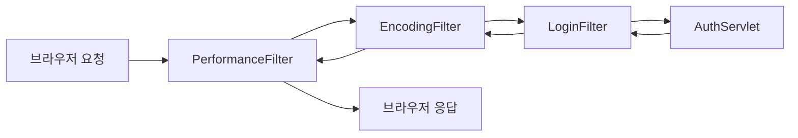

로그인한 사용자만 들어갈 수 있는 서블릿이 열 개라면, 열 개 모두에 로그인 검사 코드를 복사해야 할까? 모든 응답에 인코딩 설정도 매번 써야 할까?  
서블릿 앞에서 요청을 가로채는 필터(Filter)로 인코딩 설정, 수행 시간 측정, 로그인 검사 세 가지를 만들었다.

> **TL;DR**
> - 필터는 요청이 서블릿에 도달하기 **전후**에 끼어드는 객체다. `doFilter()`에서 `chain.doFilter()`를 호출해야 다음 단계로 넘어간다.
> - 등록 방법은 `@WebFilter` 어노테이션과 `web.xml` 두 가지이며, 이번에 둘 다 썼다.
> - 여러 서블릿에 공통으로 필요한 처리(인코딩, 로깅, 인증)를 한곳에 모을 수 있다.

환경: `jakarta.servlet-api:6.1.0`, Tomcat. 콘솔 출력은 코드에서 읽은 내용이며 실제 실행은 `확인 필요`.  
코드는 이번 실습 프로젝트에서 가져왔고, import 문과 일부 주석은 줄였다.

## 1. 왜 필터가 필요할까?

로그인 검사를 서블릿 안에 직접 쓰면 이런 코드가 서블릿마다 반복된다.

```java
// 예시 코드: 서블릿마다 이 검사를 복사해야 한다
HttpSession session = req.getSession(false);
if (session == null || session.getAttribute("loggedInUser") == null) {
    resp.sendRedirect("/h_cookie_session/cookie_session.html");
    return;
}
```

| 방식 | 문제 |
|---|---|
| 서블릿마다 직접 검사 | 코드가 중복되고, 하나라도 빼먹으면 로그인 없이 들어올 수 있다 |
| 필터 하나로 검사 | 한곳에서 관리하고, 경로 패턴으로 적용 대상을 지정한다 |

필터는 **서블릿으로 가는 길목에 서 있는 검문소**다. 서블릿은 검문을 통과한 요청만 받는다. 이 비유는 이번 글에서 한 번만 쓴다.

## 2. 먼저 알아둘 용어

| 용어 | 쉬운 설명 |
|---|---|
| 필터(Filter) | 요청이 서블릿에 가기 전, 응답이 돌아올 때 끼어들어 일을 하는 객체 |
| 필터 체인(FilterChain) | 필터들이 줄지어 있는 길. 다음 칸으로 넘기는 역할을 한다 |
| `chain.doFilter()` | 다음 필터나 서블릿으로 요청을 넘기는 호출 |
| URL 패턴 | 필터가 적용될 경로 (`/*`는 모든 경로, `/auth/*`는 `/auth`로 시작하는 경로) |
| `init-param` | `web.xml`에서 필터에 건네는 설정값 |

## 3. 필터는 서블릿 앞에서 동작한다




수업에서 그린 그림이다. `/login` 요청은 서블릿에 도달하기 전에 파란 상자(필터)를 먼저 지난다. 체크(✓) 표시는 "검사를 통과한 요청만 서블릿으로 보낸다"는 뜻으로 이해했다.


MVC 구조에 놓고 보면 필터는 controller(Servlet) **앞**에 선다. `req`는 필터를 지나 controller → service → dao → MySQL로 가고, 응답(`res`)은 같은 길을 거꾸로 돌아온다. 그래서 controller 이후의 코드를 건드리지 않고도 요청 앞뒤에 공통 처리를 끼워 넣을 수 있다.

`chain.doFilter(request, response)` 줄이 경계다. 이 줄 **앞**의 코드는 요청이 서블릿으로 가기 전에, **뒤**의 코드는 서블릿이 끝난 뒤 응답이 돌아올 때 실행된다.

```java
public void doFilter(ServletRequest request, ServletResponse response, FilterChain chain) {
    // 1. 앞: 요청이 서블릿에 가기 전에 실행
    chain.doFilter(request, response);   // 2. 다음 필터나 서블릿으로 넘김
    // 3. 뒤: 서블릿이 끝난 뒤 응답이 돌아올 때 실행
}
```

필터도 서블릿처럼 생명주기를 가진다.

| 메서드 | 호출 시점 | 이번 코드에서 한 일 |
|---|---|---|
| `init(FilterConfig)` | 필터 생성 시 한 번 | 설정값(`encoding-type`) 읽기, 시작 로그 |
| `doFilter(request, response, chain)` | 매 요청마다 | 실제 처리 |
| `destroy()` | 종료 시 한 번 | 종료 로그 출력 |

## 4. web.xml로 등록: 인코딩 필터 (EncodingFilter)

[Servlet 4]({{ site.baseurl }}/servlet-4-response.html)에서 서블릿마다 `setContentType()`을 써야 하는 불편함이 있었다. 이를 필터로 한 번에 처리한다.

```java
public class EncodingFilter implements Filter {

    private String encodingType;

    @Override
    public void init(FilterConfig filterConfig) throws ServletException {
        encodingType = filterConfig.getInitParameter("encoding-type");
    }

    @Override
    public void doFilter(ServletRequest request, ServletResponse response, FilterChain chain) throws IOException, ServletException {
        response.setContentType(encodingType);

        chain.doFilter(request, response);
    }
}
```

```xml
<filter>
    <filter-name>encoding</filter-name>
    <filter-class>com.wanted.servlet.i_filter.EncodingFilter</filter-class>
    <init-param>
        <param-name>encoding-type</param-name>
        <param-value>text/html; charset=UTF-8</param-value>
    </init-param>
</filter>

<filter-mapping>
    <filter-name>encoding</filter-name>
    <url-pattern>/*</url-pattern>
</filter-mapping>
```

| 줄 | 하는 일 |
|---|---|
| `<filter-name>` | 이 필터의 이름표. `<filter-mapping>`과 연결하는 열쇠다 |
| `<filter-class>` | 실제 필터 클래스의 전체 경로 (패키지 이름 포함) |
| `<init-param>` | 필터에 건네는 설정값 (`encoding-type`) |
| `<filter-mapping>` + `<url-pattern>` | 어떤 경로에 필터를 적용할지 (`/*`는 전부) |
| `filterConfig.getInitParameter(...)` | `init()`에서 `web.xml`의 설정값을 읽는다 |

`init-param`에 값을 두면 인코딩을 바꿀 때 Java 코드를 고치지 않고 `web.xml`만 수정하면 된다.  
이 필터가 모든 경로에 걸려 있으므로, 서블릿의 `resp.setContentType(...)` 줄을 주석 처리해도 응답 인코딩이 설정될 것으로 보인다. 실제로 한글이 안 깨지는지는 `확인 필요`다.

## 5. 어노테이션으로 등록: 수행 시간 측정 (PerformanceFilter)

```java
@WebFilter("/*")
public class PerformanceFilter implements Filter {

    @Override
    public void doFilter(ServletRequest request, ServletResponse response, FilterChain chain) throws IOException, ServletException {
        long startTime = System.currentTimeMillis();

        HttpServletRequest req = (HttpServletRequest) request;
        System.out.println("[요청 된 URL] : " + req.getRequestURI());

        chain.doFilter(request, response);

        long endTime = System.currentTimeMillis();
        System.out.println("[" + req.getRequestURI() + " 의 최종 수행 시간] : " + (endTime - startTime) + "(ms)");
    }
}
```

| 순서 | 줄 | 하는 일 |
|---|---|---|
| 1 | `startTime = System.currentTimeMillis()` | 시작 시각을 기록한다 |
| 2 | `System.out.println("[요청 된 URL]...")` | 어떤 주소가 요청됐는지 출력한다 |
| 3 | `chain.doFilter(...)` | 다음 필터와 서블릿이 실행되고, 끝나면 이 줄로 돌아온다 |
| 4 | `endTime - startTime` | 걸린 시간(밀리초)을 계산해 출력한다 |

**앞과 뒤를 모두 감쌀 수 있다**는 점이 이 예제의 핵심이다. 3번 줄에서 서블릿이 다 끝나야 4번 줄이 실행되기 때문에 전체 처리 시간을 잴 수 있다.

`ServletRequest`는 `getRequestURI()`가 없는 부모 타입이다. HTTP 전용 메서드를 쓰려면 `(HttpServletRequest)`로 형변환해야 한다.

| 등록 방식 | 방법 | 장점 | 단점 |
|---|---|---|---|
| 어노테이션 | `@WebFilter("/*")` | 클래스 옆에 설정이 있어 읽기 쉽다 | 설정을 바꾸려면 다시 컴파일해야 한다 |
| `web.xml` | `<filter>` + `<filter-mapping>` | 코드 수정 없이 설정을 바꿀 수 있다 | 클래스와 설정이 떨어져 있다 |

## 6. 로그인 검사 필터 (LoginFilter)

```java
@WebFilter("/auth/*")
public class LoginFilter implements Filter {

    @Override
    public void doFilter(ServletRequest request, ServletResponse response, FilterChain chain) throws IOException, ServletException {
        HttpServletRequest req = (HttpServletRequest) request;
        HttpServletResponse resp = (HttpServletResponse) response;

        HttpSession session = req.getSession(false);

        if (session == null || session.getAttribute("loggedInUser") == null) {
            resp.sendRedirect("/h_cookie_session/cookie_session.html");
        } else {
            chain.doFilter(req, resp);
        }
    }
}
```

| 조건 | 결과 |
|---|---|
| 세션이 없거나 `loggedInUser`가 없다 | 로그인 화면으로 redirect한다. 서블릿은 실행되지 않는다 |
| 세션이 있고 `loggedInUser`가 있다 | `chain.doFilter()`로 통과시킨다 |

**`chain.doFilter()`를 호출하지 않으면 요청은 서블릿에 도달하지 않는다.** 앞 글의 세션과 redirect가 여기서 함께 쓰인다.

```mermaid
flowchart TD
    A[/auth 요청] --> B{세션에 loggedInUser가 있는가?}
    B -->|없음| C[로그인 페이지로 redirect]
    B -->|있음| D[chain.doFilter → AuthServlet]
```

### 필터가 없으면 서블릿에서 무슨 일이 날까?

```java
@WebServlet("/auth")
public class AuthServlet extends HttpServlet {
    @Override
    protected void doGet(HttpServletRequest req, HttpServletResponse resp) throws ServletException, IOException {
        HttpSession session = req.getSession(false);
        String existUser = (String) session.getAttribute("loggedInUser");

        session.setAttribute("loggedInUser", existUser);

        req.getRequestDispatcher("/i_filter/auth.jsp").forward(req, resp);
    }
}
```

`AuthServlet`은 `session`이 `null`일 수 있다는 것을 검사하지 않는다. 로그인하지 않은 사용자의 요청이 바로 여기에 오면 `session.getAttribute(...)`에서 `NullPointerException`(서버 오류 500)이 난다. 필터가 앞에서 막아 주므로 서블릿 안에서 매번 `null` 검사를 하지 않아도 된다. 수업에서도 500 오류 대신 로그인 페이지로 보낸다는 취지로 설명했다.

`auth.jsp`는 세션 값을 출력한다. JSP는 HTML처럼 보이지만 실제로는 서블릿으로 변환되어 실행되는 파일이고, `<% %>` 안에 Java 코드를 쓸 수 있다.

```jsp
<%
    String user = (String) session.getAttribute("loggedInUser");
%>
<h3><%= user %></h3>
```

| 표기 | 의미 |
|---|---|
| `<% ... %>` | 안에 Java 코드를 그대로 쓴다 |
| `<%= user %>` | 변수 값을 화면에 출력한다 |
| `session` | JSP에서 미리 준비된 세션 객체 (따로 만들지 않아도 쓸 수 있다) |

`/auth/*` 패턴이 정확히 `/auth` 요청에도 걸리는지는 서블릿 사양의 URL 매핑 규칙으로 `확인 필요`다.

## 7. 요청 하나가 지나가는 길 (예상 출력)

로그인하지 않은 상태에서 `/auth`를 요청하면 다음 순서로 진행될 것으로 예상한다. 아래는 코드에서 읽은 **예상 흐름**이며 실제 콘솔 출력은 `확인 필요`다.

1. `PerformanceFilter`가 `[요청 된 URL] : /auth`를 출력한다.
2. `LoginFilter`가 "Login 필터 호출됨..."을 출력하고, 세션이 없어서 로그인 화면으로 redirect한다.
3. `AuthServlet`은 실행되지 않는다.
4. 브라우저가 로그인 화면(`/h_cookie_session/cookie_session.html`)을 새로 요청한다. 이 요청도 `PerformanceFilter`를 지난다.

로그인한 뒤라면 2번에서 `chain.doFilter()`로 통과하고, `AuthServlet`이 실행된 뒤 `PerformanceFilter`가 수행 시간을 출력한다.

### 직접 해보기

1. 로그인하지 않은 채 주소창에 `/auth`를 입력해서 로그인 화면으로 이동하는지 본다.
2. `cookie_session.html`에서 세션 로그인을 한 뒤 `/auth`에 접속해서 아이디가 보이는지 본다.
3. IntelliJ 콘솔에서 필터 로그의 순서를 확인한다.

## 8. 필터가 여러 개일 때의 순서

이번 프로젝트에는 `/*`에 걸리는 필터가 `EncodingFilter`(`web.xml`)와 `PerformanceFilter`(어노테이션) 두 개, `/auth/*`에 걸리는 `LoginFilter`가 있다.

| 등록 방식 | 순서 |
|---|---|
| `web.xml` | `<filter-mapping>`이 적힌 순서대로 실행 |
| 어노테이션 | 사양상 순서가 정해져 있지 않다 |

순서가 중요한 필터는 `web.xml`에 적어서 순서를 고정하는 편이 안전하다. 어노테이션끼리의 순서와 `web.xml`과 섞였을 때의 우선순위는 공식 문서로 `확인 필요`다. 위 다이어그램의 순서는 이해를 돕기 위한 예시이며, 실제 실행 순서는 콘솔 로그로 확인해야 한다.

## 9. 정리

1. 필터는 `chain.doFilter()` 앞뒤로 서블릿 실행을 감싸고, 이 호출이 없으면 요청이 막힌다.
2. 인코딩, 수행 시간 측정, 로그인 검사처럼 여러 서블릿에 공통인 처리를 필터에 모은다.
3. 등록은 `@WebFilter`와 `web.xml` 두 가지이며, 순서가 중요하면 `web.xml`을 쓴다.

## 더 학습하면 좋은 개념

- **Spring Interceptor** — 필터와 비슷하게 요청을 가로채며, 스프링 MVC의 컨트롤러 앞뒤에서 동작한다. 필터와 어디가 다른지 비교해 볼 만하다.
- **Spring Security 필터 체인** — 로그인 검사를 필터로 구현하는 방식이 스프링 보안에서 그대로 확장된다.
- **`HttpServletRequestWrapper`** — 요청을 감싸서 값을 바꿔 서블릿에 넘기는 기법이다.
- **`@WebFilter`의 `dispatcherTypes`** — forward나 error 디스패치에도 필터를 적용할지 정하는 옵션이다.

## 참고 자료

- [Jakarta Servlet 6.1 사양](https://jakarta.ee/specifications/servlet/6.1/)
- [Apache Tomcat 공식 문서](https://tomcat.apache.org/tomcat-11.0-doc/)
- 이전 글: [Servlet 7: 쿠키와 세션]({{ site.baseurl }}/servlet-7-cookie-session.html)
