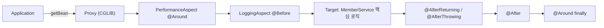

회원 가입, 조회, 비밀번호 변경, 탈퇴 메서드 네 개에 똑같은 로그·시간 측정 코드가 붙어 있었다. 로그 양식 하나를 바꾸려면 네 군데를 열어야 하는 구조다.  
이 중복을 Spring AOP로 떼어내 보고, 실행 결과를 따라가며 Advice가 어떤 순서로 실행되는지, 그리고 중간에 막혔던 문제를 정리했다.

> **TL;DR**
> - 로깅·성능 측정처럼 여러 메서드에 걸치는 코드(횡단 관심사)를 `@Aspect` 클래스 두 개로 옮기자 `MemberService`에는 비즈니스 로직만 남았다.
> - `@EnableAspectJAutoProxy`가 있어야 컨테이너가 프록시를 만든다. `getBean`이 돌려주는 객체는 진짜 `MemberService`가 아니라 CGLIB 프록시였다.
> - `@Order(1)`을 단 `PerformanceAspect`가 바깥 겹, `LoggingAspect`가 안쪽 겹이다. 출력 순서가 이 구조 그대로 나왔다.
> - 실습 중 JDK 27에서 Lombok 컴파일 실패, 수동 실행 시 classpath 누락, `PerformanceAspect`의 예외 래핑 문제를 겪었다.

환경: Gradle, Spring 7.0.8, AspectJ 1.9.25.1, Lombok 1.18.46, 실행은 JDK 21(Eclipse Adoptium 21.0.12).  
코드는 실습 프로젝트(`section01`: 적용 전, `section02`: 적용 후)에서 가져왔고 일부는 줄였다. 용어 정리는 강의에서 받은 "Spring AOP 용어 지도" 자료를 참고했고, 아래 설명은 내 실습 결과에 맞춰 다시 풀어 썼다.

## 1. section01에서 무엇이 문제였나

`section01`의 `MemberService`는 메서드마다 아래 뼈대가 반복된다.

```java
long startTime = System.currentTimeMillis();            // 성능 측정
try {
    System.out.println("[로그] 회원 가입 시작: " + ...);   // 로깅
    // beginTransaction();                               // 트랜잭션 (의사코드)
    // ----- 핵심 비즈니스 로직 -----
    // commitTransaction();
    System.out.println("[로그] 회원 가입 성공");
} catch (Exception e) {
    // rollbackTransaction();
    System.out.println("[로그] 회원 가입 실패: " + e.getMessage());
    throw e;
} finally {
    System.out.println("[성능] 처리 시간: " + (endTime - startTime) + "ms");
}
```

핵심 로직(검증 → 중복 확인 → 저장)은 이 안쪽 한 줄 영역일 뿐이고, 나머지는 네 메서드에 똑같이 복사되어 있다. 여러 메서드를 가로질러 반복된다고 해서 이런 코드를 **횡단 관심사**(cross-cutting concern)라고 부른다. `Application` 주석에 정리해 둔 문제는 세 가지였다.

| 문제 | `section01`에서 실제로 벌어지는 일 |
|---|---|
| 코드 중복 | 로깅·시간 측정·트랜잭션 의사코드가 메서드 4개에 복사되어 있다 |
| 낮은 응집도 | `MemberService`가 "회원 관리"와 "로그·성능·트랜잭션"을 함께 책임진다 |
| 유지보수 어려움 | 로그 양식이나 성능 기준을 바꾸면 모든 메서드를 고쳐야 한다 |

강의 자료의 수치로는 `MemberService.java`가 215줄에서 121줄로 줄고, 로깅·성능 코드를 고칠 곳이 메서드 4곳에서 Aspect 1곳이 된다. 이 줄 수는 내가 직접 센 값이 아니라 강의 자료의 값이다.

## 2. AOP로 분리한 과정

작업은 이 순서로 했다.

1. `build.gradle`에 `spring-context`, `spring-aop`, `aspectjrt`, `aspectjweaver`, `lombok`을 추가한다.
2. `AppConfig`에 `@EnableAspectJAutoProxy`를 켠다.
3. `LoggingAspect`와 `PerformanceAspect`를 만든다.
4. `section02`의 `MemberService`에서 횡단 관심사 코드를 지우고 `@Service`만 남긴다.

### 설정 클래스

```java
@Configuration
@ComponentScan("com.wanted.aop.section02")
@EnableAspectJAutoProxy
public class AppConfig { }
```

`@EnableAspectJAutoProxy`는 가장 눈에 안 띄지만 가장 중요한 줄이다. 강의 자료의 설명대로 이 어노테이션을 지우면 Aspect 클래스가 있어도 로그가 하나도 찍히지 않는다. (이 부분은 내가 직접 지워서 실행해 보지는 않았다.)

### 로깅 Aspect

```java
@Component @Aspect
public class LoggingAspect {
    @Before("execution(* com.wanted.aop.section02.MemberService.*(..))")
    public void logBefore(JoinPoint joinPoint) {
        String methodName = joinPoint.getSignature().getName();
        Object[] args = joinPoint.getArgs();
        // ... 출력 생략
    }

    @After("execution(* com.wanted.aop.section02.MemberService.*(..))")
    public void logAfter(JoinPoint joinPoint) { /* ... */ }

    @AfterReturning(pointcut = "execution(* com.wanted.aop.section02.MemberService.*(..))",
                    returning = "result")
    public void logAfterReturning(JoinPoint joinPoint, Object result) { /* ... */ }

    @AfterThrowing(pointcut = "execution(* com.wanted.aop.section02.MemberService.*(..))",
                   throwing = "exception")
    public void logAfterThrowing(JoinPoint joinPoint, Exception exception) { /* ... */ }
}
```

`JoinPoint`에서 메서드 이름(`getSignature().getName()`)과 인자(`getArgs()`)를 꺼내 쓸 수 있어서, 메서드마다 직접 문자열을 만들던 `section01`의 로그를 하나로 합칠 수 있었다.

### 성능 측정 Aspect

```java
@Component @Aspect @Order(1)
public class PerformanceAspect {
    @Around("execution(* com.wanted.aop.section02.MemberService.*(..))")
    public Object performance(ProceedingJoinPoint joinPoint) {
        long startTime = System.currentTimeMillis();
        try {
            Object result = joinPoint.proceed();
            return result;
        } catch (Throwable e) {
            throw new RuntimeException(e);   // 문제 있는 부분. 5장 참고
        } finally {
            // ... "[Around 성능 측정]메서드명 메서드 실행 시간:N(ms)" 출력
        }
    }
}
```

`@Around`는 실행 전후를 모두 감싸므로 시간 측정에 적합하다. 다만 강의 자료가 짚은 대로 `joinPoint.proceed()`를 부르지 않으면 진짜 메서드가 아예 실행되지 않는다.

### Pointcut 표현식 읽는 법

```text
execution(* com.wanted.aop.section02.MemberService.*(..))
          │  └──────── 패키지.클래스 ────────┘ │ └ 매개변수
          └ 반환 타입(무관)                    └ 메서드 이름(전부)
```

| 조각 | 의미 |
|---|---|
| 맨 앞 `*` | 반환 타입 무관 |
| `MemberService.*` | 그 클래스의 모든 메서드 |
| `(..)` | 매개변수 0개 이상 |
| `()` | 매개변수 없음 |
| `(String)` | `String` 1개 |
| `(String, ..)` | 첫 번째만 `String`, 나머지는 무관 |

그래서 메서드 이름을 `*`, 매개변수를 `(String, ..)`로 바꾸면 `registerMember(MemberDTO)`는 빠지고 `getMember(String)`, `updatePassword(String, String, String)`, `deleteMember(String)` 세 개만 걸린다. 이 조합은 강의 자료의 예시이고, 내 프로젝트에서 직접 바꿔 실행해 보지는 않았다.

## 3. 용어 6개를 사장님과 비서로 정리하기

용어가 여섯 개나 되어서 처음에는 서로 섞였다. 강의에서 "진짜 객체는 사장님, 프록시는 비서"라는 비유로 통일해 설명해 주셨고, 이 비유로 내 코드에 하나씩 대응시켜 보니 정리가 됐다.

| 용어 | 한 줄 정의 | 내 프로젝트에서 | 사장님·비서 비유 |
|---|---|---|---|
| Advice | 프록시가 끼워 넣는 부가 기능 코드 | `LoggingAspect`의 메서드 4개, `PerformanceAspect.performance()` | 비서가 하는 일(통화 기록, 통화 시간 재기) |
| Pointcut | Advice를 어느 메서드에 적용할지 고르는 조건식 | `execution(* ...MemberService.*(..))` | "사장님께 오는 전화는 전부"라는 규칙 |
| Aspect | Advice와 Pointcut을 묶은 클래스 | `LoggingAspect`, `PerformanceAspect` | 비서 업무 매뉴얼 한 권 |
| JoinPoint | Pointcut에 걸려 Advice가 끼어드는 실제 실행 지점 | `registerMember` 등이 실행되는 순간 각각 | 실제로 걸려 온 전화 한 통 한 통 |
| Weaving | Aspect를 Target에 엮어 프록시를 만드는 과정 | `@EnableAspectJAutoProxy`가 켜진 컨테이너 시작 시점 | 첫 출근 날 매뉴얼을 든 비서를 사장실 앞에 배치하는 일 |
| Proxy | Target 앞에서 호출을 먼저 받는 대리 객체 | `MemberService$$EnhancerBySpringCGLIB$$73b4ce66` | 사장님 대신 전화를 먼저 받는 비서 |

Advice 5종은 이렇게 구분한다: `@Before`(실행 전), `@After`(항상 마지막), `@AfterReturning`(정상 종료 후), `@AfterThrowing`(예외 발생 시), `@Around`(전후 모두).

특히 프록시 부분이 놀라웠다. `MemberService`에는 인터페이스가 없어서, Spring은 `MemberService`를 상속한 CGLIB 클래스를 만들어 그 객체를 빈으로 돌려준다. `Application`에서 `context.getBean(MemberService.class)`로 받은 객체는 사실 비서였던 셈이다. 클래스 이름은 강의 자료에서 확인한 값이고, 해시 부분은 실행마다 다를 수 있다. (확인 필요)



## 4. 실행 결과로 확인한 Advice 순서

`section02.Application`에는 시나리오 다섯 개가 있다: 가입, 조회, 비밀번호 변경, 탈퇴, 존재하지 않는 회원 조회(일부러 예외). JDK 21로 실행한 결과 중 두 가지를 인용한다.

### 정상 흐름 (테스트 1: 회원 가입)

```text
[테스트 1] 회원 가입
[Before Log]registerMember메서드 실행 시작됨, 매개변수 : MemberDTO(email=user@example.com, password=pass0123, name=홍길동, phone=010-1111-1111, role=USER),
회원 정보 저장 완료: user@example.com
[AfterReturn 로그] registerMember 메소드 정상 종료, 종료 시 반환값 : null
[After 로그]registerMember메소드 정상종료
[Around 성능 측정]registerMember메서드 실행 시간:4(ms)
```

순서는 `Before` → 메서드 본문 → `AfterReturning` → `After` → `Around`(성능 측정, 맨 마지막 출력)이다. `@Around`가 맨 마지막에 찍히는 이유는 `finally`에서 출력하기 때문이고, 호출 구조로 보면 가장 바깥 겹이라 가장 늦게 빠져나오기 때문이다.

테스트 1만 4ms이고 나머지는 0ms였다. 첫 호출에 프록시·클래스 로딩 비용이 포함된 것으로 **추정**하지만, 따로 측정해 확인하지는 않았다.

### 예외 흐름 (테스트 5: 존재하지 않는 회원 조회)

```text
[테스트 5] 존재하지 않는 회원 조회
[Before Log]getMember메서드 실행 시작됨, 매개변수 : user@example.com,
[AfterThrowing 로그] getMember 메소드 실행 중 예외 발생 : 존재하지 않는 회원입니다: user@example.com
[After 로그]getMember메소드 정상종료
[Around 성능 측정]getMember메서드 실행 시간:0(ms)
예외 발생!! : java.lang.IllegalArgumentException: 존재하지 않는 회원입니다: user@example.com
```

여기서 읽어 낸 것은 세 가지다.

- `AfterReturning`은 호출되지 않고 `AfterThrowing`이 실행된다.
- `@After`는 예외가 나도 실행된다. `finally`와 비슷한 역할이다. 그런데 로그 문구가 "정상종료"라서 예외 상황에서는 어색하다. 문구를 "메소드 종료"로 고치는 편이 정확하다.
- 마지막 줄 메시지 앞에 `java.lang.IllegalArgumentException:`이 붙어 있다. 이 부분이 5장의 시행착오와 이어진다.

### @Order로 생기는 겹 구조

강의 자료는 프록시가 Advice를 양파처럼 겹겹이 두른다고 설명한다. `@Order`는 숫자가 작을수록 바깥 겹이다. `PerformanceAspect`에 `@Order(1)`을 붙였고 `LoggingAspect`에는 붙이지 않았다. 붙이지 않은 Aspect는 가장 낮은 우선순위(`Ordered.LOWEST_PRECEDENCE`)로 취급되어 안쪽 겹이 된다는 것이 강의 자료의 설명이다.

실행 결과가 이 설명과 일치했다. 성능 측정 로그가 항상 마지막에 나왔고, 따라서 `[성능]` 시간에는 로깅 Advice가 실행된 시간도 포함된다. 시간을 측정하는 Aspect를 가장 바깥에 둔 이유가 이것이다.

## 5. 시행착오

### 5-1. JDK 27에서 컴파일이 실패했다

`./gradlew compileJava`를 실행하자 `ExceptionInInitializerError`가 났고, 원인은 아래 메시지였다.

```text
lombok.javac.apt.LombokProcessor
ClassNotFoundException: com.sun.tools.javac.tree.EndPosTable
```

PC의 기본 JDK가 openjdk 27이었는데, Lombok 1.18.46이 이 버전의 javac와 호환되지 않는 것으로 보인다. 원인 판단은 위 에러 메시지에 근거한 것이고, Lombok 쪽 공식 지원 여부는 확인하지 않았다. (확인 필요)

해결은 PC에 있던 JDK 21(Eclipse Adoptium `jdk-21.0.12`)로 `JAVA_HOME`을 바꿔 컴파일하는 것이었다. 프로젝트 파일은 건드리지 않았다. IntelliJ에서라면 Project SDK를 21로 바꾸거나 Lombok 버전을 올려야 할 것이다.

### 5-2. 수동 실행 시 classpath 문제

Gradle `application` 플러그인 없이 `java -cp`로 직접 실행하다가 세 번 막혔다.

| 증상 | 원인 | 해결 |
|---|---|---|
| `NoClassDefFoundError: org/springframework/context/ApplicationContext` | `*-sources.jar`가 섞여 들어갔고 `spring-context`가 빠졌다 | 필요한 jar를 다시 골랐다 |
| Windows용 `java`가 경로를 인식하지 못함 | Git Bash 경로(`/c/Users/...`)를 넘겼다 | `cygpath -w`로 Windows 경로로 변환했다 |
| `NoClassDefFoundError: org/apache/commons/logging/LogFactory` | `spring-jcl` 누락 | 의존성 jar를 전부 포함했다 |

한 번에 한 jar씩 빠진 것을 에러마다 찾아낸 셈이다. 교훈은 직접 `java -cp`를 조립하기보다 `build.gradle`에 `application` 플러그인과 `mainClass`를 설정하거나 IntelliJ로 실행하는 편이 낫다는 것이다.

### 5-3. PerformanceAspect가 예외를 포장하고 있었다

테스트 5의 마지막 줄이 이상했다. `Application`은 `e.getMessage()`를 출력하는데(`section02/Application.java`), 메시지 앞에 `java.lang.IllegalArgumentException:`이 붙어 있었다. 원본 예외의 메시지만 나와야 하는 자리다.

원인은 `PerformanceAspect`의 이 코드였다.

```java
} catch (Throwable e) {
    throw new RuntimeException(e);
}
```

`new RuntimeException(cause)`는 메시지를 `cause.toString()`으로 채우므로, 래핑된 예외의 `getMessage()`가 `java.lang.IllegalArgumentException: ...`가 된다. `Application`이 받은 예외도 `IllegalArgumentException`이 아니라 `RuntimeException`이다. 호출하는 쪽에서 `catch (IllegalArgumentException e)`로 잡으려 했다면 못 잡았을 것이다.

`LoggingAspect`는 `PerformanceAspect`보다 안쪽 겹이라 포장되기 전의 원본 예외를 받는다. 그래서 `[AfterThrowing 로그]`에는 원본 메시지가 나오고, 맨 마지막 줄에서만 포장된 메시지가 보였다. 겹 구조를 이해하고 나니 두 줄의 차이가 설명됐다.

개선안은 `catch`를 없애고 메서드에 `throws Throwable`을 선언해서 원본 예외를 그대로 던지는 것이다.

```java
@Around("execution(* com.wanted.aop.section02.MemberService.*(..))")
public Object performance(ProceedingJoinPoint joinPoint) throws Throwable {
    long startTime = System.currentTimeMillis();
    try {
        return joinPoint.proceed();
    } finally {
        // ... 실행 시간 출력
    }
}
```

강의 자료의 `PerformanceAspect`는 이미 이 형태(`throws Throwable` + `try/finally`, 메서드명 `measurePerformance`)였다. 이 개선안을 내 프로젝트에 적용해 다시 실행해 보지는 않았다. (확인 필요)

### 5-4. 코드에서 발견한 잔여 흔적

실행에는 지장이 없지만 정리가 덜 된 곳이 몇 군데 있었다.

- `section02` `MemberService`의 javadoc에 "로깅 코드가 섞여 있다"는 옛 설명이 남아 있다.
- `section01` `MemberDTO`에 쓰지 않는 `import ...Service`가 있다.
- `LoggingAspect` 주석에 오타("각 메서드맘다")가 있다.
- After 로그 문구가 "정상종료"다(4장 참고).

## 6. @Pointcut으로 표현식 재사용하기

`LoggingAspect`에는 똑같은 `execution(...)` 문자열이 네 번 들어 있다. 패키지 이름이 바뀌면 네 곳을 고쳐야 하니, 횡단 관심사를 모으려던 목적에 다시 어긋난다. `@Pointcut`은 표현식에 이름을 붙여 한 번만 적게 해 준다. 아래는 강의 자료의 예시 코드다.

```java
@Aspect @Component
public class LoggingAspect {
    @Pointcut("execution(* com.wanted.aop.section02.MemberService.*(..))")
    public void memberServiceMethods() {}   // 이름표. 몸체는 비워 둔다

    @Before("memberServiceMethods()")
    public void logBefore(JoinPoint joinPoint) { /* ... */ }

    @AfterReturning(pointcut = "memberServiceMethods()", returning = "result")
    public void logAfterReturning(JoinPoint joinPoint, Object result) { /* ... */ }
}
```

`memberServiceMethods()`는 호출되는 코드가 아니라 표현식에 붙인 이름표다. 몸체가 비어 있어도 되는 이유다. 표현식 고칠 곳이 4곳에서 1곳이 된다.

주의할 점은 이름 뒤 괄호까지 적어야 한다는 것이다. 강의 자료에 따르면 괄호를 빼거나 이름을 잘못 적으면 컨테이너 시작 단계에서 오류가 난다. 다른 클래스의 Pointcut을 쓸 때는 `패키지.클래스.메서드()` 전체 이름을 쓰고, 선언 쪽은 `public`이어야 한다. `&&`, `||`, `!`로 조합도 된다.

```java
public class CommonPointcuts {   // 빈으로 등록할 필요 없음
    @Pointcut("execution(* com.wanted.aop.section02.MemberService.*(..))")
    public void memberService() {}

    @Pointcut("execution(* com.wanted.aop.section02.MemberService.get*(..))")
    public void memberRead() {}

    @Pointcut("memberService() && !memberRead()")
    public void memberWrite() {}
}
```

| 표현 | 걸리는 메서드 |
|---|---|
| `memberService()` | 4개 전부 |
| `memberRead()` | `getMember` |
| `memberService() && !memberRead()` | `registerMember`, `updatePassword`, `deleteMember` |

세 번째가 쓸모 있어 보였다. 변경 작업에만 트랜잭션이나 감사 로그를 붙이고 싶을 때 쓸 수 있다. 이 장의 `@Pointcut` 코드는 강의 자료의 예시이고, 내 프로젝트의 `LoggingAspect`에는 아직 적용하지 않았다. 다음 실습에서 적용해 볼 계획이다.

## 7. 결과와 배운 점

| 항목 | 적용 전(`section01`) | 적용 후(`section02`) |
|---|---|---|
| `MemberService.java` 줄 수 | 215줄 | 121줄 |
| 로깅·성능 코드를 고칠 곳 | 메서드 4곳 | Aspect 1곳 |
| 표현식을 고칠 곳(`@Pointcut` 적용 시) | - | 1곳 (적용 전에는 `LoggingAspect` 안에서만 4곳) |

앞의 두 줄 수치는 강의 자료의 값이다. 정량 지표를 직접 만들지는 못해서, 이 점은 다음 실습에서 줄 수를 직접 세어 보강하고 싶다.

배운 점은 세 가지다.

1. **AOP는 코드를 줄이기보다 한 곳에 모으는 일**이다. 로그 양식이든 성능 기준이든 바꿀 곳이 하나가 된다.
2. **눈에 안 보이는 프록시**가 모든 동작의 출발점이다. `getBean`이 돌려주는 것이 진짜 객체가 아니라는 사실을 알고 나니 `@EnableAspectJAutoProxy`와 `@Order`의 의미가 이해됐다.
3. **에러 하나가 환경 문제인지 코드 문제인지** 구분해야 했다. JDK 27과 classpath는 환경 문제, 예외 래핑은 코드 문제였다.

## 더 학습하면 좋은 개념

- **JDK 동적 프록시와 CGLIB 프록시** — 이번에는 인터페이스가 없어서 CGLIB가 쓰였다. 인터페이스가 있을 때는 어떤 프록시가 만들어지는지 비교해 보면 `getBean`으로 받는 타입이 왜 달라지는지 알 수 있다.
- **자기 호출(self-invocation) 문제** — 같은 클래스 안에서 메서드가 다른 메서드를 부르면 프록시를 거치지 않아 Advice가 적용되지 않는다. 프록시 방식 AOP의 대표적인 한계이므로 알아 둬야 한다.
- **`@Transactional`과 AOP** — `section01`의 `beginTransaction()` 의사코드가 실제로는 AOP로 구현된다. 이번 실습의 원리를 그대로 적용해 볼 수 있다.
- **Spring AOP와 AspectJ의 차이** — Spring은 런타임에 프록시로 엮고, AspectJ 자체는 컴파일·로드 시점에 엮을 수도 있다. 이번 프로젝트에 `aspectjweaver`가 들어간 이유와 Spring AOP가 메서드 실행만 JoinPoint로 삼는 한계를 이해하는 데 필요하다.
- **Advice 실행 순서의 세부 규칙** — 같은 Aspect 안에서 `@After`가 `@AfterReturning` 다음에 실행되는 것을 실행 결과로 확인했다. 버전별 차이가 있는지는 공식 문서로 확인해 볼 만하다.

## 참고 자료

- 강의에서 받은 "Spring AOP 용어 지도" 자료 (강사님 제공, 링크 없음)
- [Spring Framework 공식 문서 - Aspect Oriented Programming with Spring](https://docs.spring.io/spring-framework/reference/core/aop.html)
- [Spring Framework 공식 문서 - Declaring a Pointcut](https://docs.spring.io/spring-framework/reference/core/aop/ataspectj/pointcuts.html)
- [Spring Framework 공식 문서 - Advice Ordering](https://docs.spring.io/spring-framework/reference/core/aop/ataspectj/advice.html#aop-ataspectj-advice-ordering)
- [Spring Framework 공식 문서 - Proxying Mechanisms](https://docs.spring.io/spring-framework/reference/core/aop/proxying.html)
- [Project Lombok 변경 이력](https://projectlombok.org/changelog)
