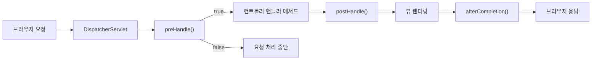

컨트롤러 메서드가 몇 ms 걸리는지 알고 싶다면 메서드마다 시작·종료 시간을 재는 코드를 넣어야 할까? 메서드가 스무 개면 스무 곳을 고쳐야 한다.  
컨트롤러 앞뒤에서 요청을 가로채는 인터셉터(Interceptor)로 `/stopwatch` 요청의 처리 시간을 측정하고, 직접 실행하면서 동작 순서와 빠지기 쉬운 함정까지 확인했다.

> **TL;DR**
> - 인터셉터는 `DispatcherServlet`이 컨트롤러를 부르기 **전**(`preHandle`)과 **후**(`postHandle`)에 끼어드는 객체다.
> - `HandlerInterceptor`를 구현하고 `WebMvcConfigurer.addInterceptors()`에서 등록해야 동작한다. `@Component`만 붙여서는 동작하지 않는다.
> - `postHandle`의 `ModelAndView`는 `null`일 수 있다. 실습 코드 그대로 두면 정적 파일 요청에서 `NullPointerException`이 난다.

환경: Java 21, Spring Boot 4.1.2, Gradle, Thymeleaf. 8080 포트가 이미 사용 중이어서 `--server.port=8089`로 실행했다.  
코드는 이번 실습 프로젝트(`chap05-interceptor`)에서 가져왔고, import 문은 줄였다.

## 1. 왜 인터셉터가 필요할까?

시간 측정 코드를 컨트롤러에 직접 쓰면 이런 모양이 메서드마다 반복된다.

```java
// 예시 코드: 핸들러 메서드마다 이 측정 코드를 복사해야 한다
long start = System.currentTimeMillis();
// ... 실제 처리 ...
long end = System.currentTimeMillis();
model.addAttribute("interval", end - start);
```

측정 대상이 바뀌거나 계산 방식을 고치면 모든 메서드를 찾아 수정해야 한다. 하나라도 빠뜨리면 그 요청만 기준이 달라진다.  
인터셉터는 컨트롤러 **앞뒤의 공통 처리**를 한곳에 모은다. 컨트롤러는 자기 일만 하고, 측정은 인터셉터가 맡는다.

[Servlet 8: 필터]({{ site.baseurl }}/servlet-8-filter.html)에서 배운 필터도 공통 처리를 모은다. 둘의 차이는 **어느 층에서 동작하느냐**다.

| 비교 기준 | 필터(Filter) | 인터셉터(Interceptor) |
|---|---|---|
| 소속 | 서블릿 컨테이너(Tomcat) 표준(Jakarta Servlet) | Spring MVC |
| 동작 위치 | `DispatcherServlet` 앞뒤를 감싼다 | `DispatcherServlet` 안, 컨트롤러 앞뒤 |
| 알 수 있는 정보 | 요청·응답 객체 | 요청·응답 + 실행될 핸들러(`handler`), `ModelAndView` |
| 등록 방법 | `@WebFilter`, `web.xml`, Spring Boot의 `FilterRegistrationBean` | `WebMvcConfigurer.addInterceptors()` |
| 어울리는 일 | 인코딩, 보안 등 서블릿 전체에 걸친 처리 | 핸들러 단위의 로그인 검사, 실행 시간 측정 |

이번 예제에서 측정 결과를 `ModelAndView`에 담아 화면(`result.html`)에 보여주는 것은 필터로는 할 수 없다. 필터는 `ModelAndView`를 알지 못하기 때문이다.

## 2. 먼저 알아둘 용어

| 용어 | 쉬운 설명 |
|---|---|
| `HandlerInterceptor` | 인터셉터가 구현해야 하는 인터페이스 |
| 핸들러(handler) | 요청을 처리하는 대상. 이번 예제에서는 `@GetMapping`이 붙은 컨트롤러 메서드 |
| `preHandle()` | 핸들러가 실행되기 **전**에 호출된다. `boolean`을 반환한다 |
| `postHandle()` | 핸들러가 정상 실행된 **후**, 화면을 그리기 전에 호출된다 |
| `afterCompletion()` | 화면 렌더링까지 끝난 뒤 호출된다. 핸들러에서 예외가 나도 호출된다. 이번 예제에서는 쓰지 않았다 |
| `WebMvcConfigurer` | 스프링 MVC의 기본 설정은 유지하면서 인터셉터, CORS, 정적 리소스 같은 설정을 덧붙이는 인터페이스 |
| 경로 패턴 | 인터셉터를 적용할 URL 범위. `/*`는 `/`로 구분된 한 단계 경로(예: `/stopwatch`), `/**`는 하위 경로 전체 |

## 3. 요청은 어떤 순서로 흐를까?



`preHandle()`이 `false`를 반환하면 컨트롤러는 호출되지 않는다. 로그인하지 않은 사용자를 여기서 돌려보내는 식으로 쓴다.  
`true`를 반환하면 다음 인터셉터를 호출하고, 남은 인터셉터가 없으면 컨트롤러를 호출한다. 인터셉터를 여러 개 등록하면 `preHandle()`은 등록한 순서대로, `postHandle()`은 반대 순서로 호출된다고 알려져 있다. 이번 예제는 인터셉터를 하나만 등록해서 순서를 확인하지 않았다(`확인 필요`).

## 4. 구현: 요청 처리 시간 측정하기

### 4-1. 인터셉터 만들기

```java
@Component
public class TimerInterceptor implements HandlerInterceptor {

    @Override
    public boolean preHandle(HttpServletRequest request, HttpServletResponse response, Object handler) throws Exception {
        System.out.println("preHandle() 동작함..");

        long startTime = System.currentTimeMillis();
        request.setAttribute("startTime", startTime);

        return true; // 다음 인터셉터 또는 컨트롤러로 진행
    }

    @Override
    public void postHandle(HttpServletRequest request, HttpServletResponse response, Object handler, @Nullable ModelAndView modelAndView) throws Exception {
        System.out.println("postHandler() 호출됨..");

        long endTime = System.currentTimeMillis();
        long startTime = (long) request.getAttribute("startTime");

        modelAndView.addObject("interval", endTime - startTime);
    }
}
```

시작 시각을 인터셉터 필드에 저장하면 안 된다. `@Component` 빈은 하나뿐이라 동시에 들어온 요청이 같은 필드를 덮어쓴다. 그래서 요청마다 따로 존재하는 `request`의 속성(`setAttribute`)에 시작 시각을 담고, `postHandle()`에서 꺼내 쓴다.

### 4-2. 인터셉터 등록하기

```java
@Configuration
public class WebConfig implements WebMvcConfigurer {

    private final TimerInterceptor timerInterceptor;

    @Autowired
    public WebConfig(TimerInterceptor timerInterceptor) {
        this.timerInterceptor = timerInterceptor;
    }

    @Override
    public void addInterceptors(InterceptorRegistry registry) {
        registry.addInterceptor(timerInterceptor)
                .addPathPatterns("/*")
                .excludePathPatterns("/css/**")
                .excludePathPatterns("/images/**")
                .excludePathPatterns("/js/**")
                .excludePathPatterns("/video/**");
    }
}
```

`TimerInterceptor`에 `@Component`를 붙이면 빈으로 만들어질 뿐이다. 스프링 MVC가 "이 객체를 인터셉터로 쓰겠다"고 알게 하는 것은 `registry.addInterceptor()` 호출이다. 스프링 부트에서도 `HandlerInterceptor` 빈이 자동으로 등록되지는 않는다.  
`excludePathPatterns`로 CSS, 이미지, JS, 영상 경로를 제외했다. 정적 파일마다 시간을 재면 로그가 불필요하게 늘어나기 때문이다.

### 4-3. 컨트롤러와 화면

```java
@Controller
public class InterceptorController {

    @GetMapping("stopwatch")
    public String handle() throws InterruptedException {
        System.out.println("stopwatch 요청을 처리하는 핸들러 메서드 동작..");
        Thread.sleep(2000); // 처리 시간을 눈으로 확인하려고 2초 정지
        return "result";
    }
}
```

```html
<h3 th:text="| 핸들러 메서드 호출 수행 시간 : ${interval} |"></h3>
```

컨트롤러는 `interval`이라는 이름을 모른다. `postHandle()`에서 `ModelAndView`에 넣은 값을 Thymeleaf가 화면에 꺼내 쓴다.

## 5. 실행 결과

```bash
$ curl localhost:8089/stopwatch
```

```html
<h3> 핸들러 메서드 호출 수행 시간 : 2039 </h3>
```

서버 콘솔에는 아래 순서로 출력됐다. 내 Windows 콘솔에서는 한글이 깨져 보였지만(콘솔 인코딩 문제로 추정, 확인 필요), 호출 순서는 코드의 출력 문구와 일치했다.

```text
preHandle() 동작함..
stopwatch 요청을 처리하는 핸들러 메서드 동작..
postHandler() 호출됨..
```

`preHandle` → 핸들러 → `postHandle` 순서가 3절 흐름도와 같다. `Thread.sleep(2000)`보다 39ms 긴 2039ms가 나왔다. 첫 요청이어서 초기화 비용이 섞였을 가능성이 있지만, 원인은 확인하지 않았다(`확인 필요`).  
`postHandle()`은 화면을 그리기 **전**에 호출되므로, 이 값에는 뷰 렌더링 시간이 포함되지 않는다. 뷰까지 포함한 시간을 재려면 `afterCompletion()`에서 계산해야 한다.

## 6. 헷갈렸던 점과 한계

### 정적 파일 요청에서 NullPointerException이 났다

`/index.html`과 `/`를 요청하자 서버 로그에 아래 예외가 나왔다. 응답 코드는 200이었다.

```text
java.lang.NullPointerException: Cannot invoke "org.springframework.web.servlet.ModelAndView.addObject(String, Object)" because "modelAndView" is null
```

원인은 `@Nullable ModelAndView modelAndView` 매개변수에 있다. 정적 파일을 내려주는 핸들러는 `ModelAndView`를 만들지 않아서 `null`이 들어온다. `excludePathPatterns`에 `/css/**` 등만 있고 루트의 `index.html`은 제외하지 않았기 때문에 인터셉터가 실행됐다.  
응답 코드가 200인 이유는 정적 파일 응답이 이미 완료된 뒤에 예외가 났기 때문으로 이해했다(`확인 필요`). 사용자 눈에는 정상이어도 로그에는 에러가 쌓인다.

```java
// 예시 코드: null 검사 (이 수정본은 실행해 확인하지 않았다)
if (modelAndView != null) {
    modelAndView.addObject("interval", endTime - startTime);
}
```

### 그 밖에 확인한 것과 남은 질문

| 상황 | 확인한 내용 |
|---|---|
| `/a/b` 처럼 `/*`에 맞지 않는 경로 | `/*`는 한 단계 경로만 맞춘다. 직접 요청하니 404였다 |
| 존재하지 않는 경로(`/nothing`) | 404 응답 과정에서 `preHandle` 로그가 한 번 찍혔다. `/error`로 다시 전달되면서 `/*`에 걸린 것으로 추정한다(`확인 필요`) |
| 핸들러에서 예외가 발생할 때 | 공식 문서 기준으로 `postHandle()`은 호출되지 않고 `afterCompletion()`은 호출된다. 이번에는 실행해 보지 않았다 |
| 하위 경로까지 적용하려면 | `/*` 대신 `/**`를 쓴다 |

## 7. 정리

- 인터셉터는 컨트롤러 앞(`preHandle`)과 뒤(`postHandle`)의 공통 처리를 한곳에 모으고, `HandlerInterceptor` 구현 + `addInterceptors()` 등록으로 완성된다.
- 요청별로 다른 값은 인터셉터 필드가 아니라 `request` 속성에 담는다.
- 경로 패턴과 `null` 가능성을 점검하지 않으면 정적 파일 요청에서 예외가 난다.

다음에는 `afterCompletion()`으로 뷰 렌더링까지 포함한 시간을 재 보고, 인터셉터를 두 개 등록해 호출 순서를 확인해 볼 계획이다.

## 더 학습하면 좋은 개념

- **`afterCompletion()`과 예외 처리** — 핸들러에서 예외가 나도 호출되므로, 자원 정리와 전체 소요 시간 측정은 여기가 안전하다.
- **인터셉터 체인과 `order()`** — 인터셉터가 여러 개일 때 호출 순서를 직접 지정하는 방법이다. 로그인 검사와 로깅의 순서가 결과를 바꿀 수 있다.
- **`DispatcherServlet`의 요청 처리 순서** — `HandlerMapping`이 핸들러를 찾고 `HandlerAdapter`가 실행하는 과정에서 인터셉터가 어디에 끼는지 알면 이번 흐름도가 더 정확해진다.
- **필터 vs 인터셉터 vs AOP** — 같은 공통 처리라도 층이 다르다. 어디까지 알아야 하는지(요청 객체, 핸들러, 메서드 인자)로 고르는 기준을 세워 두면 좋다.
- **`@ControllerAdvice`** — 핸들러에서 발생한 예외를 한곳에서 처리하는 방법이다. 인터셉터와 예외 흐름을 함께 이해하는 데 필요하다.

## 참고 자료

- [Spring Framework 공식 문서 - Interceptors](https://docs.spring.io/spring-framework/reference/web/webmvc/mvc-config/interceptors.html)
- [Spring Framework 공식 문서 - Interception (HandlerMapping)](https://docs.spring.io/spring-framework/reference/web/webmvc/mvc-servlet/handlermapping-interceptor.html)
- [Spring Framework 공식 문서 - HandlerInterceptor](https://docs.spring.io/spring-framework/docs/current/javadoc-api/org/springframework/web/servlet/HandlerInterceptor.html)
- [Spring Framework 공식 문서 - WebMvcConfigurer](https://docs.spring.io/spring-framework/docs/current/javadoc-api/org/springframework/web/servlet/config/annotation/WebMvcConfigurer.html)
