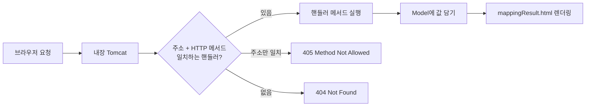

같은 `/menu/regist` 주소인데 버튼을 누르면 GET 메시지가 나오고, 폼을 제출하면 POST 메시지가 나온다. 메서드마다 주소를 따로 쓰지 않았는데 스프링은 어떻게 구분할까?  
메뉴·주문 요청 실습을 직접 실행해 보면서 `@RequestMapping`이 요청을 메서드에 연결하는 방식과, 핸들러가 없을 때 돌아오는 405·404·400 응답을 정리했다.

> **TL;DR**
> - `@RequestMapping`은 "주소 + HTTP 메서드"로 요청을 핸들러 메서드에 연결한다. `@GetMapping`, `@PostMapping`은 메서드를 고정한 줄임 표기다.
> - 클래스에 붙인 경로는 접두사가 되고, `{orderNo}` 같은 경로 변수는 `@PathVariable`로 받는다.
> - 매핑이 없으면 404, 주소만 맞고 메서드가 다르면 405(`Allow` 헤더 포함), 경로 변수 타입이 안 맞으면 400이다. 실습의 `application.yaml`은 포트 설정이 적용되지 않는 오타가 있었다.

환경: Windows 11, JDK 21, Spring Boot 4.1.2(Spring Framework 7.0.10, 내장 Tomcat 11.0.27), Gradle, Thymeleaf.  
아래 응답 결과는 `curl`로 실제 요청해서 확인한 값이다. 코드는 실습 프로젝트(`chap01-request-mapping`)에서 가져왔고, import 문과 일부 주석은 줄였다.

## 1. 요청이 컨트롤러 메서드까지 오는 길

서블릿으로 만들 때는 요청마다 서블릿 클래스를 만들고 `service()` 안에서 GET/POST를 직접 나눴다. 스프링 부트는 Tomcat이 내장되어 있어서, 요청이 들어오면 `@Controller`가 붙은 클래스의 메서드(핸들러 메서드)가 대신 받는다.



핸들러 메서드가 `String`을 반환하면 그 문자열이 뷰 이름이 된다. 실습에서는 `"mappingResult"`를 반환하고, 스프링이 `templates/mappingResult.html`을 찾아 응답한다. 서블릿의 `forward(req, res)`와 비슷한 역할이다. `Model`에 담은 값은 템플릿에서 `${message}`로 꺼낸다.

## 2. 메서드에 요청 매핑하기

`MethodController`에는 같은 주소 `/menu/regist`를 쓰는 메서드가 두 개 있다.

```java
@Controller
public class MethodController {

    @RequestMapping("/menu/regist")
    public String registMenu(Model model) {
        model.addAttribute("message", "GET 방식의 메뉴 등록 핸들러 메서드 동작함..");
        return "mappingResult";
    }

    @RequestMapping(value = "/menu/regist", method = RequestMethod.POST)
    public String postRegistMenu(Model model) {
        model.addAttribute("message", "POST 방식의 메뉴 등록 핸들러 메서드 동작함..");
        return "mappingResult";
    }

    @GetMapping("/menu/modify")
    public String getModifyMenu(Model model) { /* ... 생략 */ }

    @PostMapping("/menu/modify")
    public String postModifyMenu(Model model) { /* ... 생략 */ }
}
```

`@RequestMapping`에 `method`를 주면 그 메서드의 요청만 받는다. `/menu/modify`처럼 `@GetMapping`, `@PostMapping`을 쓰면 같은 내용을 짧게 쓸 수 있다.

| 요청 | 상태 코드 | 응답 본문 |
|---|---|---|
| `GET /menu/regist` | 200 | GET 방식의 메뉴 등록 핸들러 메서드 동작함.. |
| `POST /menu/regist` | 200 | POST 방식의 메뉴 등록 핸들러 메서드 동작함.. |
| `GET /menu/modify` | 200 | GET 방식의 메뉴 수정 핸들러 메서드 동작함.. |
| `POST /menu/modify` | 200 | POST 방식의 메뉴 수정 핸들러 메서드 동작함.. |

### 헷갈렸던 점: method를 안 쓴 @RequestMapping은 GET 전용이 아니다

처음에는 첫 번째 메서드가 "GET용"이라고 생각했다. 실행해 보니 `PUT /menu/regist`도 200이 나왔다. `method`를 지정하지 않은 `@RequestMapping`은 모든 HTTP 메서드를 받기 때문이다. 이 실습에서 POST가 따로 처리되는 이유는, 더 구체적인 조건(POST 한정)을 가진 두 번째 메서드가 있기 때문이다.  
그래서 GET만 받으려는 의도라면 `@GetMapping`으로 쓰는 편이 안전하다.

## 3. 클래스에 요청 매핑하기

공통 접두사는 클래스에 붙인다. `ClassController`는 `/order/*`를 붙이고, 메서드에는 나머지 경로만 쓴다.

```java
@Controller
@RequestMapping("/order/*")
public class ClassController {

    @GetMapping("/regist")
    public String registOrder(Model model) {
        model.addAttribute("message", "GET 방식의 주문 등록 핸들러 메서드 동작.");
        return "mappingResult";
    }

    @GetMapping("/detail/{orderNo}")
    public String pathVariable(Model model, @PathVariable("orderNo") int no) {
        model.addAttribute("message", no + "번 주문 상세조회!!");
        return "mappingResult";
    }
}
```

`/detail/{orderNo}`의 `{orderNo}`는 **경로 변수(path variable)**다. 요청 주소에 들어 있는 값을 `@PathVariable`로 받아 메서드 매개변수에 넣어 준다. `/order/detail/3`을 요청하면 `no`는 `3`이 되고, 문자열 `"3"`이 `int`로 자동 변환된다.

## 4. 핸들러가 없는 요청은 어떻게 응답할까?

`static/index.html`에는 컨트롤러에 대응하는 메서드가 없는 버튼도 있다(`POST /order/regist`, `/order/modify`, `/order/delete`). 눌러 보면 오류가 나는데, 오류마다 상태 코드가 다르다.

| 요청 | 상태 코드 | 이유 | `Allow` 헤더 |
|---|---|---|---|
| `POST /order/regist` | 405 | 주소는 있지만 GET만 등록되어 있다 | `GET` |
| `GET /order/modify` | 404 | 이 주소의 핸들러가 없다 | 없음 |
| `POST /order/modify` | 404 | 이 주소의 핸들러가 없다 | 없음 |
| `POST /order/delete` | 404 | 이 주소의 핸들러가 없다 | 없음 |
| `GET /order/detail/abc` | 400 | `abc`를 `int`로 바꿀 수 없다 | 없음 |
| `GET /order/detail/` | 404 | `{orderNo}` 자리가 비어 있다 | 없음 |

405 응답에만 `Allow: GET`이 붙는다. 서버가 "이 주소는 GET만 된다"고 알려 주는 것이어서, 404와 405를 구분하면 "주소가 틀렸나, 메서드가 틀렸나"를 바로 좁힐 수 있다. 타입 변환 실패는 500이 아니라 400(잘못된 요청)이었다.  
`curl`로 받은 에러 응답은 HTML 오류 페이지가 아니라 `status`, `error`, `path` 등을 담은 JSON이었다. 브라우저에서 보이는 형태는 `확인 필요`다.

## 5. 겪은 문제: 포트 7777이 적용되지 않았다

실습 프로젝트를 설정 그대로 실행했더니 시작이 실패했다.

```text
Tomcat initialized with port 8080 (http)
...
APPLICATION FAILED TO START
Web server failed to start. Port 8080 was already in use.
```

의도한 포트는 7777인데 로그에는 8080이 찍혀 있었다. 원인은 `application.yaml`이었다.

```yaml
# 문제가 있던 설정
spring:
  application:
    name: chap01-request-mapping

  server:
    port:7777
```

| 문제 | 설명 |
|---|---|
| 들여쓰기 위치 | `server:`가 `spring:` 아래에 있어서 `server.port`가 아니라 `spring.server.port`라는 키가 된다 |
| 콜론 뒤 공백 | `port:7777`은 `키: 값`으로 읽히지 않고 문자열 하나로 취급된다 |

이 설정에 대한 경고는 로그에 없었다. 설정이 틀려도 스프링이 알려 주지 않고 기본값(8080)을 쓴다는 점이 함정이다. 내 PC에서는 8080을 다른 실습 앱이 쓰고 있어서 충돌로 드러났지만, 비어 있었다면 오타를 눈치채지 못하고 넘어갔을 것이다.

이번에는 환경 변수로 포트만 바꿔서 실행했다.

```bash
$ SERVER_PORT=18080 ./gradlew bootRun
```

```text
Tomcat started on port 18080 (http) with context path '/'
Started Chap01RequestMappingApplication in 2.598 seconds
```

올바른 형태는 아래와 같다. 이 수정으로 7777에 실제로 뜨는지는 소스를 고치지 않고 확인했기 때문에 `확인 필요`다.

```yaml
spring:
  application:
    name: chap01-request-mapping

server:
  port: 7777
```

## 6. 코드만 읽고 발견한 것

실행하지 않고 코드에서 읽은 내용이다.

* `index.html`의 버튼 문구는 "3번 주문 상세"인데, `form action`은 `/order/detail/2`다. 눌러 보면 "2번 주문 상세조회!!"가 나올 것으로 보인다. (실행 확인 안 함)
* `mappingResult.html`은 `th:text`를 쓰는데, 이 문법은 Thymeleaf 템플릿 엔진 것이다. 수업에서는 뒤쪽 챕터에서 다룬다고 했다.

## 정리

* 요청 매핑의 기준은 **주소 + HTTP 메서드**다. 메서드를 구분하고 싶으면 `@GetMapping`, `@PostMapping`을 쓴다.
* 클래스 경로는 접두사, `{변수}`는 `@PathVariable`로 받는다.
* 404, 405, 400의 차이를 알면 오류를 만났을 때 주소·메서드·값 중 무엇이 문제인지 좁힐 수 있다.

다음에 볼 것: 요청 파라미터를 받는 `@RequestParam`과 `@ModelAttribute`.

## 더 학습하면 좋은 개념

* **HTTP 메서드의 의미(GET, POST, PUT, DELETE)** — 메서드마다 쓰임이 정해져 있어서, 매핑을 나눌 때 기준이 된다.
* **DispatcherServlet** — 요청을 핸들러에 연결해 주는 스프링 MVC의 중심 서블릿이다. 매핑이 내부에서 어떻게 찾아지는지 이해할 수 있다.
* **`application.yaml` 외부화 설정** — 환경 변수로 설정을 덮어쓴 이유(`SERVER_PORT`)를 이해하는 데 필요하다.

## 참고 자료

- [Spring Framework 공식 문서 - Mapping Requests](https://docs.spring.io/spring-framework/reference/web/webmvc/mvc-controller/ann-requestmapping.html)
- [Spring Boot 공식 문서 - Externalized Configuration](https://docs.spring.io/spring-boot/reference/features/external-config.html)
