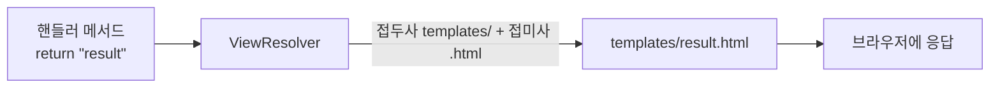
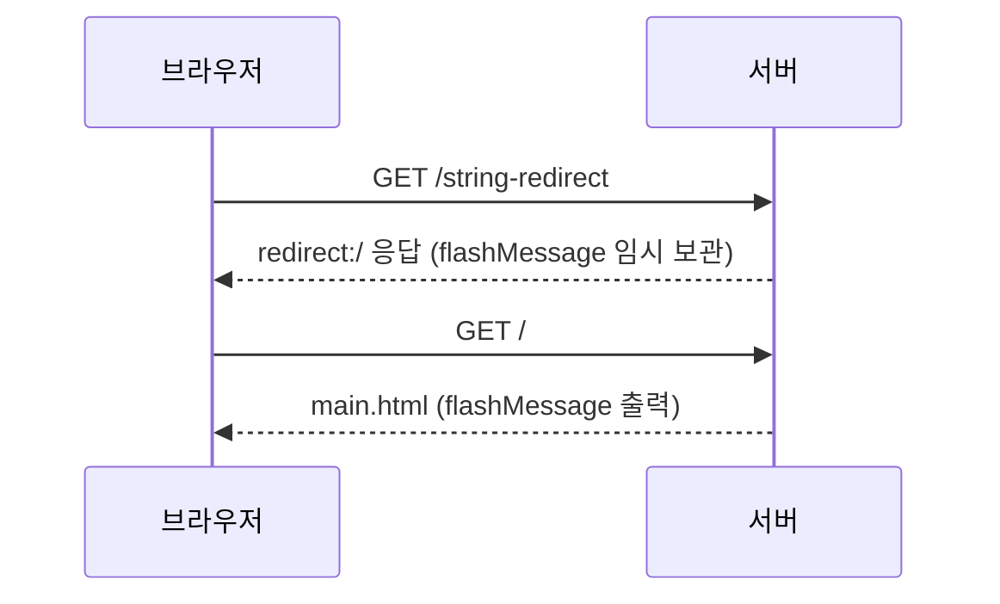

컨트롤러는 `"result"`라는 문자열 하나만 돌려주는데, 브라우저에는 `templates/result.html`이 그려진다. 파일 경로도 확장자도 쓰지 않았는데 스프링은 어떻게 그 파일을 찾을까?  
뷰를 반환하는 세 가지 방법과 `redirect:` 접두사, 그리고 리다이렉트에서 값을 넘기는 `RedirectAttributes`를 실습하며 정리했다.

> **TL;DR**
> - 컨트롤러가 돌려준 뷰 이름 문자열을 실제 템플릿 파일로 바꿔 주는 것이 ViewResolver(뷰 리졸버)다. 이번 실습에서는 접두사 `templates/`와 접미사 `.html`이 자동으로 붙었다.
> - 뷰를 반환하는 방법은 `void`, `String`, `ModelAndView` 세 가지이고, 기본 동작은 forward다. 문자열 앞에 `redirect:`를 붙이면 redirect로 바뀐다.
> - redirect는 요청이 두 번 일어나므로 `Model`의 값이 사라진다. 값을 넘기려면 `RedirectAttributes`의 `addFlashAttribute()`를 쓴다.

환경: Java 21, Gradle, Spring Boot 4.1.2, Thymeleaf.  
코드는 이번 실습 프로젝트(`chap03-view-resolver`)에서 가져왔다. 실행 결과는 코드를 읽고 예상한 내용이며, 실제 실행으로 확인하지 않은 부분은 `확인 필요`로 표시했다.

## 1. 뷰 이름은 어떻게 파일이 될까?

`@Controller`의 핸들러 메서드는 화면(View)을 돌려줄 책임이 있다. 이번 실습의 `build.gradle`에는 `spring-boot-starter-thymeleaf`와 `spring-boot-starter-webmvc`만 있고, ViewResolver를 직접 등록하는 설정 클래스는 없다. `application.yaml`에도 `spring.application.name`만 있다.

그런데도 동작하는 이유는 Spring Boot의 자동 설정이 Thymeleaf용 ViewResolver를 등록해 주기 때문이다. 컨트롤러 주석은 이 동작을 이렇게 설명한다.

> ViewResolver 객체는 리턴되는 문자열에 접두사로 resources/templates, 접미사로 .html 을 붙여주게 된다.



접두사와 접미사의 기본값(`classpath:/templates/`, `.html`)은 코드가 아니라 Boot의 기본 설정에서 온다. 어떤 클래스가 ViewResolver 역할을 하는지는 코드에 드러나지 않으므로 `ThymeleafViewResolver`라고 단정하지 않는다. (확인 필요: 공식 문서의 Thymeleaf 자동 설정 항목)

## 2. 뷰를 반환하는 세 가지 방법

코드 주석에는 뷰 반환 방법이 세 가지로 정리되어 있다.

| 반환 타입 | 뷰 경로가 정해지는 방식 | 실습에서 쓴 곳 |
|---|---|---|
| `void` | 요청 URL이 곧 뷰 경로 | 사용하지 않음 (주석에만 있음) |
| `String` | 반환한 문자열이 곧 뷰 경로 | `/`, `/main`, `/string`, `/string-redirect` |
| `ModelAndView` | `setViewName("문자열")`의 문자열이 뷰 경로 | `modelAndView` |

### 문자열 반환

```java
@GetMapping("/string")
public String stringView(Model model) {
    model.addAttribute("forwardMessage", "문자열로 View 반환");
    return "result";
}
```

`Model`에 담은 `forwardMessage`는 `result.html`에서 꺼낸다.

```html
<h3 th:text="${forwardMessage}"></h3>
```

메인 페이지를 담당하는 `MainController`는 `@RequestMapping`의 `value`에 배열을 넘겨 경로 두 개를 한 메서드에 연결했다. 주석처럼 `{}` 안에 쉼표로 여러 경로를 쓸 수 있다.

```java
@RequestMapping(value = {"/", "/main"})
public String mainPage() {
    return "main";
}
```

### ModelAndView 반환

`ModelAndView`는 데이터(`addObject`)와 뷰 이름(`setViewName`)을 한 객체에 담아 돌려준다.

```java
@GetMapping("modelAndView")
public ModelAndView modelAndView(ModelAndView mv) {
    mv.addObject("forwardMessage", "MV 활용 뷰와 데이터!");
    mv.setViewName("result");
    return mv;
}
```

화면 결과는 문자열 방식과 같다. 이 메서드는 경로를 `"modelAndView"`로 썼고 앞의 `/`가 없다. 같은 컨트롤러의 다른 매핑은 `"/string"`처럼 `/`로 시작한다. 이 차이가 동작에 영향을 주는지는 실행해서 확인하지 않았다. (확인 필요)

## 3. redirect는 요청이 두 번 일어난다

스프링이 뷰를 반환할 때 기본 방식은 forward다. redirect가 필요하면 문자열 앞에 `redirect:`와 보낼 URL을 붙인다. 주석에 정리된 핵심은 요청 횟수다.

| 방식 | 요청 횟수 | `Model`에 담은 값 |
|---|---|---|
| forward (기본) | 1번 | 뷰에서 사용할 수 있다 |
| redirect (`redirect:`) | 2번 | 두 번째 요청에서는 사라진다 |

redirect는 서버가 "다른 주소로 다시 요청하라"고 응답하고, 브라우저가 그 주소로 새 요청을 보내는 방식이다. 새 요청이므로 첫 요청의 `Model`은 이어지지 않는다. 서블릿에서는 이럴 때 session이나 cookie를 썼다.

### 값 넘기기: RedirectAttributes

스프링은 redirect에 값을 실어 보내는 `RedirectAttributes`를 제공한다. 실습에서는 `addFlashAttribute()`를 썼다.

```java
@GetMapping("/string-redirect")
public String redirect(RedirectAttributes rttr) {
    rttr.addFlashAttribute("flashMessage", "리다이랙트 된 페이지에서도 유지되는 값!");
    return "redirect:/";
}
```

`/`로 이동한 뒤 `main.html`이 값을 꺼낸다.

```html
<h3 th:text="${flashMessage}"></h3>
```

흐름을 순서대로 그리면 다음과 같다.



flash 속성은 다음 요청에서 한 번 쓰이고 사라지는 값으로 알고 있다. 내부적으로 세션을 이용한다는 설명은 공식 문서에서 다시 확인해야 한다. (확인 필요)

## 4. 연결되지 않은 버튼

`main.html`에는 버튼이 네 개 있다.

| 버튼 | 이동 경로 | 매핑된 핸들러 |
|---|---|---|
| 문자열로 뷰 반환 | `string` | `stringView` |
| 문자열로 뷰 반환하면서 redirect | `string-redirect` | `redirect` |
| 문자열로 뷰 반환하면서 redirect && flashAttribute | `string-redirect-attr` | 없음 |
| ModelAndView | `modelAndView` | `modelAndView` |

세 번째 버튼은 컨트롤러에 대응하는 메서드가 없다. 누르면 404가 나올 것으로 예상한다. (확인 필요) flashAttribute 시연은 두 번째 버튼의 `/string-redirect`가 이미 하고 있으므로, 버튼을 지우거나 경로를 `string-redirect`로 합치면 된다.

## 정리

1. ViewResolver는 뷰 이름 문자열을 `templates/` + 이름 + `.html` 파일로 바꿔 준다. 이번 실습에서는 Boot 기본값이 적용되었다.
2. 뷰 반환은 `void`, `String`, `ModelAndView` 세 가지이고 기본은 forward다. `redirect:`를 붙이면 요청이 두 번 일어난다.
3. redirect로 값을 넘길 때는 `RedirectAttributes.addFlashAttribute()`를 쓴다.

다음에 볼 것은 Boot의 Thymeleaf 접두사·접미사 설정(`spring.thymeleaf.prefix`, `spring.thymeleaf.suffix`)과 `forward:` 접두사다.

## 참고 자료

- [Spring Framework 공식 문서 - View Resolution](https://docs.spring.io/spring-framework/reference/web/webmvc-view/mvc-viewresolver.html)
- [Spring Framework 공식 문서 - Redirecting to a View](https://docs.spring.io/spring-framework/reference/web/webmvc/mvc-servlet/viewresolver.html)
- [Spring Framework 공식 문서 - Flash Attributes](https://docs.spring.io/spring-framework/reference/web/webmvc/mvc-controller/ann-methods/flash-attributes.html)
- [Spring Boot 공식 문서 - Thymeleaf](https://docs.spring.io/spring-boot/reference/web/servlet.html)
