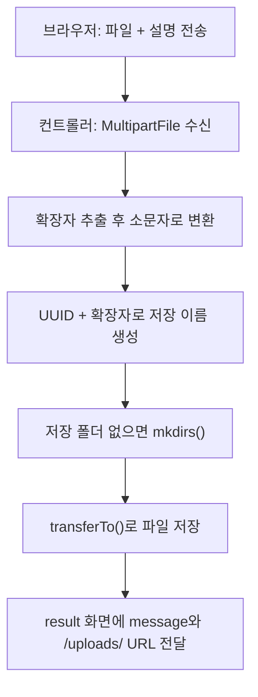

사용자가 올린 `스크린샷.png`를 서버 폴더에 그대로 저장하면 같은 이름의 파일이 서로 덮어쓴다. 저장은 했는데 브라우저에서 그 파일을 보여 주려 하면 404가 나기도 한다.  
`MultipartFile`로 단일·다중 파일 업로드를 만들면서, 파일명을 UUID로 바꿔 저장하는 이유와 저장한 파일을 URL로 다시 내려주는 설정까지 정리했다.

> **TL;DR**
> - 파일을 보내는 `<form>`에는 `method="post"`와 `enctype="multipart/form-data"`가 모두 있어야 하고, 컨트롤러는 `MultipartFile`로 받는다.
> - 원본 파일명 대신 `UUID + 확장자`로 저장하면 이름 충돌을 피할 수 있다.
> - 저장 폴더는 `WebMvcConfigurer.addResourceHandlers()`로 URL(`/uploads/**`)에 연결해야 브라우저에서 접근할 수 있다.

환경: Java 21, Spring Boot 4.1.2, Gradle, Thymeleaf, Lombok. 프로젝트 이름은 `chap06-file-upload`이다.  
이 글의 코드는 실습 프로젝트에서 가져왔고 import 문은 줄였다. 업로드 동작을 브라우저에서 실행해 확인한 결과는 대화에서 남기지 않아서, 실행 결과로 단정한 부분은 없다(`확인 필요`).

## 1. 왜 파일은 일반 폼과 다르게 보낼까?

일반 폼은 `이름=값&이름=값` 형태의 문자열로 전송된다(`application/x-www-form-urlencoded`). 이 방식으로는 이미지 같은 바이너리 데이터를 담을 수 없다.  
파일을 보낼 때는 요청 본문을 여러 부분(part)으로 나누고, 부분마다 이름과 종류를 붙이는 `multipart/form-data` 방식을 쓴다. 파일 한 부분과 설명 문자열 한 부분이 한 요청에 함께 실리는 구조다.

```html
<form action="single-file" method="post" enctype="multipart/form-data">
    파일 : <input type="file" name="singleFile"> <br>
    파일 설명 : <input type="text" name="description"><br>
    <input type="submit">
</form>
```

`enctype`을 빼먹으면 브라우저가 파일 내용 대신 파일 이름만 문자열로 보낸다. 서버에서 `MultipartFile`로 받으려 하면 값이 비어 있거나 오류가 난다.

| 속성 | 값 | 의미 |
|---|---|---|
| `method` | `post` | 파일은 본문에 실어 보내야 하므로 `get`을 쓸 수 없다 |
| `enctype` | `multipart/form-data` | 본문을 부분(part)으로 나눠 파일을 담는다 |
| `name` (`input`) | `singleFile` | 컨트롤러의 `@RequestParam` 이름과 일치해야 한다 |

## 2. 요청은 어떤 순서로 처리될까?

컨트롤러 주석에 적어 둔 진행 순서를 그림으로 옮기면 아래와 같다.



## 3. 구현

### 3-1. 저장 경로를 설정 파일로 빼기

```yaml
file:
  upload-dir: uploads
```

```java
@Value("${file.upload-dir}")
private String uploadDir;
```

저장 경로를 코드에 적으면 운영 서버와 내 컴퓨터의 경로가 다를 때 코드를 고쳐야 한다. `application.yaml`에 두고 `@Value`로 읽으면 설정만 바꾸면 된다.  
`uploads`처럼 상대 경로를 쓰면 애플리케이션을 실행한 작업 폴더 기준이 된다. 그래서 저장할 때 `getAbsoluteFile()`로 절대 경로로 바꿨다.

### 3-2. 단일 파일 저장

```java
@PostMapping("single-file")
public ModelAndView single(
        @RequestParam MultipartFile singleFile,
        @RequestParam String description,
        ModelAndView mv) {

    try {
        String savedName = save(singleFile);
        mv.addObject("message", "파일 업로드 성공!!");
        mv.addObject("files", "/uploads/" + savedName);
    } catch (IOException e) {
        mv.addObject("message", "파일 업로드 실패.." + e.getMessage());
    }

    mv.setViewName("result");
    return mv;
}

// 파일을 저장하고, 저장된 파일의 이름을 반환한다.
private String save(MultipartFile file) throws IOException {
    String originName = file.getOriginalFilename();                         // test.png
    String ext = originName.substring(originName.lastIndexOf(".")).toLowerCase(); // .png
    String savedName = UUID.randomUUID().toString() + ext;                  // 3829...-....png

    File dir = new File(uploadDir).getAbsoluteFile();
    dir.mkdirs();

    file.transferTo(new File(dir, savedName));
    return savedName;
}
```

`save()`가 하는 일을 한 줄씩 나누면 이렇다.

| 코드 | 하는 일 | 왜 필요한가 |
|---|---|---|
| `getOriginalFilename()` | 사용자 컴퓨터에서의 원래 파일명을 꺼낸다 | 확장자를 알아내기 위해 |
| `.toLowerCase()` | `.PNG`를 `.png`로 통일한다 | 확장자 대소문자가 섞여 저장되는 것을 막으려고 |
| `UUID.randomUUID()` | 겹칠 가능성이 사실상 없는 문자열을 만든다 | 같은 이름의 파일이 서로 덮어쓰지 않게 하려고 |
| `mkdirs()` | 폴더가 없으면 상위 폴더까지 만든다 | 처음 실행할 때 저장 폴더가 없어도 동작하게 하려고 |
| `transferTo()` | 업로드된 내용을 지정한 파일로 옮겨 저장한다 | 요청이 끝나면 임시 파일이 사라질 수 있어서 |

`@RequestParam MultipartFile singleFile`에서 변수명 `singleFile`이 HTML의 `name="singleFile"`과 같아야 값이 연결된다. 이름이 다르면 `@RequestParam("이름")`으로 직접 지정해야 한다.

### 3-3. 저장한 파일을 URL로 보여 주기

파일을 `uploads` 폴더에 저장했다고 해서 `localhost:8080/uploads/xxx.png`로 바로 열리지는 않는다. 스프링 부트가 기본으로 내주는 정적 리소스 경로는 `classpath:/static/` 같은 곳이고, 실행 중에 생긴 외부 폴더는 포함되지 않기 때문이다.  
그래서 URL 패턴과 실제 폴더를 직접 연결했다.

```java
@Configuration
public class WebConfig implements WebMvcConfigurer {

    @Value("${file.upload-dir}")
    private String uploadDir;

    @Override
    public void addResourceHandlers(ResourceHandlerRegistry registry) {
        registry.addResourceHandler("/uploads/**")
                .addResourceLocations("file:" + uploadDir + "/");
    }
}
```

`/uploads/abc.png` 요청이 들어오면 `uploads` 폴더에서 `abc.png`를 찾아 응답한다. `file:` 접두어가 없으면 클래스패스 안에서 찾기 때문에 파일 시스템의 폴더로는 연결되지 않는다.

### 3-4. 결과 화면

```html
<h1 th:text="${message}"></h1>

<div th:each="file: ${files}">
    
</div>
<p th:text="${files}"></p>
<a href="/">돌아가기</a>
```

`th:each`는 자바의 향상된 for문과 비슷하다. 단일 업로드에서는 `files`에 문자열 하나를 넣었고, 다중 업로드에서는 문자열 목록을 넣었다. 같은 `result.html`로 둘 다 보여 주는 구조다. 단일 값일 때 반복이 한 번 도는 동작은 직접 실행해 확인하지 못했다(`확인 필요`).

## 4. 다중 파일 업로드와 롤백

다중 업로드는 HTML에서 `multiple` 속성을 주고, 컨트롤러에서 `List<MultipartFile>`로 받는다.

```html
<input type="file" name="multiFile" multiple>
```

```java
@PostMapping("multi-file")
public ModelAndView multiFileUpload(
        @RequestParam("multiFile") List<MultipartFile> multipartFile,
        String description,
        ModelAndView mv) {

    List<FileDTO> files = new ArrayList<>();      // 저장에 성공한 파일 기록
    List<String> savedFiles = new ArrayList<>();  // 화면에서 쓸 URL 목록

    try {
        for (MultipartFile file : multipartFile) {
            String savedName = save(file);
            files.add(new FileDTO(file.getOriginalFilename(), savedName, uploadDir, description));
            savedFiles.add("/uploads/" + savedName);
        }
        mv.addObject("message", "멀티 파일 업로드 성공!");
        mv.addObject("files", savedFiles);
    } catch (Exception e) {
        // 이미 저장된 파일을 지워서 "전부 성공 또는 전부 실패"로 맞춘다
        for (FileDTO file : files) {
            new File(new File(uploadDir).getAbsoluteFile(), file.getSavedName()).delete();
        }
        mv.addObject("message", "멀티 파일 업로드 실패!");
    }

    mv.setViewName("result");
    return mv;
}
```

다섯 개를 올렸는데 네 개만 저장되고 한 개가 실패하면, 사용자에게는 "실패"라고 알리면서 서버에는 네 개가 남는다. 이 불일치를 막기 위해 데이터베이스 트랜잭션의 롤백(rollback)과 같은 발상을 적용했다. 성공한 파일을 `files` 목록에 기록해 두었다가, 예외가 나면 그 목록의 파일을 모두 삭제한다.


`FileDTO`는 파일 한 개의 정보(원본 이름, 저장 이름, 경로, 설명)를 묶는 객체다. 롤백할 때 "무엇을 지워야 하는가"를 알기 위해 저장 이름을 모아 두는 용도로 썼다.

| 비교 기준 | 데이터베이스 트랜잭션 | 이번 파일 롤백 |
|---|---|---|
| 되돌리는 방법 | DBMS가 변경 내용을 취소한다 | 저장한 파일을 코드로 직접 삭제한다 |
| 중간에 서버가 멈추면 | DBMS가 복구한다 | 삭제 코드가 실행되지 않아 파일이 남는다 |
| 보장 수준 | 원자성(전부 성공 또는 전부 취소) | 예외가 잡히는 경우에 한해 비슷하게 맞춘다 |

## 5. 헷갈렸던 점과 한계

실습 코드를 다시 읽으며 짚은 부분이다. 실행해서 재현한 것이 아니라 코드를 읽고 추론한 내용이라 `확인 필요`로 표시한다.

| 상황 | 코드를 읽고 추론한 동작 |
|---|---|
| 확장자 없는 파일(`README`)을 올리면 | `lastIndexOf(".")`가 `-1`을 반환하고 `substring(-1)`에서 `StringIndexOutOfBoundsException`이 난다. 이 예외는 `IOException`이 아니라서 단일 업로드의 `catch (IOException e)`에 잡히지 않는다. 다중 업로드는 `catch (Exception e)`라서 잡힌다(`확인 필요`) |
| 파일을 선택하지 않고 전송하면 | 파일명이 빈 문자열이 되어 위와 같은 상황이 될 수 있다(`확인 필요`) |
| 확장자를 `.exe`로 바꿔 올리면 | 확장자 검사가 없어서 그대로 저장된다. 실제 서비스라면 허용 확장자를 제한해야 한다 |
| 큰 파일을 올리면 | 스프링 부트에는 업로드 크기 제한 설정이 있다. 설정 이름과 기본값은 공식 문서에서 확인해야 한다(`확인 필요`) |

화면 안내문에도 이 방식은 **추후에는 권장하지 않는 방식**이라고 적어 두었다. 서버 로컬 디스크에 저장하면 서버가 여러 대일 때 파일이 한 대에만 있게 된다. 그래서 실무에서는 별도 저장소를 쓰는 경우가 많다고 알려져 있다. 현재 기술 스택에서는 이 방식이 가장 단순해서 개념 이해용으로 쓴다.

## 6. 정리

- 파일 폼은 `post` + `multipart/form-data`, 서버는 `MultipartFile`로 받는다.
- 저장 이름은 `UUID + 소문자 확장자`로 만들어 충돌을 막고, 저장 폴더는 `addResourceHandlers()`로 URL에 연결해야 화면에 보인다.
- 다중 업로드는 성공한 파일을 기록해 두었다가 실패 시 삭제해, 사용자에게 알린 결과와 서버 상태를 맞춘다.

다음에는 확장자와 크기를 검증하는 코드를 추가하고, 확장자 없는 파일을 직접 올려 위 5절의 추론이 맞는지 확인해 볼 계획이다.

## 더 학습하면 좋은 개념

- **`multipart/form-data`의 요청 구조** — 본문이 boundary로 나뉘는 모습을 개발자 도구의 Network 탭에서 직접 보면 `MultipartFile`이 어떤 데이터를 받는지 이해된다.
- **업로드 크기 제한 설정** — 제한 없이 받으면 서버 디스크와 메모리를 소모시키는 공격에 취약하다. 스프링의 multipart 설정과 서블릿 컨테이너의 제한을 함께 알아야 한다.
- **파일 검증과 보안** — 확장자, MIME 타입(파일 종류 표기), 파일명 경로 조작(`../`)을 점검하는 방법이다. 이번 예제에는 검증이 없다.
- **외부 저장소(예: 클라우드 객체 스토리지)** — 서버가 여러 대일 때 파일을 공유하는 방법으로, 로컬 저장 방식의 한계를 넘는 다음 단계다.
- **`ResourceHandlerRegistry`와 정적 리소스 처리** — `addResourceHandler`와 `addResourceLocations`가 어떻게 URL과 위치를 연결하는지 알면 캐시 설정 같은 확장도 이해할 수 있다.

## 참고 자료

- [Spring Framework 공식 문서 - Multipart Resolver](https://docs.spring.io/spring-framework/reference/web/webmvc/mvc-servlet/multipart.html)
- [Spring Framework 공식 문서 - Static Resources](https://docs.spring.io/spring-framework/reference/web/webmvc/mvc-config/static-resources.html)
- [Spring Framework 공식 문서 - MultipartFile](https://docs.spring.io/spring-framework/docs/current/javadoc-api/org/springframework/web/multipart/MultipartFile.html)
- [MDN - POST 메서드와 multipart/form-data](https://developer.mozilla.org/ko/docs/Web/HTTP/Methods/POST)
