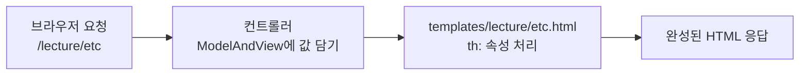

HTML 파일에 `th:text="${ member.name }"`라고 적었더니 브라우저에는 `홍길동`이 나왔다. 서버가 보낸 값이 어떻게 HTML 안으로 들어간 걸까?  
Thymeleaf(타임리프)를 처음 배우면서 값 출력, 조건문과 반복문, 공통 영역 재사용(fragment)을 직접 실행해 보고, 서버가 돌려준 HTML을 그대로 비교해 정리했다.

> **TL;DR**
> - Thymeleaf는 `th:` 속성이 붙은 HTML 템플릿에 서버의 값을 채워서 완성된 HTML로 바꿔 준다. 컨트롤러는 `ModelAndView`에 값을 담고, 템플릿은 `${ 키 }`로 꺼낸다.
> - 값 출력은 `th:text`, 조건은 `th:if`, 반복은 `th:each`, 공통 영역은 `th:replace` / `th:insert`로 쓴다.
> - 이번 실습에서 가장 놀랐던 점은 `th:text`가 태그를 글자로 보여 주는 것, 주석 안의 `[[...]]`까지 처리되는 것, 파라미터 없이 접속하면 500 오류가 나는 것이었다.

환경: Java 21, Spring Boot 4.1.2, Gradle, Thymeleaf. 프로젝트 이름은 `chap07-thymeleaf`이고 코드는 이 실습 프로젝트에서 가져왔다.  
실행 결과는 서버(`localhost:8080`)가 응답한 HTML을 직접 받아서 확인한 내용이다. 브라우저 화면의 모양(CSS)과 `alert` 창은 직접 보지 않았다.

## 1. Thymeleaf는 무엇을 해 줄까?

HTML 파일은 그대로는 값이 고정되어 있다. 회원 이름이 `홍길동`인지 `유관순`인지에 따라 화면이 달라지려면 서버가 값을 채워 넣어야 한다. Thymeleaf가 그 일을 하는 도구(템플릿 엔진)다.



컨트롤러는 화면에 보낼 값(Model)과 보여 줄 파일 이름(View)을 `ModelAndView`에 함께 담아 돌려준다.

```java
@GetMapping("/conditional")
public ModelAndView conditional(ModelAndView mv) {
    mv.addObject("num", 1);                       // 템플릿에서 ${ num } 으로 꺼낸다
    mv.addObject("str", "바나나");                 // 템플릿에서 ${ str } 으로 꺼낸다
    mv.setViewName("lecture/conditional");        // templates/lecture/conditional.html
    return mv;
}
```

뷰 이름에는 앞에 `/`를 붙이지 않았다. 컨트롤러 주석에 따르면 `/`를 붙이면 jar로 배포했을 때 템플릿을 못 찾을 수 있다.

템플릿 파일은 `<html>` 태그에 아래 네임스페이스(`th:` 속성을 쓰겠다는 선언)를 적는다. 코드 주석에 따르면 `th:` 문법을 쓰는 페이지에 필요한 선언이다.

```html
<html xmlns:th="http://www.thymeleaf.org">
```

## 2. 서버를 띄우고 접속하기

```bash
./gradlew bootRun
```

로그에 아래 두 줄이 나오면 서버가 켜진 것이다. 이번에는 `2.612 seconds`가 걸렸다.

```text
Tomcat started on port 8080 (http) with context path '/'
Started Chap07ThymeleafApplication in 2.612 seconds
```

처음에는 `localhost:8080`이 열리지 않았다. 원인은 코드가 아니라 서버를 꺼 둔 상태였다. 확인해 보니 8080 포트를 쓰는 프로세스가 하나도 없었다.  
`bootRun`으로 다시 켠 뒤에는 `index.html`의 버튼 네 개(표현식, 제어문, 기타, fragment)로 각 페이지에 들어갈 수 있었다. 포트가 안 열리면 `localhost:8080`이 꺼져 있는지부터 보면 된다.

## 3. 값을 꺼내는 표현식 여섯 가지

`expression.html`에는 표현식이 종류별로 정리되어 있다. 표현식은 값을 꺼내는 문법이다.

| 이름 | 문법 | 쓰는 곳 | 이번에 쓴 예 |
|---|---|---|---|
| 변수 표현식 | `${...}` | Model에 담은 값, 요청 파라미터 | `${ member.name }` |
| 선택 변수 표현식 | `*{...}` | `th:object`로 고른 객체의 필드 | `*{ age }` |
| 메시지 표현식 | `#{...}` | `messages.properties`의 값 | `#{ message.value }` |
| 링크 표현식 | `@{...}` | URL 만들기 | `@{/lecture/expression(title='링크', no=1)}` |
| 조각 표현식 | `~{...}` | fragment 불러오기 | `~{common/header :: headerFragment}` |
| 인라인 표현식 | `[[...]]`, `[(...)]` | 태그 안 글자 사이에 값 넣기 | `[[${ hello }]]` |

값이 어디에 담겼는지에 따라 꺼내는 방법이 다르다.

| 값의 위치 | 꺼내는 방법 |
|---|---|
| 요청 파라미터(쿼리스트링) | `${ param.이름 }` |
| 세션 attribute | `${ session.이름 }` |
| `ModelAndView`에 담은 값 | `${ 이름 }` |

### 3-1. th:text와 th:utext의 차이

컨트롤러에서 `"hello!<h3>Thymeleaf</h3>"`라는 태그가 섞인 문자열을 보냈다. 같은 값을 두 속성으로 출력했더니 서버가 돌려준 HTML이 이렇게 달랐다.

```html
<li>hello!&lt;h3&gt;Thymeleaf&lt;/h3&gt;</li>   <!-- th:text  : 태그가 글자로 바뀜 -->
<li>hello!<h3>Thymeleaf</h3></li>               <!-- th:utext : 태그가 그대로 살아 있음 -->
```

`th:text`는 `<`를 `&lt;`로 바꿔서(escape) 태그를 글자로 보여 준다. `th:utext`는 바꾸지 않아서 브라우저가 `<h3>`를 진짜 제목으로 그린다.  
사용자가 입력한 값을 `th:utext`로 출력하면 `<script>` 같은 악성 코드가 실행될 수 있다(XSS 공격). 그래서 기본은 `th:text`로 쓰고, 믿을 수 있는 값에만 `th:utext`를 쓴다.

### 3-2. 인라인 표현식과 th:inline

`th:inline="none"`을 붙인 태그에서는 `[[...]]`를 처리하지 않고 글자 그대로 둔다. 서버 응답에서 확인했다.

```html
<li>hello!&lt;h3&gt;Thymeleaf&lt;/h3&gt;</li>   <!-- th:inline="text"로 쓴 [[...]] -->
<li>hello!<h3>Thymeleaf</h3></li>               <!-- [(...)] -->
<li>[[${ hello }]]</li>                          <!-- th:inline="none": 그대로 출력 -->
<li>[(${ hello })]</li>                          <!-- th:inline="none": 그대로 출력 -->
```

자바스크립트 안에서 값을 쓸 때는 `<script th:inline="javascript">`가 필요하다. 코드 주석에는 세 가지 방법이 비교되어 있다.

| 작성 방법 | 결과 |
|---|---|
| `let hello = [[${ hello }]];` | 서버에서는 동작하지만, HTML 파일을 그냥 열면 문법 오류가 난다 |
| `let hello = "[[${ hello }]]";` | 따옴표가 두 번 붙어 문법 오류가 난다 |
| `let hello = /*[[${ hello }]]*/ '기본값';` | 서버에서도, 파일을 그냥 열어도 오류가 없다 (권장) |

세 번째 방식에서 주석과 기본값이 서버의 값으로 바뀐다. 서버 응답에는 `let hello = "hello!<h3>Thymeleaf<\/h3>";`로 나왔다. `<\/h3>`처럼 `/` 앞에 역슬래시가 붙는 것이 자바스크립트용 escape다.

### 3-3. 주석에서 놀랐던 점

주석은 두 종류로 나뉜다.

| 종류 | 작성 | 서버 응답 결과 |
|---|---|---|
| parser-level 주석 | `<!--/* 주석내용 */-->` | 사라진다 |
| prototype-only 주석 | `<!--/*/ 주석내용 /*/-->` | 주석 기호가 벗겨지고 ` 주석내용 ` 글자만 화면에 보인다 |

헷갈린 점이 하나 더 있다. HTML 주석(`<!-- -->`) 안에 설명용으로 적어 둔 `[[...]]`가 응답에서는 `...`로 바뀌어 있었다.

```html
<!-- 작성한 코드 -->
인라인 표현식(Inline Expressions): [[...]] [(...)]

<!-- 서버 응답 -->
인라인 표현식(Inline Expressions): ... ...
```

주석 안의 글자도 인라인 표현식으로 처리되는 것으로 보인다(원인은 공식 문서로 확인하지 않았다. `확인 필요`). 주석에 `[[...]]`를 예시로 적으면 나중에 응답에서 모양이 달라질 수 있다.

### 3-4. 파라미터 없이 접속하면 500 오류

표현식 페이지는 `${ param.no[0] }`를 쓴다. `index.html`의 버튼은 `?title=표현식&no=5&no=6`을 붙여 이동하므로 문제가 없다. 주소창에 `/lecture/expression`만 입력하면 `param.no`가 비어 있어서 서버가 **500 오류**를 돌려준다. 직접 확인했다.  
같은 이름의 파라미터가 여러 개면 `param.no[0]`, `param.no[1]`처럼 인덱스로 꺼낸다. 없는 인덱스(`[2]`)에 접근해도 오류가 난다.

## 4. 조건문과 반복문

`conditional.html`은 컨트롤러가 보낸 `num = 1`, `str = "바나나"`를 쓴다. 조건에 맞지 않는 태그는 응답에 아예 나오지 않는다.

| 작성 | 응답 결과 |
|---|---|
| `<p th:if="${ num > 0 }">` | 출력됨 |
| `<p th:if="${ num < 0 }">` | 응답에서 사라짐 |
| `<p th:unless="${ num < 0 }">` | 출력됨 (`th:unless`는 조건이 거짓일 때 출력) |
| `<th:block th:switch="${ str }">` + `th:case="바나나"` | `바나나가 선택되었습니다`만 출력 |

`th:case="*"`는 어떤 case에도 맞지 않을 때 쓰는 기본값이다. 자바의 `switch`에서 `default`와 같다.  
`th:block`은 화면에 태그를 남기지 않고 범위만 묶는 태그다. `th:if`를 여러 태그에 한꺼번에 적용하고 싶을 때 쓴다.

### 4-1. th:each와 반복 상태

`memberList`에 회원 4명을 담아 보냈고, `th:each="member : ${ memberList }"`로 행을 4번 만들었다. 자바의 향상된 for문과 같다.

```html
<tr th:each="member, stat : ${ memberList }">
    <td th:text="${ member.name }"></td>
    <td th:text="${ stat.count }"></td>
</tr>
```

`member, stat`처럼 두 번째 이름을 적으면 반복 상태를 꺼낼 수 있다. 4명을 반복한 결과를 정리했다.

| 이름 | 의미 | 홍길동(첫째) | 신사임당(마지막) |
|---|---|---|---|
| `index` | 0부터 시작하는 번호 | 0 | 3 |
| `count` | 1부터 시작하는 번호 | 1 | 4 |
| `size` | 전체 개수 | 4 | 4 |
| `even` | 짝수 번째인지 | false | true |
| `odd` | 홀수 번째인지 | true | false |
| `first` | 첫 번째인지 | true | false |
| `last` | 마지막인지 | false | true |

`index`가 0부터 시작하므로 `even`과 `odd`가 직관과 반대로 느껴졌다. 홍길동은 `index`가 0이라서 `even`이 `false`이고 `odd`가 `true`로 나왔다. 이 표는 응답에서 읽은 값이다.  
`stat` 이름을 적지 않아도 `memberStat`이라는 이름(변수명 + `Stat`)으로 같은 값을 꺼낼 수 있었다. 두 표의 결과가 같았다.

`current`는 현재 객체를 그대로 보여 주기 때문에 `MemberDTO{name='홍길동', age=20, ...}`처럼 `toString()` 결과가 출력됐다.

### 4-2. 숫자 범위 반복

`#numbers.sequence(5, 10)`은 5부터 10까지의 숫자 목록을 만든다. `th:each`와 함께 쓰면 자바의 `for (int i = 5; i <= 10; i++)`과 비슷하다. 링크 글자는 `번호5`부터 `번호10`까지 6개가 나왔다.  
링크 주소는 `/numbering/1`부터 `/numbering/6`까지 나왔다. 코드 주석에 따르면 이 경로를 처리하는 컨트롤러가 없는 예제용 링크다. 클릭했을 때의 404는 직접 눌러 보지 않았다.

## 5. 지역 변수와 SpringEL

`etc` 페이지에서 `SelectCriteria(1, 10, 3)`(시작 1, 끝 10, 현재 3)으로 페이지 버튼을 만들었다. `th:with`는 이 템플릿 안에서만 쓰는 변수를 만든다.

```html
<th:block th:with="start = ${ selectCriteria.startPage }, last = ${ selectCriteria.endPage }">
    <th:block th:each="p : ${ #numbers.sequence(start, last) }">
        <th:block th:if="${ selectCriteria.pageNo eq p }">
            <button th:text="${ p }" disabled></button>
        </th:block>
        <th:block th:if="${ selectCriteria.pageNo ne p }">
            <button th:text="${ p }"></button>
        </th:block>
    </th:block>
</th:block>
```

응답에는 버튼 1부터 10까지 나왔고, 현재 페이지인 **3번만** `disabled`가 붙었다. `eq`(같다)와 `ne`(다르다)는 `==`, `!=`를 글자로 쓴 비교 연산자다. `gt`, `lt`, `ge`, `le`도 있다.

컨트롤러에서 `mv.addObject(selectCriteria)`처럼 키 없이 객체만 담으면, 클래스 이름의 첫 글자를 소문자로 바꾼 `selectCriteria`가 키가 된다.

`${...}` 안에서는 SpringEL이라는 표현 방식을 쓰기 때문에 객체, 리스트, 맵의 값도 꺼낼 수 있다.

| 대상 | 작성 | 응답 결과 |
|---|---|---|
| 객체 | `${ member.name }` | 홍길동 |
| 객체 | `${ member['age'] }` | 20 |
| 객체 | `${ member.getGender() }` | 남 |
| 리스트 | `${ memberList[1].name }` | 유관순 |
| 리스트 | `${ memberList.get(1).address }` | 서울시 노원구 |
| 맵 | `${ memberMap['m03'].name }` | 장보고 |

`.name`, `['age']`, `.getGender()` 세 방식은 모두 내부에서 getter를 호출한다고 코드 주석에 적혀 있다. 그래서 필드가 `private`이어도 getter가 있어야 한다.  
`LinkedHashMap`에 넣은 맵을 `th:each`로 반복하면 `m01`, `m02`, `m03`, `m04` 순서로 출력됐다. 컨트롤러 주석에 따르면 `HashMap`은 순서를 보장하지 않아서 넣은 순서를 유지하려고 `LinkedHashMap`을 썼다.

## 6. fragment로 공통 영역 재사용하기

헤더, 푸터처럼 여러 페이지에 반복되는 영역을 파일 하나로 빼 두고 불러다 쓸 수 있다. 영역을 `th:fragment`로 이름 붙이고, 쓰는 쪽에서 `~{파일 경로 :: 조각 이름}`으로 부른다.

```html
<!-- common/header.html -->
<header th:fragment="headerFragment" class="header">
    <h1> header Fragment</h1>
</header>

<!-- lecture/fragment.html -->
<header th:replace="~{common/header :: headerFragment}">
    <h1>나는 header</h1>
</header>
```

`th:replace`와 `th:insert`는 결과가 다르다. 서버 응답으로 비교했다.

| 속성 | 쓰는 쪽 태그 | 응답 결과 |
|---|---|---|
| `th:replace` | 통째로 지우고 fragment로 바꾼다 | `<header class="header">...</header>` |
| `th:insert` | 남겨 두고, 안쪽에 fragment를 넣는다 | `<footer><footer class="footer">...</footer></footer>` |

`th:insert`는 바깥 `footer` 안에 `footer`가 한 번 더 들어간 모양이 된다. 태그가 중복되는 것이 싫으면 `th:replace`를 쓰면 된다.

`aside.html`의 fragment는 `th:fragment="asideFragment(parameter, parameter1)"`처럼 매개변수를 받는다. 쓰는 쪽에서 `~{common/aside :: asideFragment(${test1}, ${test2})}`로 값을 넘기면, 컨트롤러가 담은 `values1`, `values2`가 목록에 출력됐다.

## 7. 정리

- 컨트롤러가 `ModelAndView`에 값을 담으면 템플릿에서 `${ 키 }`로 꺼낸다. 태그를 글자로 보여 주는 `th:text`가 기본이고, `th:utext`는 믿을 수 있는 값에만 쓴다.
- `th:if` / `th:unless` / `th:switch`는 맞지 않는 태그를 응답에서 지우고, `th:each`는 태그를 반복하며 `stat`으로 `index`, `count`, `first`, `last` 같은 상태를 알려 준다.
- fragment는 `th:replace`(태그까지 교체)와 `th:insert`(안쪽에 삽입)로 불러온다.

다음에는 폼에서 값을 받아 입력 화면과 연결하는 `th:field`와 `th:action`을 실습해 볼 계획이다.

## 더 학습하면 좋은 개념

- **Thymeleaf 내추럴 템플릿(Natural Templates)** — 서버 없이 파일을 열어도 깨지지 않게 쓰는 방식이다. 이번의 `/*[[${ hello }]]*/ '기본값'`이 그 예이므로 원리를 알면 디자이너와 협업하기 쉽다.
- **XSS(교차 사이트 스크립팅)** — `th:utext`가 위험한 이유다. 사용자 입력을 화면에 출력할 때 어떤 방어가 필요한지 알아야 한다.
- **Thymeleaf 유틸리티 객체(`#strings`, `#numbers` 등)** — 이번에는 `#numbers.sequence`와 `#strings.isEmpty`만 봤다. 날짜 서식과 문자열 처리는 자주 쓰는 기능이다.
- **메시지 소스와 국제화(i18n)** — `messages.properties`로 문구를 관리하는 방법이다. 언어별 파일을 나누면 다국어 화면으로 확장된다.
- **Spring Security와 Thymeleaf 연동** — `sec:authorize`로 로그인 여부에 따라 화면을 나눈다. 코드 주석에 따르면 이 프로젝트에는 Security가 없어서 예제를 주석 처리했다.

## 참고 자료

- [Thymeleaf 공식 문서 - Using Thymeleaf 3.1](https://www.thymeleaf.org/doc/tutorials/3.1/usingthymeleaf.html)
- [Thymeleaf 공식 문서 - Thymeleaf + Spring 3.1](https://www.thymeleaf.org/doc/tutorials/3.1/thymeleafspring.html)
