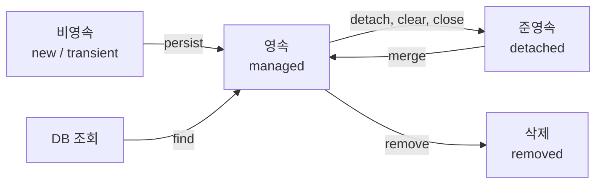
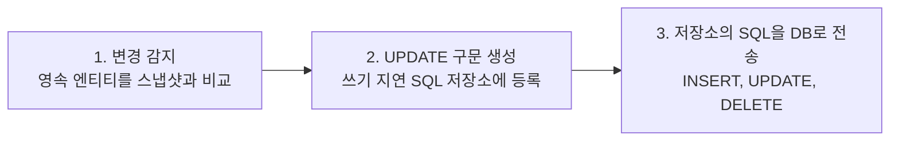

가격을 바꿨는데 UPDATE가 나가지 않는 엔티티가 있고, `merge()`에 넘긴 객체가 영속 상태가 되지 않는 경우도 있다. `Menu` 객체 하나가 어떤 순간에는 JPA의 관리를 받고 어떤 순간에는 받지 않기 때문이다.  
[앞선 글]({{ site.baseurl }}/jpa-entity-manager-crud.html)에서 `EntityManager`로 CRUD를 했다면, 이번에는 엔티티가 거치는 상태와 그 상태를 바꾸는 메서드를 `section02` 예제로 정리했다.

> **TL;DR**
> - 엔티티는 비영속, 영속, 준영속, 삭제 네 가지 상태를 가진다. 영속성 컨텍스트가 관리하는 영속 상태에서만 1차 캐시와 변경 감지가 동작한다.
> - 준영속 엔티티의 값을 바꿔도 변경 감지는 동작하지 않는다. `merge()`는 준영속 엔티티의 값을 복사한 새로운 영속 엔티티를 반환하며, 넘긴 객체가 영속이 되는 것은 아니다.
> - `flush()`는 변경 내용을 DB로 전송할 뿐 commit이 아니다. 그래서 flush 뒤에 rollback하면 전송한 SQL도 취소된다.

환경: Java 21, Spring Boot 4.1.2, Gradle, MySQL(`menudb` 데이터베이스), Lombok. 프로젝트 이름은 `chap02-persistence-context`이고, 이 글은 `section02` 패키지만 다룬다.  
소스 코드와 코드에 달린 주석을 기준으로 정리했다. 콘솔 실행 결과는 직접 확인하지 못해서 이 글에 싣지 않았고, 실행해야 알 수 있는 부분은 `(확인 필요)`로 표시했다.

## 1. 예제는 어떻게 구성되어 있을까?

`Section02Application`은 콘솔에서 번호를 입력받아 `EntityLifeCycle`의 메서드를 하나씩 실행한다.

| 번호 | 메뉴 이름 | 호출하는 메서드 | 트랜잭션 | 끝날 때 |
|---|---|---|---|---|
| 1 | 비영속 상태 확인 | `transientState` | 사용하지 않음 | `close()` |
| 2 | 영속 상태 확인 | `managedState` | 사용하지 않음 | `close()` |
| 3 | 준영속 상태 확인 | `detachedState` | 직접 `begin()` | `rollback()` 후 `close()` |
| 4 | 삭제 상태 확인 | `removedState` | 직접 `begin()` | `rollback()` 후 `close()` |
| 5 | 병합 확인 | `merge` | 직접 `begin()` | `rollback()` 후 `close()` |

JPA 개요 글의 예제와 달리 `@PersistenceContext`로 주입받지 않고, 앞선 CRUD 글처럼 `EntityManagerFactory`에서 `createEntityManager()`로 엔티티 매니저를 직접 만든다. 그래서 트랜잭션도 `EntityTransaction`으로 직접 시작하고 끝낸다. `EntityManager`를 만든 만큼 `close()`도 직접 호출한다.

3~5번 예제는 데이터를 바꾸는데 마지막에 `commit()`이 아니라 `rollback()`을 호출한다. 코드 주석에 따르면 실습 데이터를 지키기 위해서다. 숫자를 바꿔 가며 반복해서 실행해도 `tbl_menu`의 값이 그대로 남는다.

사용하는 엔티티는 `tbl_menu` 테이블과 매핑한 `Menu`다. 이번에는 연관 관계 없이 `category_code`를 `int categoryCode` 필드로 가진다. Lombok의 `@Getter`, `@Setter`, `@ToString`을 붙였고, 이름을 바꾸는 `changeMenuName()`도 있다.

```java
@Entity
@Table(name = "tbl_menu")
public class Menu {

    @Id
    @Column(name = "menu_code")
    private int menuCode;

    @Column(name = "menu_name")
    private String menuName;

    @Column(name = "menu_price")
    private int menuPrice;

    @Column(name = "category_code")
    private int categoryCode;

    @Column(name = "orderable_status")
    private String orderableStatus;
}
```

DB 접속 설정은 `application.yaml`에 있다. `show-sql: true`와 `format_sql: true`로 JPA가 만든 SQL을 콘솔에서 볼 수 있게 했고, 계정 정보는 마스킹했다.

```yaml
spring:
  datasource:
    driver-class-name: com.mysql.cj.jdbc.Driver
    url: jdbc:mysql://localhost:3306/menudb
    username: ****
    password: ****
  jpa:
    show-sql: true
    hibernate:
      ddl-auto: none
    properties:
      hibernate:
        format_sql: true
```

## 2. 엔티티에는 어떤 상태가 있을까?

`EntityLifeCycle`의 클래스 주석이 정리한 네 가지 상태와, 상태를 바꾸는 메서드는 아래와 같다.



`merge()`가 만드는 화살표는 준영속 객체 자체가 영속이 된다는 뜻이 아니다. 3-6절에서 따로 다룬다. `persist()`로 영속이 되는 경로는 클래스 주석에 이름만 나오고 이 예제에서는 호출하지 않는다.

| 상태 | 의미 | 진입 방법 | 변경 감지 |
|---|---|---|---|
| 비영속(new/transient) | 객체를 생성만 한 상태이고 영속성 컨텍스트와 관련이 없다 | `new Menu()` | 대상 아님 |
| 영속(managed) | 영속성 컨텍스트가 관리하는 상태 | `persist`, `find` 등 | 동작함 |
| 준영속(detached) | 영속성 컨텍스트가 관리하다가 분리된 상태 | `detach`, `clear`, `close` | 동작하지 않음 |
| 삭제(removed) | 영속성 컨텍스트와 DB에서 삭제될 상태 | `remove` | - (주석에 언급 없음) |

영속성 컨텍스트는 엔티티를 관리하는 공간이고, `EntityManager`를 통해 접근한다. 같은 `EntityManager` 안에서만 영속 상태가 유지된다는 점이 아래 예제 전체에 깔려 있다.

## 3. 상태별로 코드를 확인하기

### 3-1. 비영속: 값이 같아도 다른 객체다

`transientState`는 `find()`로 찾은 엔티티와 같은 값을 복사한 `new Menu()`를 만들어 비교한다.

```java
Menu foundMenu = manager.find(Menu.class, menuCode);
// ... 생략 (null이면 close() 후 return)

Menu newMenu = new Menu();
newMenu.setMenuCode(foundMenu.getMenuCode());
newMenu.setMenuName(foundMenu.getMenuName());
newMenu.setMenuPrice(foundMenu.getMenuPrice());
newMenu.setCategoryCode(foundMenu.getCategoryCode());
newMenu.setOrderableStatus(foundMenu.getOrderableStatus());
// 자료형 같고, 값도 똑같음.

System.out.println("foundMenu == newMenu : " + (foundMenu == newMenu));
System.out.println("foundMenu 는 영속 상태인가? " + manager.contains(foundMenu));
System.out.println("newMenu 는 영속 상태인가? " + manager.contains(newMenu));
```

`newMenu`는 PK도 같고 필드 값도 모두 같다. 그런데 `new`로 만든 별개의 객체이므로 `foundMenu == newMenu`는 `false`다. `==`는 값이 아니라 같은 객체인지를 비교하기 때문이다.  
`contains()`는 객체가 현재 영속성 컨텍스트에 속한 영속 엔티티인지 묻는다. `foundMenu`는 `find()`로 가져왔으니 `true`, `newMenu`는 컨텍스트에 넣은 적이 없으니 `false`일 것으로 읽힌다. 실제 출력은 확인하지 못했다(확인 필요).

여기서 헷갈리기 쉬운 점이 하나 있다. 주석은 "객체를 생성하면(new) 비영속"이라는 설명을 `find()` 줄 위에 달아 두었는데, 비영속인 것은 그 아래의 `newMenu`다.

### 3-2. 영속: 같은 PK는 1차 캐시에서 꺼낸다

`managedState`는 같은 PK로 `find()`를 두 번 호출한다.

```java
System.out.println("===== 첫 번째 조회 =====");
Menu foundMenu = manager.find(Menu.class, menuCode);
System.out.println("===== 두 번째 조회 =====");
Menu newMenu = manager.find(Menu.class, menuCode);

System.out.println("foundMenu == newMenu : " + (foundMenu == newMenu));
```

주석에 따르면 `find()`로 조회한 엔티티는 영속성 컨텍스트의 1차 캐시에 저장된다. 같은 PK로 다시 조회하면 DB에 SELECT를 보내지 않고 1차 캐시의 엔티티를 반환하고, 그래서 같은 엔티티 매니저 안에서는 동일성(`==`)이 보장된다. 각 조회 구분선 아래에 SELECT가 한 번만 찍힌다는 점은 직접 확인하지 못했다(확인 필요).

변수 이름에 속기 쉽다. 두 번째 변수를 `newMenu`라고 지었지만 `new`로 만든 객체가 아니다. 3-1절의 `newMenu`와 달리 이쪽은 `foundMenu`와 같은 객체이고, 코드가 `hashCode()`를 두 번 출력하는 것도 같은 객체임을 눈으로 확인하려는 구조다.

이 메서드는 트랜잭션을 시작하지 않고 `find()`만 한다. 조회는 트랜잭션 없이도 되지만, 값을 바꿨을 때 DB에 반영하려면 트랜잭션이 필요하다. 이 부분은 다음 절에서 이어진다.

### 3-3. 준영속: 분리하면 변경 감지에서 빠진다

`detachedState`는 메뉴 두 개를 `find()`로 가져온 뒤 두 번째만 `detach()`한다. 그리고 두 메뉴의 가격을 모두 1000씩 올린다.

```java
manager.detach(foundMenu2);

foundMenu1.setMenuPrice(foundMenu1.getMenuPrice() + 1000);
foundMenu2.setMenuPrice(foundMenu2.getMenuPrice() + 1000);

System.out.println(menuCode1 + "번 메뉴는 영속 상태인가? " + manager.contains(foundMenu1));
System.out.println(menuCode2 + "번 메뉴는 영속 상태인가? " + manager.contains(foundMenu2));

System.out.println("===== flush =====");
manager.flush();

transaction.rollback();
manager.close();
```

`detach()`는 특정 엔티티 하나만 영속성 컨텍스트에서 분리한다. `clear()`와 `close()`는 관리하던 엔티티 전체를 준영속으로 만든다.

| 메서드 | 준영속이 되는 범위 |
|---|---|
| `detach(entity)` | 지정한 엔티티 하나 |
| `clear()` | 영속성 컨텍스트를 초기화해서 관리하던 모든 엔티티 |
| `close()` | 영속성 컨텍스트를 종료해서 관리하던 모든 엔티티 |

주석에 따르면 `foundMenu2`는 준영속이므로 값을 바꿔도 변경 감지가 동작하지 않고, 영속인 `foundMenu1`의 UPDATE만 실행된다. 이 메서드가 실행하는 SQL을 직접 확인하지는 못했다(확인 필요).

다음 절의 flush와 함께 읽어야 의미가 보이는 코드다. 가격 변경 코드는 `"===== flush ====="` 출력보다 먼저 실행된다. 그런데 주석에 따르면 콘솔의 UPDATE 구문은 `"===== flush ====="` 아래에 출력된다. 값을 바꾸는 순간 SQL이 나가는 것이 아니라, 변경 감지와 SQL 전송이 `flush()` 때 일어나기 때문이다. 이를 쓰기 지연이라고 부른다.

### 3-4. flush: 변경 내용을 DB로 보내는 단계

주석이 정리한 `flush()`의 동작과 호출 시점은 아래와 같다.



| 호출 시점 | 자동 여부 |
|---|---|
| `transaction.commit()` 호출 | 자동 |
| `manager.flush()` 직접 호출 | 직접 |
| JPQL 쿼리 실행 직전 | 자동 |

JPQL은 DB에서 조회하는 쿼리라서, DB에 아직 반영되지 않은 변경이 있으면 조회 결과와 어긋난다. 그래서 주석은 JPQL을 실행하기 직전에 변경 내용을 먼저 반영한다고 설명한다.

`flush()`와 commit을 같은 것으로 착각하기 쉽다. 주석은 두 가지를 분명히 짚는다.

- flush는 영속성 컨텍스트를 비우는 것이 아니다. 1차 캐시는 그대로 유지된다.
- flush는 SQL을 DB에 전송할 뿐 commit이 아니다. 그래서 이 예제처럼 flush 후에 rollback하면 전송된 SQL도 취소된다.

이것이 3~5번 예제가 매번 `flush()` 다음에 `rollback()`을 호출하는 이유다. `flush()`로 SQL을 DB까지 보내 콘솔에서 확인하되, commit하지 않으므로 데이터는 그대로다. 만약 `flush()` 대신 `commit()`을 썼다면 가격 변경이 실제 DB에 남는다.

### 3-5. 삭제: remove도 쓰기 지연이다

`removedState`는 `remove()` 직후에 같은 PK로 다시 `find()`해서 결과를 출력한다.

```java
manager.remove(foundMenu);

// 삭제 상태의 엔티티는 다시 조회해도 null 이 반환된다.
Menu refoundMenu = manager.find(Menu.class, menuCode);

System.out.println("삭제한 엔티티 객체 = " + foundMenu);
System.out.println("다시 조회한 결과 = " + refoundMenu);
System.out.println("삭제한 엔티티는 영속 상태인가? " + manager.contains(foundMenu));

System.out.println("===== flush =====");
manager.flush();
```

주석에 따르면 `remove()`를 호출하면 엔티티는 즉시 삭제 상태가 되지만, DELETE 구문은 쓰기 지연 SQL 저장소에 등록된다. 그래서 DELETE가 `"===== flush ====="` 아래에 출력된다. 삭제 상태의 엔티티는 다시 조회해도 `null`이다.

즉 DB에서 행이 지워지기 전에도 영속성 컨텍스트 안에서는 이미 삭제된 것으로 다뤄진다. 주석은 "트랜잭션을 제어하지 않으면 영구 반영되지 않는다"고도 적었다. 이 예제는 마지막에 rollback하므로 `flush()`로 DELETE를 보내더라도 행은 남는다. `contains(foundMenu)`가 무엇을 출력하는지는 주석에 적혀 있지 않아서 확인하지 못했다(확인 필요).

### 3-6. merge: 준영속 엔티티로 새 영속 엔티티를 얻기

`merge`는 영속 엔티티를 `detach()`한 뒤 이름을 바꾸고, 이를 `merge()`에 넘긴다.

```java
Menu detachMenu = manager.find(Menu.class, menuCode);
manager.detach(detachMenu);

// 준영속 상태에서 값을 변경 -> 변경 감지 대상이 아니다.
detachMenu.setMenuName(menuName);

System.out.println("===== merge =====");
Menu mergedMenu = manager.merge(detachMenu);

System.out.println("detachMenu == mergedMenu : " + (detachMenu == mergedMenu));
System.out.println("detachMenu 는 영속 상태인가? " + manager.contains(detachMenu));
System.out.println("mergedMenu 는 영속 상태인가? " + manager.contains(mergedMenu));
```

주석이 설명하는 `merge()`의 순서는 이렇다.

1. 파라미터로 전달된 엔티티의 PK로 1차 캐시에서 엔티티를 찾는다. 없으면 DB에서 SELECT한다.
2. 찾아온 영속 엔티티에 준영속 엔티티의 값을 복사한다.
3. 값이 복사된 영속 엔티티를 반환한다.

세 번째 단계가 핵심이다. 파라미터로 넘긴 `detachMenu`가 영속 상태가 되는 것이 아니라, 값이 복사된 다른 객체가 반환된다. 그래서 코드는 `hashCode()`, `==`, `contains()`로 `detachMenu`와 `mergedMenu`가 서로 다른 객체임을 확인하는 구조다. 이 예제에서 `merge()` 전에 `detach()`를 했으므로 1차 캐시에는 해당 PK의 엔티티가 없고, 주석 설명대로라면 `merge()` 시점에 SELECT가 나갈 것으로 읽힌다(확인 필요).

`mergedMenu`는 영속 엔티티이고 이름이 바뀐 상태이므로, 코드 주석에 따르면 `flush()` 때 UPDATE 구문이 실행된다. 반대로 `merge(detachMenu)` 뒤에 `detachMenu`를 계속 수정하면 변경 감지는 일어나지 않는다. 이후 작업은 반환값인 `mergedMenu`로 이어가야 한다.

주석에는 한 가지가 더 있다. 파라미터의 PK로 조회된 엔티티가 없다면 새로운 엔티티로 판단하여 저장(INSERT)한다. 이 예제는 먼저 `find()`로 존재 여부를 확인하므로 이 경로를 타지 않는다.

## 4. 헷갈리기 쉬운 점

코드를 읽으면서 오해하기 쉬웠던 지점을 모았다.

| 상황 | 겉으로 보이는 것 | 실제 |
|---|---|---|
| `transientState`의 `newMenu` | PK와 값이 모두 `foundMenu`와 같다 | `new`로 만든 별개의 객체라 `==`은 `false`, 영속이 아니다 |
| `managedState`의 `newMenu` | 이름에 `new`가 붙어 있다 | `foundMenu`와 같은 객체이고, `new`로 만들지 않았다 |
| `detachedState`의 가격 변경 | 코드상 flush 출력보다 먼저 실행된다 | UPDATE는 `flush()` 때 전송된다(쓰기 지연) |
| `merge`의 `detachMenu`와 `mergedMenu` | 값이 같아 보인다 | 서로 다른 객체이고, 영속이 되는 쪽은 `mergedMenu`다 |
| `flush()` 호출 | DB에 SQL이 전송된다 | commit이 아니라서 `rollback()`하면 취소된다 |

## 정리

1. 엔티티는 비영속, 영속, 준영속, 삭제 상태를 가지고, 변경 감지와 1차 캐시는 영속 상태에서만 동작한다.
2. `persist`, `remove`, 값 변경은 바로 DB에 반영되지 않고 쓰기 지연 SQL 저장소에 모였다가 `flush()` 때 전송된다. `flush()`는 commit이 아니므로 그 뒤에 `rollback()`하면 취소된다.
3. `detach`, `clear`, `close`로 준영속이 된 엔티티는 `merge()`로 다시 관리할 수 있지만, 영속이 되는 것은 파라미터가 아니라 반환값이다.

다음에는 이 예제를 실행해 콘솔의 SQL 로그가 주석의 설명과 맞는지 확인하고, `persist()`가 만드는 영속 상태를 살펴볼 예정이다.

## 더 학습하면 좋은 개념

- **플러시 모드(FlushModeType)** — 주석은 JPQL 실행 직전에 자동으로 flush된다고 설명한다. 자동 flush가 일어나는 조건과 끄는 방법을 알아야 SQL이 나가는 시점을 예측할 수 있다.
- **변경 감지(Dirty Checking)와 스냅샷** — flush 때 엔티티를 스냅샷과 비교한다는 것이 이 글의 전제다. 비교 방식을 알면 `UPDATE`가 어떤 컬럼을 포함하는지 이해할 수 있다.
- **트랜잭션과 commit, rollback** — `flush()`와 commit이 다른 이유를 설명하는 개념이다. 이 예제가 rollback으로 끝나는 이유도 여기에 닿아 있다.
- **준영속 엔티티가 생기는 상황** — 트랜잭션이 끝난 뒤 계층 사이로 엔티티를 넘길 때 준영속이 되는 경우가 많다. `merge()`를 언제 쓰고 언제 피할지 판단하려면 필요하다(확인 필요).
- **Spring Data JPA** — `save()`가 `persist()`와 `merge()` 중 무엇을 부르는지 알려면 이 글의 상태 구분이 먼저 필요하다. (확인 필요)

## 참고 자료

- [Jakarta Persistence 공식 사이트](https://jakarta.ee/specifications/persistence/)
- [Jakarta Persistence 3.2 API - EntityManager](https://jakarta.ee/specifications/persistence/3.2/apidocs/jakarta.persistence/jakarta/persistence/EntityManager.html)
- [Hibernate ORM User Guide - Persistence Context](https://docs.hibernate.org/orm/current/userguide/html_single/Hibernate_User_Guide.html#pc)
- [Hibernate ORM User Guide - Flushing](https://docs.hibernate.org/orm/current/userguide/html_single/Hibernate_User_Guide.html#flushing)
