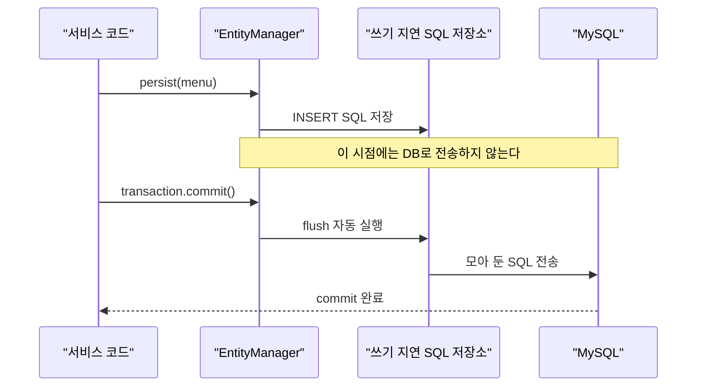

JPA에는 `update()` 메서드가 없다. 그런데 `setMenuName()`으로 값만 바꿨는데 DB의 메뉴 이름이 바뀐다. 그리고 `persist()`를 호출한 줄에서는 INSERT가 실행되지 않고, `commit()`을 호출해야 실행된다.  
`EntityManager`로 조회, 등록, 수정, 삭제를 직접 작성해 보면서 이런 동작이 어떤 원리로 가능한지 정리했다.

> **TL;DR**
> - 조회는 `find()`, 등록은 `persist()`, 삭제는 `remove()`를 쓴다. 수정은 메서드 없이 조회한 엔티티의 값을 바꾸면 된다(변경 감지, Dirty Checking).
> - `persist`, `remove`, 값 변경은 SQL을 바로 보내지 않고 쓰기 지연 SQL 저장소에 모아 두었다가, `commit()` 때 flush되며 DB로 전송된다.
> - `EntityManager`는 필드로 공유하지 않고 요청 1건당 하나씩 만들어 쓰고 닫는다.

환경: Java 21, Spring Boot 4.1.2, Gradle, MySQL(`menudb` 데이터베이스), Lombok. 프로젝트 이름은 `chap02-persistence-context`이고, 이 글은 그중 `section01` 패키지만 다룬다.  
이 글은 소스 코드와 코드에 달린 주석을 기준으로 정리했다. 콘솔 실행 결과(SQL 로그, 출력값)는 확인하지 못해서 싣지 않았고, 코드만으로 단정할 수 없는 부분은 `(확인 필요)`로 표시했다.

## 1. 실습은 어떻게 구성했을까?

`Section01Application`은 콘솔 메뉴를 반복해서 보여 주고, 입력받은 번호에 따라 `EntityManagerCRUD`의 메서드를 호출한다.

| 입력 | 호출하는 메서드 | 하는 일 |
|---|---|---|
| 1 | `findMenuByMenuCode` | 메뉴 코드로 조회 |
| 2 | `registMenu` | 신규 메뉴 등록 |
| 3 | `modifyMenuName` | 메뉴 이름 수정 |
| 4 | `removeMenu` | 메뉴 삭제 |
| 9 | - | 컨텍스트를 닫고 종료 |

엔티티는 `tbl_menu` 테이블과 매핑한 `Menu`다. JPA 소개 글의 `Menu`와 달리 카테고리를 객체가 아닌 `int categoryCode`로 가진다.

```java
@Entity
@Table(name = "tbl_menu")
public class Menu {

    @Id
    @Column(name = "menu_code")
    private int menuCode;

    @Column(name = "menu_name")
    private String menuName;

    // menuPrice, categoryCode, orderableStatus 필드는 같은 방식이라 생략
}
```

접속 정보는 `application.yaml`에 있다. 계정 정보는 마스킹했다.

```yaml
spring:
  datasource:
    driver-class-name: com.mysql.cj.jdbc.Driver
    url: jdbc:mysql://localhost:3306/menudb
    username: ****
    password: ****
  jpa:
    show-sql: true
    hibernate:
      ddl-auto: none
    properties:
      hibernate:
        format_sql: true
```

`show-sql`과 `format_sql`을 켜 두었으므로 JPA가 만든 SQL을 콘솔에서 볼 수 있다. 이 글의 "언제 SQL이 나가는가"는 이 로그로 확인해야 하는 내용이다.

## 2. EntityManager는 왜 요청마다 새로 만들까?

`EntityManagerCRUD`에는 필드로 `EntityManager`를 주입받는 코드가 주석 처리되어 있고, 대신 `EntityManagerFactory`를 받는다.

```java
// @PersistenceContext
// private EntityManager manager;
private final EntityManagerFactory factory;

public EntityManagerCRUD(EntityManagerFactory factory) {
    this.factory = factory;
}
```

코드 주석에 따르면 엔티티 매니저는 기능 1개당 1개를 별도로 만들어야 한다. 필드에서 공유하지 않고, 요청 1건에 매니저 1개만 존재해야 한다. 모든 메서드가 같은 틀을 따른다.

```java
EntityManager manager = factory.createEntityManager();
// ... 작업 ...
manager.close();
```

영속성 컨텍스트는 엔티티를 관리하는 공간이고, 엔티티 매니저를 통해 접근한다. 매니저를 필드로 공유하면 여러 요청이 한 영속성 컨텍스트를 함께 쓰게 되어, 요청마다 불러온 엔티티와 변경 내용이 섞일 수 있다. 이렇게 추론한 것이고, 주석은 규칙만 말한다. 요청이 끝나면 `close()`로 매니저를 닫는다.

이전 글(JPA 개요)의 `compareSameMenu`는 `@PersistenceContext`로 필드를 주입받고 `@Transactional`을 썼다. 그 방식과 이 글의 방식은 매니저를 얻는 방법이 다르다. Spring이 주입한 매니저가 요청마다 어떻게 분리되는지는 이 코드만으로 확인되지 않는다(확인 필요).

## 3. 조회: find

```java
public void findMenuByMenuCode(int menuCode) {
    EntityManager manager = factory.createEntityManager();

    Menu foundMenu = manager.find(Menu.class, menuCode);
    System.out.println("foundMenu = " + foundMenu);
    manager.close();
}
```

`find(엔티티 타입, PK 값)`으로 조회한다. 조회는 데이터를 바꾸지 않으므로 이 메서드에는 트랜잭션이 없다. 해당 PK의 행이 없을 때의 결과는 코드에서 처리하지 않았는데, `null`이 출력되는 것으로 예상한다(확인 필요).

## 4. 등록: persist와 쓰기 지연

```java
public void registMenu(Menu menu) {
    EntityManager manager = factory.createEntityManager();
    EntityTransaction transaction = manager.getTransaction();
    transaction.begin();

    try {
        manager.persist(menu);
        transaction.commit();
        System.out.println("등록 된 메뉴 : " + menu);
    } catch (Exception e) {
        transaction.rollback();
    } finally {
        manager.close();
    }
}
```

### 4-1. 왜 트랜잭션이 필요할까?

주석에 따르면 DML(INSERT, UPDATE, DELETE)은 트랜잭션이 매우 중요하다. DML 중 오류가 나면 롤백이 반드시 필요하기 때문이다. `transaction.begin()` 아래부터 트랜잭션이 적용된다. 조회는 `begin()` 없이 `find`만 호출했고, 등록, 수정, 삭제는 모두 `begin()`으로 시작한다.

### 4-2. persist를 호출해도 INSERT가 바로 나가지 않는다

주석에 따르면 엔티티 매니저는 CUD 작업 시 SQL을 DB에 바로 반영하지 않는다. "쓰기 지연 SQL 저장소"에 SQL을 모아 두었다가 `flush()` 시점에 DB로 보낸다. `commit()`이 호출되면 flush가 자동으로 실행된다.



주석은 SQL을 모아 두는 이유까지는 설명하지 않는다. 코드에서 확인되는 사실은 `persist()`가 호출되는 줄이 아니라 `commit()`에서 SQL이 DB로 전송된다는 점이다. 그래서 `commit()` 전에 오류가 나면 `rollback()`으로 끝낼 수 있다. 쓰기 지연을 둔 이유는 공식 문서에서 따로 확인해야 한다(확인 필요).

### 4-3. 등록 코드에서 헷갈린 지점

- `Menu`의 `@Id`에는 `@GeneratedValue`가 없다. `inputNewMenu`는 `menuCode`를 입력받지 않으므로 `int` 기본값 `0`인 채로 `persist`가 호출될 것이다. 이때 어떤 SQL이 나가고 DB가 어떻게 응답하는지는 실행 로그로 확인해야 한다(확인 필요).
- `catch`가 `rollback()`만 하고 예외를 출력하지 않는다. 등록이 실패하면 콘솔에 "등록 된 메뉴"가 찍히지 않을 뿐, 실패 원인은 보이지 않는다.
- `menu`가 `null`이면 `persist`가 어떤 예외를 던지는지는 코드에 없다(확인 필요).

## 5. 수정: update 메서드는 없다

```java
public void modifyMenuName(int menuCode, String menuName) {
    EntityManager manager = factory.createEntityManager();

    Menu foundMenu = manager.find(Menu.class, menuCode);
    System.out.println("수정 전 메뉴 : " + foundMenu);

    EntityTransaction transaction = manager.getTransaction();
    transaction.begin();

    try {
        foundMenu.setMenuName(menuName);
        System.out.println("=======commit 하기 전=========");
        transaction.commit();
    } catch (Exception e) {
        transaction.rollback();
    }

    System.out.println("수정 후 메뉴 : " + manager.find(Menu.class, menuCode));
    manager.close();
}
```

### 5-1. 변경 감지와 스냅샷

주석에 따르면 JPA에는 update 관련 메서드가 없다. 대신 이런 순서로 동작한다.

1. 영속성 컨텍스트는 엔티티를 처음 조회(`find`)하는 순간 그 엔티티의 상태(스냅샷)를 보관한다.
2. `commit()` 시점에 스냅샷과 현재 엔티티를 비교한다.
3. 바뀐 부분이 있으면 UPDATE 쿼리를 만들어 쓰기 지연 저장소에 등록하고 DB로 전송한다.

이 과정을 변경 감지(Dirty Checking)라고 한다. 코드에서 우리가 한 일은 `setMenuName()` 호출뿐이다. UPDATE 문을 직접 쓰지 않는다.

그래서 변경 감지의 전제는 엔티티가 영속성 컨텍스트에 있다는 것이다. 이 메서드는 `find`로 조회한 엔티티를 수정하므로 조건을 만족한다. 직접 `new Menu()`로 만든 객체의 값을 바꾸면 스냅샷이 없어서 변경 감지 대상이 아니다. 이 부분은 다음 글의 엔티티 생명주기에서 다룬다.

### 5-2. 마지막 find는 DB를 다시 읽을까?

`commit()` 뒤에 `manager.find(Menu.class, menuCode)`로 수정 후 메뉴를 출력한다. DB에서 다시 읽어 온 값처럼 보이지만, 아직 같은 매니저(같은 영속성 컨텍스트)를 쓰고 있다. Jakarta Persistence의 `EntityManager.find` Javadoc은 엔티티 인스턴스가 영속성 컨텍스트에 있으면 거기서 반환한다고 설명한다. 그래서 이 줄은 DB 조회 없이 컨텍스트에 있는 같은 객체를 돌려줄 가능성이 높다. SQL 로그에 SELECT가 한 번 더 찍히는지로 확인할 수 있다(확인 필요).

수정 결과가 실제 DB에 반영됐는지 확인하려면 이 출력에 의존하지 말고 매니저를 새로 만들어 다시 조회하거나, DB에서 직접 확인해야 한다.

### 5-3. 대상이 없으면?

`menuCode`에 해당하는 행이 없으면 `foundMenu`가 `null`이라고 예상한다(확인 필요). 그러면 `setMenuName()`에서 `NullPointerException`이 나는데, 이 호출이 `try` 안에 있어서 `catch`가 받아 `rollback()`만 하고 끝난다. 사용자에게는 오류 메시지 없이 "수정 전 메뉴 : null", "수정 후 메뉴 : null"이 출력될 것이다.

## 6. 삭제: remove

```java
public void removeMenu(int menuCode) {
    EntityManager manager = factory.createEntityManager();

    Menu removeMenu = manager.find(Menu.class, menuCode);

    EntityTransaction transaction = manager.getTransaction();
    transaction.begin();

    try {
        manager.remove(removeMenu);
        transaction.commit();
    } catch (Exception e) {
        transaction.rollback();
    }

    Menu removedMenu = manager.find(Menu.class, menuCode);
    System.out.println("removedMenu = " + removedMenu);

    manager.close();
}
```

주석에 따르면 삭제할 엔티티는 먼저 조회해서 영속성 컨텍스트가 관리하는 상태여야 삭제할 수 있다. `remove()`를 호출해도 DELETE 문은 `commit()` 시점에 DB로 전송된다. 등록과 같은 쓰기 지연 방식이다.

헷갈릴 만한 지점은 두 가지다.

- `catch`가 예외를 삼키는 구조는 수정, 등록과 같다. 삭제 중 오류가 나도 알 수 없다. 대상이 없어서 `removeMenu`가 `null`일 때 `remove(null)`이 무엇을 던지는지도 코드에 없다(확인 필요).
- 마지막 "삭제 여부 확인"의 `find`는 수정 때와 같은 이유로 DB가 아닌 컨텍스트 상태를 반영한 결과일 수 있다. 삭제가 정상이면 `removedMenu = null`이 출력될 것이라고 예상하지만, 실행 결과로 확인하지 못했다(확인 필요).

## 7. 네 가지 작업 비교

| 작업 | 메서드 | 트랜잭션 | DB 전송 시점 |
|---|---|---|---|
| 조회 | `find(Menu.class, menuCode)` | 사용하지 않음 | 호출 시점 (확인 필요) |
| 등록 | `persist(menu)` | 필요 | `commit()` 시 flush |
| 수정 | 없음 (`setMenuName()` 후 변경 감지) | 필요 | `commit()` 시 flush |
| 삭제 | `remove(menu)` | 필요 | `commit()` 시 flush |

## 정리

1. 조회는 `find`, 등록은 `persist`, 삭제는 `remove`를 쓰고, 수정은 메서드 없이 조회한 엔티티의 값을 바꾸면 변경 감지가 UPDATE를 만든다.
2. DML은 `begin()`과 `commit()` 사이에서 하고, SQL은 쓰기 지연 저장소에 모였다가 `commit()` 때의 flush로 DB에 전송된다.
3. `EntityManager`는 요청 1건에 하나씩 `createEntityManager()`로 만들고 `close()`로 닫는다. 같은 매니저로 `commit()` 뒤에 `find`한 결과는 DB를 다시 읽은 값이 아닐 수 있다.

다음에는 엔티티의 상태(비영속, 영속, 준영속, 삭제)와 `detach`, `merge`를 정리하는 엔티티 생명주기를 볼 예정이다.

## 더 학습하면 좋은 개념

- **엔티티 생명주기** — `find`로 조회한 엔티티와 `new`로 만든 엔티티를 JPA가 다르게 취급하는 이유를 설명한다. 변경 감지가 되는 조건을 알 수 있다.
- **flush와 FlushModeType** — `commit()` 말고도 flush가 일어나는 시점이 있는지 알아야 SQL이 나가는 시점을 예측할 수 있다.
- **ID 생성 전략(`@GeneratedValue`)** — 이번 `Menu`에는 없었다. `persist` 시점에 PK를 정하는 방식과 INSERT 시점의 관계를 이해하는 데 필요하다.
- **Spring의 `@Transactional`과 `@PersistenceContext`** — 이번에는 트랜잭션과 매니저를 직접 관리했다. 프레임워크가 이를 대신하는 방식을 비교하면 직접 관리하는 코드가 무엇을 하는지 분명해진다.
- **1차 캐시와 동일성 보장** — 5-2의 `find`가 컨텍스트에서 반환될 수 있는 근거가 되는 개념이다.

## 참고 자료

- [Jakarta Persistence 공식 사이트](https://jakarta.ee/specifications/persistence/)
- [Jakarta Persistence 3.2 API - EntityManager](https://jakarta.ee/specifications/persistence/3.2/apidocs/jakarta.persistence/jakarta/persistence/EntityManager.html)
- [Hibernate ORM 공식 문서](https://hibernate.org/orm/documentation/)
- [Spring Framework 공식 문서 - Transaction Management](https://docs.spring.io/spring-framework/reference/data-access/transaction.html)
