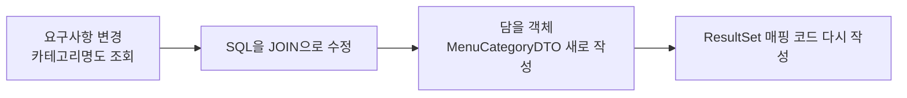

메뉴 목록을 조회하는 데 JDBC 코드는 30줄 가까이 필요한데, JPA는 `manager.find(Menu.class, menuCode)` 한 줄로 끝난다. 줄 수만 줄어드는 걸까, 아니면 JDBC가 가진 구조적인 문제를 푸는 걸까?  
JDBC로 만든 예제에서 문제가 생기는 지점을 먼저 직접 확인하고, 같은 문제를 JPA가 어떻게 해결하는지 비교하며 정리했다.

> **TL;DR**
> - JDBC로 개발하면 반복되는 JDBC 코드, SQL 의존, 객체와 테이블의 구조 차이(패러다임 불일치), 동일성 보장이라는 네 가지 문제가 생긴다.
> - JPA(Java Persistence API)는 자바 객체와 DB 테이블을 연결(매핑)해 주는 ORM 표준이다. SQL 작성과 결과 변환을 JPA가 대신한다.
> - 같은 트랜잭션 안에서 같은 PK로 조회하면 JPA는 항상 같은 객체를 돌려준다. JDBC는 조회할 때마다 새 객체를 만든다.

환경: Java 21, Spring Boot 4.1.2, Gradle, MySQL(`menudb` 데이터베이스), Lombok. 프로젝트 이름은 `chap01-jpa-intro`이고, 코드는 이 실습 프로젝트에서 가져왔다.  
이 글은 소스 코드와 코드에 달린 주석을 기준으로 정리했다. 콘솔 실행 결과 화면은 이 글에 싣지 않았다.

## 1. 실습 프로젝트는 어떻게 구성했을까?

`section01`은 JDBC의 문제점을, `section02`는 JPA의 해결 방법을 보여 준다. 두 섹션은 같은 테이블(`tbl_menu`, `tbl_category`)을 사용한다.

| 패키지 | 실행 클래스 | 내용 |
|---|---|---|
| `section01.jdbc` | `Section01Application` | JDBC를 직접 사용할 때의 문제점 4가지 |
| `section02` | `Section02Application` | 같은 문제를 JPA로 해결하기 |

`@SpringBootApplication`이 붙은 클래스의 패키지 아래만 스캔한다. 그래서 섹션마다 실행 클래스를 따로 두면 다른 섹션의 클래스와 섞이지 않는다.

의존성은 `build.gradle`에서 아래 세 가지가 핵심이다.

```groovy
implementation 'org.springframework.boot:spring-boot-starter-data-jpa'
runtimeOnly 'com.mysql:mysql-connector-j'
compileOnly 'org.projectlombok:lombok'
```

DB 접속 정보는 `application.yml`에 적는다. 코드 주석에 따르면 MySQL 의존성을 추가하면 접속 정보를 적어야 애플리케이션이 실행된다. 계정 정보는 마스킹했다.

```yaml
spring:
  datasource:
    driver-class-name: com.mysql.cj.jdbc.Driver
    url: jdbc:mysql://localhost:3306/menudb
    username: ****
    password: ****
  jpa:
    show-sql: true          # JPA가 만든 SQL을 콘솔에 출력
    hibernate:
      ddl-auto: none
    properties:
      hibernate:
        format_sql: true    # SQL을 보기 좋게 줄바꿈
```

`ddl-auto`는 애플리케이션을 시작할 때 테이블을 어떻게 다룰지 정한다. 이번 실습은 이미 만들어 둔 테이블을 쓰기 때문에 `none`으로 두었다.

| 값 | 동작 |
|---|---|
| `create` | 실행할 때 테이블을 새로 생성한다 |
| `create-drop` | 실행할 때 생성하고 종료할 때 삭제한다 |
| `update` | 개발 중 바뀐 테이블 구조를 반영한다 |
| `none` | 미리 준비한 DDL 스크립트로만 진행한다 |

## 2. JDBC로 개발하면 어떤 문제가 생길까?

`JdbcProblem` 클래스는 Spring이 만들어 준 `DataSource`(커넥션 풀)에서 `Connection`을 꺼내 쓴다. 커넥션만 받아 올 뿐이어서, SQL 작성과 실행, `ResultSet`을 객체로 옮기는 일은 모두 직접 한다.

### 2-1. 반복되는 JDBC 코드와 수작업 매핑

메뉴 전체를 조회하는 `findAllMenu()`는 이렇게 생겼다.

```java
String query = "SELECT menu_code, menu_name, menu_price,category_code, orderable_status FROM tbl_menu";

try (Connection con = dataSource.getConnection();
     Statement stmt = con.createStatement();
     ResultSet rset = stmt.executeQuery(query)) {

    while (rset.next()) {
        Menu menu = new Menu();
        menu.setMenuCode(rset.getInt("menu_code"));
        menu.setMenuName(rset.getString("menu_name"));
        menu.setMenuPrice(rset.getInt("menu_price"));
        menu.setCategoryCode(rset.getInt("category_code"));
        menu.setOrderableStatus(rset.getString("orderable_status"));

        menuList.add(menu);
    }
} catch (SQLException e) {
    throw new RuntimeException(e);
}
```

조회 로직은 SQL 한 줄뿐인데, 그 앞뒤로 커넥션을 열고 닫는 코드와 컬럼을 필드에 하나씩 옮기는 코드가 붙는다. `try-with-resources`로 자원 반납은 자동화했지만, 이 틀 자체는 조회 메서드마다 반복해서 써야 한다.

### 2-2. SQL에 의존하는 개발

요구사항이 "메뉴 목록에 카테고리 이름도 보여 주세요"로 바뀌었다고 해 보자. `findAllMenuWithCategoryName()`을 보면 바꿔야 할 곳이 연쇄적으로 늘어난다.



```java
String query = "SELECT m.menu_code, m.menu_name, m.menu_price, c.category_name, m.orderable_status " +
        "FROM tbl_menu m " +
        "JOIN tbl_category c ON m.category_code = c.category_code " +
        "ORDER BY m.menu_code";
```

SQL이 바뀔 때마다 이를 담는 클래스(`MenuCategoryDTO`)가 하나씩 늘어난다. 객체를 중심으로 설계하는 것이 아니라, SQL 결과(테이블)에 맞춰 객체를 만드는 개발이 된다.

### 2-3. 객체와 테이블의 패러다임 불일치

같은 1:N 관계를 SQL과 자바는 다르게 표현한다.

| 구분 | SQL(테이블) | Java(객체) |
|---|---|---|
| 연관 관계 표현 | FK 값을 가진다 | 연관된 객체를 필드로 가진다 |
| 이 실습의 예 | `tbl_menu`가 `category_code` 값을 가진다 | `Menu`가 `Category` 객체를 가진다 |
| 연관 데이터 접근 | `JOIN` 또는 추가 조회 | `menu.getCategory()` |

JDBC용 `Menu` 클래스는 테이블 구조에 맞춰 만들었기 때문에 카테고리를 `int categoryCode`로만 가지고 있다. 그래서 `findMenuAndCategory()`에서는 메뉴를 조회한 뒤 그 값으로 SQL을 한 번 더 실행해서 카테고리를 직접 가져온다.

```java
Menu menu = findMenuByMenuCode(menuCode);
// menu.getCategory() 처럼 객체를 탐색할 수 없다.
Category category = findCategoryByCategoryCode(menu.getCategoryCode());
```

### 2-4. 동일성 보장의 문제

`compareSameMenu()`는 같은 PK로 메뉴를 두 번 조회해 두 객체를 비교한다.

```java
Menu menu1 = findMenuByMenuCode(menuCode);
Menu menu2 = findMenuByMenuCode(menuCode);

System.out.println("menu1 == menu2 : " + (menu1 == menu2));

menu1.setMenuName("이름 변경 테스트");
System.out.println(menu1.getMenuName());  // 변경된 이름
System.out.println(menu2.getMenuName());  // 원래 이름 그대로
```

`findMenuByMenuCode()`는 호출할 때마다 `new Menu()`로 새 객체를 만든다. DB에서는 같은 행이지만 자바에서는 서로 다른 객체이므로 `menu1 == menu2`는 `false`다. 한쪽 객체의 이름을 바꿔도 다른 쪽은 변경을 알 수 없다. 코드 주석에서도 이 부분을 "중요"하게 짚었다.

## 3. JPA는 이 문제를 어떻게 풀까?

`JpaSolution` 클래스의 주석에 따르면 JPA는 자바 진영의 ORM(Object Relational Mapping, 객체와 관계형 DB를 연결하는 기술) 표준이다. JPA 자체는 인터페이스(명세)이고, 실제로 동작하는 구현체가 따로 있다. `application.yml`의 `hibernate` 설정이 그 구현체 쪽 설정이다. 어떤 구현체가 쓰이는지는 `spring-boot-starter-data-jpa` 의존성 구성을 확인해야 해서 이 글에서는 단정하지 않는다(확인 필요).

### 3-1. 엔티티로 테이블 매핑하기

테이블과 연결할 클래스에 JPA 어노테이션을 붙인다. 아래는 `section02.Menu`다.

```java
@Entity
@Table(name = "tbl_menu")
public class Menu {

    @Id
    @Column(name = "menu_code")
    private int menuCode;

    @Column(name = "menu_name")
    private String menuName;

    @Column(name = "menu_price")
    private int menuPrice;

    @ManyToOne
    @JoinColumn(name = "category_code")
    private Category category;

    @Column(name = "orderable_status")
    private String orderableStatus;
}
```

| 어노테이션 | 의미 |
|---|---|
| `@Entity` | JPA가 관리하는 객체임을 나타낸다 |
| `@Table(name = "tbl_menu")` | 이 엔티티와 매핑할 테이블 이름을 지정한다 |
| `@Id` | 기본키(PK)가 되는 필드다 |
| `@Column(name = "menu_code")` | 필드와 매핑할 컬럼 이름을 지정한다 |
| `@ManyToOne` | 여러 메뉴가 하나의 카테고리에 속하는 N:1 관계다 |
| `@JoinColumn(name = "category_code")` | FK 컬럼을 지정한다 |

JDBC 쪽 `Menu`와 가장 다른 점은 `int categoryCode` 대신 `Category category` 객체를 필드로 가진다는 것이다. 코드 주석대로 FK로 맺어진 관계를 자바에서는 엔티티를 필드로 가지는 방식으로 표현한다. `@ManyToOne`이 붙은 필드의 조회 방식(지연 로딩 등)은 이번 실습 코드에 설정이 없어서 다루지 않았다.

### 3-2. 조회 한 줄로 끝내기

엔티티를 다루는 `EntityManager`는 `@PersistenceContext`로 주입받는다. 코드 주석에 따르면 영속성 컨텍스트(PersistenceContext)는 엔티티 객체를 관리하는 컨테이너이고, `EntityManager`를 통해 엔티티를 넣거나 조회한다.

```java
@PersistenceContext
private EntityManager manager;

public void findMenu(int menuCode) {
    Menu foundMenu = manager.find(Menu.class, menuCode);
    System.out.println(foundMenu);
}
```

2장에서 직접 하던 일을 비교하면 이렇다.

| 개발자가 직접 하던 일 | JDBC | JPA |
|---|---|---|
| SQL 작성 | 직접 작성 | JPA가 생성 (`show-sql: true`로 확인 가능) |
| 커넥션·`Statement`·`ResultSet` 코드 | 직접 작성 | 작성하지 않음 |
| 행 → 객체 변환 | `rset.getXxx()`로 필드마다 수작업 | JPA가 매핑 |

패러다임 불일치도 같은 방식으로 풀린다. `findMenuAndCategory()`는 `manager.find()` 한 번만 호출하는데, `Menu`가 `Category`를 필드로 가지고 있어서 코드 주석의 예시처럼 메뉴 정보와 카테고리 정보를 함께 다룰 수 있다. JDBC에서처럼 카테고리를 조회하는 SQL을 따로 작성하지 않는다. 다만 이 메서드는 `println`으로 엔티티를 출력만 하고, 출력되는 SQL이 JOIN인지 추가 조회인지는 코드만으로는 알 수 없다. 실행해서 SQL 로그를 확인해야 한다(확인 필요).

### 3-3. 같은 트랜잭션에서는 같은 객체

```java
@Transactional(readOnly = true)
public void compareSameMenu(int menuCode) {
    Menu menu1 = manager.find(Menu.class, menuCode);
    Menu menu2 = manager.find(Menu.class, menuCode);

    System.out.println("menu1 == menu2 : " + (menu1 == menu2));

    menu1.changeMenuName("테스트!");
    System.out.println(menu1.getMenuName());
    System.out.println(menu2.getMenuName());
}
```

코드 주석에 따르면 같은 트랜잭션 안에서 같은 PK로 조회한 엔티티는 항상 같은 객체를 돌려준다. 그래서 `menu1 == menu2`가 `true`가 되고, `menu1`의 이름을 바꾸면 `menu2.getMenuName()`도 바뀐 이름을 돌려준다. JDBC 예제와 정반대 결과다.

`@Transactional`에 대한 주석 내용은 다음과 같다.

- 메서드가 실행될 때 트랜잭션이 시작된다.
- 메서드가 에러 없이 끝나면 commit, 에러가 발생하면 rollback이 자동으로 처리된다.
- `readOnly = true`는 조회 전용 트랜잭션이다.

처음 이 예제를 읽으면 `changeMenuName()`으로 이름을 바꿨는데 DB 값도 바뀌는지 궁금해진다. 이 메서드는 `readOnly = true`라서 조회 전용으로 선언되어 있다. 이름 변경이 DB에 반영되는지, 반영되지 않는지는 실행해서 확인하지 못했다(확인 필요). 이 예제가 보여 주려는 것은 DB 변경이 아니라, 두 변수가 같은 객체를 가리킨다는 점이다.

## 4. JPA를 쓰면 모든 게 해결될까?

이번 실습 코드만으로는 JPA의 단점을 확인하지 못했다. 다만 코드를 따라가며 알게 된 한계는 이렇다.

- JPA는 SQL을 대신 만들어 줄 뿐 SQL이 사라지는 것은 아니다. `show-sql: true`를 켜 두는 이유가 생성된 SQL을 눈으로 확인하기 위해서다.
- 동일성 보장은 **같은 트랜잭션(영속성 컨텍스트) 안에서만** 성립한다. 코드 주석에 "동일한 트랜잭션 내부"라는 조건이 명시되어 있다.
- 엔티티 클래스마다 테이블과 컬럼을 어노테이션으로 매핑해야 한다. 이 설정에서 틀리면 조회가 안 된다.

## 정리

1. JDBC는 SQL 작성, 커넥션 처리, 객체 변환을 모두 직접 해야 하고, 요구사항이 바뀌면 SQL, 객체, 매핑 코드가 함께 바뀐다.
2. JPA는 엔티티 매핑으로 객체를 중심에 두고, SQL 생성과 매핑을 대신한다. FK 값이 아니라 객체를 필드로 가질 수 있다.
3. 같은 트랜잭션 안에서 같은 PK로 조회한 엔티티는 같은 객체다.

다음에는 `section02`를 실제로 실행해 `show-sql` 로그에 찍히는 SQL을 확인하고, 엔티티의 값을 바꿨을 때 DB에 반영되는 시점을 살펴볼 예정이다.

## 더 학습하면 좋은 개념

- **영속성 컨텍스트(Persistence Context)** — 동일성 보장이 어떻게 가능한지 설명하는 핵심 개념이다. 엔티티의 생명주기를 알아야 `find`와 수정이 언제 DB에 반영되는지 이해할 수 있다.
- **연관관계 매핑과 지연 로딩** — `@ManyToOne`을 쓸 때 연관 객체를 언제 조회하는지가 성능에 영향을 준다.
- **트랜잭션(`@Transactional`)과 격리 수준** — commit과 rollback이 자동 처리되는 범위를 알아야 데이터 정합성을 지킬 수 있다.
- **JPQL** — `find`로 해결되지 않는 조건 검색에는 객체 대상 쿼리 언어가 필요하다.
- **Spring Data JPA** — 이번 의존성 이름에도 들어 있다. `EntityManager`를 직접 다루는 코드를 더 줄여 준다.

## 참고 자료

- [Jakarta Persistence 공식 사이트](https://jakarta.ee/specifications/persistence/)
- [Spring Data JPA 공식 문서](https://docs.spring.io/spring-data/jpa/reference/)
- [Hibernate ORM 공식 문서](https://hibernate.org/orm/documentation/)
- [Spring Boot 공식 문서 - SQL Databases](https://docs.spring.io/spring-boot/reference/data/sql.html)
