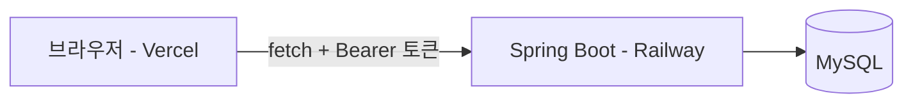

3명이 1주일 동안 위기청소년을 위한 학습·쪽지 서비스 **이음(IEUM)** 을 만들었다. 나는 프론트엔드를 맡아 화면 20개를 만들고 서버 API에 연결했다.  
이 글은 결과물을 소개하고, 프론트엔드에서 실제로 겪은 문제와 협업 과정을 정리한 회고다.

> **TL;DR**
> - 이음은 청소년이 안전한 곳에서 상황을 연습하고, 쪽지로 믿을 수 있는 어른(이음쌤)에게 도움을 청하는 서비스다. 점수·순위를 남기지 않고, 위험 신호는 이음쌤에게만 알린다.
> - 나는 `frontend/`(React + TypeScript)를 맡았고, 커밋 기록상 개발은 2026-11-03부터 11-12까지 이어졌다.
> - 가장 오래 걸린 문제는 서버가 주는 완료 시각(`completedAt`)과 화면의 학습 기록 집계를 맞추는 일이었다.

## 1. 프로젝트 소개

| 항목 | 내용 |
|---|---|
| 프로젝트명 | 이음(IEUM) |
| 개발 기간 | 1주 프로젝트. 저장소 커밋은 2026-11-03 ~ 11-12 (정확한 시작·종료일은 확인 필요) |
| 팀 구성 | 3명. 프론트엔드(나), 백엔드(B), DB(C) |
| 개발 목적 | 위기 상황의 청소년이 연습으로 대처법을 익히고, 쪽지로 도움을 청할 수 있게 하기 |
| 기획 배경 | 점수와 순위가 있는 학습 서비스는 도움이 필요한 청소년에게 부담이 될 수 있다고 보고, 비교 없이 내 속도로 하는 방식을 택했다 |

**주요 기능** (API 24개, 화면 20개, 테이블 8개)

| 구분 | 기능 |
|---|---|
| 계정 | 가입, 로그인, 내 정보 조회·수정, 비밀번호 변경, 탈퇴 |
| 학습 | 홈, 학습 영역 목록, 연습 열기, 연습 기록 저장, 내 학습 기록 |
| 쪽지 | 쪽지 보내기(이음쌤 자동 배정, 위험 신호 검사), 쪽지함, 쪽지 상세, 이어서 쓰기·답장 |
| 이음쌤 | 요약 숫자, 담당 학습자 목록·상세, 받은 쪽지, 신호 목록, 신호 대응 처리 |
| 알림 | 알림 목록, 읽음 처리, 모두 읽음 |

## 2. 기술 스택

| 구분 | 기술 | 사용 목적 |
|---|---|---|
| 프론트엔드 | React 18, TypeScript, Vite, React Router | 화면 구성, 타입 검사, 빌드, 라우팅 |
| 프론트엔드 | three.js | 홈 화면의 3D 마을 |
| 백엔드 | Java 21, Spring Boot 4, Spring Security(JWT), JPA | API 서버, 인증, 데이터 접근 |
| 데이터베이스 | MySQL 8 | 테이블 8개 저장 |
| 배포 | Vercel(프론트), Railway(백엔드·DB) | 배포 |

## 3. 담당 역할

- **담당:** `frontend/` 전체. 커밋 63개를 남겼다.
- **구현한 것:** 인증·내 정보 연결, 홈 3D 마을, 학습 영역·연습(시나리오, 감정 읽기), 쪽지함·알림, 이음쌤 화면(학습자 상세, 신호 확인, 이관 신청·수락), Vercel 배포 설정
- **핵심 파일:** `api/client.ts`(`http()`, `ApiError`), `api/services/recordService.ts`, `router.tsx`
- **협업에서 한 일:** 서버 응답이 바뀌면 화면의 타입과 문구를 맞추고, 백엔드가 만든 기능(예: 로그인 5회 실패 잠금, 이관 상태)에 맞춰 화면을 붙였다.

## 4. 시스템 및 코드 구조



```text
frontend/src
├─ api/           client.ts, session.ts, types.ts, services/ (도메인별 서비스 11개)
├─ pages/         auth(Landing, Login, Signup, Terms) / learner / teacher
├─ components/    Header, SideNav, TeacherNav, Gem ...
├─ lib/, data/, styles/
└─ router.tsx
```

| 계층 | 역할 |
|---|---|
| `pages/` | 화면. 서비스 함수만 부르고 서버 주소를 직접 알지 않는다 |
| `api/services/` | 도메인별 API 호출과 서버 응답을 화면용 모델로 변환 |
| `api/client.ts` | 공통 `http()` 함수. 토큰 헤더, 오류를 `ApiError`로 통일 |

## 5. 주요 기능 구현: 실서버 연결 계층

**목표:** 서버가 완성되기 전에도 화면을 만들고, 서버가 나오면 코드 수정 없이 바꿔 끼우기

**구현 과정:** 서비스 함수가 목업과 실서버 중 하나를 쓰도록 `USE_MOCK` 스위치를 두었다. 개발 모드에서만 목업이 기본값이고, 프로덕션 빌드에서는 값이 비어 있어도 목업을 쓰지 않는다. 배포 주소(`VITE_API_BASE_URL`)가 비어 있으면 화면에 오류 배너를 띄운다.

**핵심 코드** (`api/client.ts`에서 줄여서 인용)

```ts
export const USE_MOCK: boolean = !import.meta.env.PROD && import.meta.env.VITE_USE_MOCK !== "false";
export const API_BASE_MISSING: boolean = import.meta.env.PROD && envApiBase === "";

export async function http<T = void>(method: Method, path: string, body?: unknown) {
  const headers: Record<string, string> = {};
  if (session.token) headers.Authorization = `Bearer ${session.token}`;
  const res = await fetch(API_BASE + path, { method, headers, /* ... */ });
  if (!res.ok) { /* 서버의 code·message를 읽어 ApiError로 던진다 */ }
}
```

**코드 설명:** 배포본이 실수로 목업 데이터를 보여 주는 사고를 막으려고 프로덕션에서는 목업을 끄고, 설정이 빠졌을 때는 조용히 실패하지 않고 배너로 알리게 했다. 서버가 보내는 `code`와 필드 오류 메시지를 `ApiError`에 담아, 화면이 "5회 실패 잠금(429)" 같은 안내 문구를 상태 코드로 구분해 보여 준다.

**실행 결과:** Vercel에 프론트를 배포하고 Railway의 백엔드를 호출하는 구조로 동작했다. (실행 화면은 아래 9번에 첨부 예정)

## 6. 트러블슈팅

### 6.1 학습 완료 개수가 서버와 다르게 보임 (#112, #111)

| 단계 | 내용 |
|---|---|
| 문제 상황 | 학습 기록의 완료 개수가 실제와 어긋났다. 이미 끝낸 연습을 다시 하면 "완료"가 "하는 중"으로 바뀌어 완료 기록이 사라진 것처럼 보였다 |
| 원인 분석 | 화면이 `status`(DONE / IN_PROGRESS)로 완료를 판단했다. 서버는 다시 하는 연습에서도 처음 완료한 시각 `completedAt`을 남기므로, 두 기준이 서로 달랐다 |
| 해결 방법 | 완료 기준을 `completedAt`으로 바꿨다. `completedAt`이 있고 `status`가 `IN_PROGRESS`이면 항목을 "했어요" 줄(`completedAt`)과 "하는 중" 줄(`updatedAt`) 두 개로 펼쳤다(`recordService.ts`, `map` → `flatMap`) |
| 해결 결과 | 다시 하는 연습도 완료 기록이 유지되고 두 줄로 표시된다. 백엔드도 같은 기준(`completed_at`)으로 집계하도록 함께 고쳤다(#111) |

```ts
if (item.completedAt && item.status === "IN_PROGRESS") {
  return [build("done", item.completedAt), build("doing", item.updatedAt)];
}
```

### 6.2 develop 빌드 오류 (#137)

| 단계 | 내용 |
|---|---|
| 문제 상황 | 위 수정이 합쳐진 뒤 `develop`의 빌드가 깨졌다 |
| 원인 분석 | `PracticeItem` 타입에 `completedAt` 필드가 없어 TypeScript가 오류를 냈다 |
| 해결 방법 | `api/types.ts`에 필드를 1줄 추가 |
| 해결 결과 | 빌드 복구. 응답 필드를 쓰는 코드를 고칠 때는 타입도 같이 고치고, PR 올리기 전에 `npm run build`를 돌려야 한다는 점을 확인했다 |

### 6.3 로그인 전 화면에서 토큰 오류 로그 (#153)

| 단계 | 내용 |
|---|---|
| 문제 상황 | 로그인하지 않은 화면에서 "사용자 정보 조회 실패" 오류가 콘솔에 계속 찍혔다 |
| 원인 분석 | 저장된 토큰이 만료·무효인데 사용자 정보 조회를 시도했고, 로그인 전 헤더도 알림 배지를 서버에 물었다. 이때 401 응답을 오류로 처리했다 |
| 해결 방법 | 401이면 로그아웃 상태로 되돌리고 오류로 남기지 않았다(`router.tsx`). 로그인 전 헤더(`guest`, `guest-plain`)는 배지 조회를 건너뛰었다(`Header.tsx`) |
| 해결 결과 | 로그인 전 화면의 콘솔 오류가 사라졌다 |

## 7. 협업 과정

| 항목 | 내용 |
|---|---|
| 역할 분담 | 폴더 단위로 나눴다: `frontend/`(나), `backend/`(B), `db/`(C). 자기 폴더만 수정 |
| 브랜치 | `main` ← `develop` ← `feature/front-…` 형태. PR은 항상 `develop`으로 |
| Issue/PR | 이슈 번호를 커밋·PR에 연결했다(`#112`, `#116`). 저장소의 PR 번호는 #153까지 올라갔다 |
| 충돌 | 같은 `develop`에 계속 합쳐지므로 작업 시작 전 `develop`을 받아 병합했다. 커밋 기록에 `develop` 병합 커밋이 남아 있다 |
| 프론트·백엔드 맞추기 | 백엔드 PR(예: 이관 상태 #151)이 합쳐진 뒤 화면 PR(#152)을 올렸다. 서버 응답이 바뀌면 화면 쪽 수정이 뒤따랐다 |

## 8. 프로젝트 회고

**배운 점**
- 서버 응답의 한 필드(`completedAt`)에 대한 이해가 팀마다 다르면 화면 숫자가 어긋난다. 필드의 의미를 API 명세에 적어 두는 것이 중요했다.
- 목업과 실서버를 같은 서비스 함수 뒤에 두면, 서버가 준비되기 전에도 화면을 만들 수 있었다.
- 응답 필드를 쓰는 코드를 고치면 타입 정의도 같이 고쳐야 한다.

**아쉬운 점** (확인 필요: 내가 느낀 점으로 바꿔 주세요)
- 서버 응답 형식이 바뀐 뒤에야 화면을 맞추는 일이 반복됐다. 커밋 기록에 "서버 응답에 맞추고"류의 수정이 여러 번 나온다.
- 화면 문구와 디자인 수정(`fix: 시나리오 질문 문구 수정` 등)이 후반에 몰렸다.

**향후 개선 방향**
- API 명세에 필드별 의미와 예외 상황을 더 구체적으로 적기
- 화면 테스트를 추가해 응답 형식 변경을 일찍 발견하기
- PR 전에 빌드를 자동으로 돌리는 CI 추가하기

## 9. 관련 자료

- GitHub 저장소: 확인 필요 (링크를 넣어 주세요)
- 실행 화면: 확인 필요 (스크린샷을 `assets/img/`에 넣고 연결)
- 배포 주소: 발표 때 공유

## 더 학습하면 좋은 개념

- **API 계약(OpenAPI)과 타입 자동 생성** — 서버 명세에서 TypeScript 타입을 만들면 6.2 같은 필드 누락을 빌드 단계에서 잡을 수 있다.
- **JWT 만료와 401 처리 전략** — 만료 토큰을 로그아웃으로 처리할지 재발급할지 정하는 일이다. 6.3의 처리를 한 단계 발전시킨다.
- **상태(status)와 이벤트 시각(timestamp)의 모델링** — "다시 하는 중이면서 완료한 적도 있음"처럼 상태가 겹치는 경우를 데이터로 표현하는 방법이다.
- **CI에서 빌드·테스트 자동화(GitHub Actions)** — develop 빌드가 깨지는 일을 PR 단계에서 막는다.

## 참고 자료

- [React 공식 문서](https://react.dev/learn)
- [Vite 공식 문서 - 환경 변수와 모드](https://vite.dev/guide/env-and-mode)
- [MDN - Fetch API](https://developer.mozilla.org/ko/docs/Web/API/Fetch_API)
- [MDN - HTTP 401 Unauthorized](https://developer.mozilla.org/ko/docs/Web/HTTP/Reference/Status/401)
- [GitHub Docs - 풀 리퀘스트](https://docs.github.com/ko/pull-requests)
