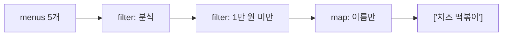

메뉴 배열에서 "분식 중 1만 원 미만인 메뉴 이름"만 뽑으려면 `for` 문에 `if`를 겹쳐 쓰고 결과 배열을 직접 만들어야 할까? `forEach`, `map`, `filter`를 쓰면 무엇을 할지만 적고, 어떻게 돌지는 배열에 맡길 수 있다.  
메뉴 5개짜리 배열로 세 함수를 하나씩 실행해 보고, 콜백을 화살표 함수와 구조 분해로 줄이는 방법, 그리고 "새 배열을 반환해도 원본이 바뀔 수 있는 경우"까지 정리했다.

> **TL;DR**
> - 고차 함수는 함수를 매개변수로 받거나 함수를 반환하는 함수다. 배열의 `forEach`, `map`, `filter`는 콜백 함수를 받아 요소를 하나씩 처리하고, 콜백은 화살표 함수로 짧게 쓰는 경우가 많다.
> - `forEach`는 반환값이 없고, `map`은 콜백의 반환값으로 새 배열을 만들고, `filter`는 콜백이 `true`를 반환한 요소만 모아 새 배열을 만든다. 둘 다 `.filter().filter().map()`처럼 이어 쓸 수 있다.
> - 새 배열이어도 안의 객체는 원본과 같은 객체다. 요소를 바꿔야 하면 스프레드 문법으로 새 객체를 만든다.

환경: Node.js v24.20.0. 아래 코드는 모두 직접 실행해서 출력을 확인했다.

## 예제 데이터

메뉴 5개를 객체 배열로 만들었다. 이후 모든 예제가 이 배열을 사용한다.

```js
const menus = [
    {name: '치즈 떡볶이', category: '분식', price: 5000},
    {name: '제육 덮밥', category: '한식', price: 8000},
    {name: '돈까스', category: '양식', price: 9000},
    {name: '청국장', category: '한식', price: 6000},
    {name: '김치찜', category: '한식', price: 7000}
];
```

## 고차 함수는 왜 콜백을 받을까?

배열을 순회하는 코드는 늘 같은 모양이다. 달라지는 것은 요소마다 "무엇을 할지"뿐이다. 고차 함수는 이 반복 부분을 배열 메서드가 맡고, 달라지는 부분만 콜백 함수로 받는 구조다.

| 메서드 | 콜백이 받는 것 | 콜백의 반환값 | 메서드의 반환값 |
|--------|----------------|----------------|------------------|
| `forEach` | 요소 하나 | 사용하지 않음 | `undefined` |
| `map` | 요소 하나 | 새 배열에 담을 값 | 새 배열 |
| `filter` | 요소 하나 | `true` / `false` | 조건을 만족한 요소만 담은 새 배열 |

## 콜백을 화살표 함수로 줄여 쓰기

콜백은 한 번 쓰고 버리는 경우가 많아서, `function` 키워드를 매번 적으면 코드가 길어진다. 화살표 함수는 `function` 키워드와 중괄호 블록, `return` 키워드를 생략하는 문법이다. 가격 목록에 10% 할인을 적용하는 `map`을 세 단계로 줄여 봤다.

```js
const prices = [4000, 5000, 14000];

console.log(prices.map(function (price) { return price * 0.9; }));
console.log(prices.map((price) => { return price * 0.9; }));
console.log(prices.map(price => price * 0.9));
```

```text
[ 3600, 4500, 12600 ]
[ 3600, 4500, 12600 ]
[ 3600, 4500, 12600 ]
```

| 상황 | 쓰는 법 |
|------|---------|
| 매개변수가 2개 이상 | `(a, b) => a + b` 처럼 소괄호가 필요하다 |
| 매개변수가 1개 | `price => price * 0.9` 처럼 소괄호를 생략할 수 있다 |
| 코드가 한 줄(식 하나) | 중괄호와 `return`을 생략하면 식의 결과가 반환된다 |
| 코드가 여러 줄 | 중괄호를 쓰고, 반환할 값에는 `return`을 직접 적는다 |

모양은 Java의 람다 표현식(`price -> price * 0.9`)과 비슷하다.

### 화살표 함수에서 자주 틀리는 두 가지

중괄호를 쓰면서 `return`을 빼면 `map`은 `undefined`로 채운 배열을 만든다. 오류가 나지 않아서 결과를 출력해 봐야 알 수 있다.

```js
console.log(prices.map(price => { price * 0.9; }));
```

```text
[ undefined, undefined, undefined ]
```

객체를 바로 반환할 때도 같은 문제가 생긴다. 화살표 뒤의 `{`를 함수 본문의 시작으로 읽기 때문이다. 객체 리터럴을 소괄호로 감싸야 객체로 읽는다.

```js
console.log(prices.map(price => { name: price }));
console.log(prices.map(price => ({ price })));
```

```text
[ undefined, undefined, undefined ]
[ { price: 4000 }, { price: 5000 }, { price: 14000 } ]
```

## forEach: 요소마다 실행만 하기

`forEach`는 요소 하나를 콜백에 넘겨 실행하기만 한다. 결과를 모아 주지 않으므로 출력처럼 바깥에 영향을 주는 작업에 쓴다.

```js
menus.forEach(menu => console.log(menu.name));
```

```text
치즈 떡볶이
제육 덮밥
돈까스
청국장
김치찜
```

## map: 요소를 다른 값으로 바꾸기

`map`은 콜백이 반환한 값을 모아 새 배열을 만든다. 원본 `menus`는 바뀌지 않는다.

```js
const names = menus.map(menu => menu.name);
console.log(names);
```

```text
[ '치즈 떡볶이', '제육 덮밥', '돈까스', '청국장', '김치찜' ]
```

## filter: 조건에 맞는 요소만 고르기

`filter`는 콜백이 `true`를 반환한 요소만 모아 새 배열을 만든다. 분식만 고르는 조건에 `===`를 썼다.

```js
const snacks = menus.filter(menu => menu.category === '분식');
console.log(snacks);
```

```text
[ { name: '치즈 떡볶이', category: '분식', price: 5000 } ]
```

가격이 1만 원 미만인 메뉴를 고르면 5개 모두 조건을 만족한다. 이때도 `filter`는 요소를 그대로 담은 새 배열을 돌려준다.

### == 와 === 는 뭐가 다를까?

조건식에서 `===`를 쓴 이유를 직접 비교해서 확인했다.

```js
console.log(`1=='1' : ${1 == '1'}`);
console.log(`1==='1' : ${1 === '1'}`);
```

```text
1=='1' : true
1==='1' : false
```

| 연산자 | 비교 방식 |
|--------|-----------|
| `==` | 타입이 다르면 암묵적으로 타입을 변환한 뒤 값을 비교한다 (동등 비교) |
| `===` | 값과 타입이 모두 같아야 `true`다 (일치 비교) |

## filter와 map 이어 쓰기

`filter`는 배열을 반환하므로 바로 뒤에 `.filter()`나 `.map()`을 붙일 수 있다. "분식 중 1만 원 미만인 메뉴 이름 목록"은 이렇게 만들었다.

```js
const result = menus
    .filter(menu => menu.category === '분식')
    .filter(menu => menu.price < 10000)
    .map(menu => menu.name);

console.log(result);
```

```text
[ '치즈 떡볶이' ]
```



### 처음 작성한 코드의 실수

처음에는 `price < 10000` 조건의 `filter`를 두 번 넣었고, 결과를 만들기만 하고 `console.log(result)`를 빼먹었다. 중복 필터는 결과를 바꾸지 않아서 오류 없이 돌아갔고, 출력이 없다는 점 때문에 뒤늦게 알아챘다.  
같은 조건의 `filter`를 두 번 쓰면 배열을 두 번 순회할 뿐 얻는 것이 없다. 체인을 쓸 때는 단계마다 조건이 서로 다른지 확인하는 편이 좋다.

## 구조 분해로 콜백 매개변수 줄이기

콜백이 받는 요소가 객체면 `menu.name`, `menu.price`처럼 `menu.`를 계속 적게 된다. 구조 분해 할당은 객체에서 프로퍼티를 꺼내 같은 이름의 변수로 만드는 문법이고, 콜백의 매개변수 자리에도 쓸 수 있다.

```js
console.log(menus.map(({ name, price }) => `${name} ${price}원`));
```

```text
[
  '치즈 떡볶이 5000원',
  '제육 덮밥 8000원',
  '돈까스 9000원',
  '청국장 6000원',
  '김치찜 7000원'
]
```

객체를 구조 분해할 때는 프로퍼티 key와 변수 이름이 일치해야 한다. `{ name, price }`를 `{ title, cost }`로 바꾸면 해당 key가 객체에 없으므로 `undefined`가 된다. 배열은 key 대신 순서로 꺼내서 `const [first, second] = menuArr`처럼 이름을 자유롭게 정한다.

## 새 배열을 받아도 원본이 바뀌는 경우

`map`과 `filter`는 원본 배열을 바꾸지 않고 새 배열을 반환한다. 그런데 `filter` 결과에서 요소의 값을 고쳤더니 원본 `menus`의 값이 같이 바뀌었다.

```js
const snacks = menus.filter(menu => menu.category === '분식');
console.log(snacks === menus, snacks[0] === menus[0]);

snacks[0].price = 4500;
console.log(menus[0].price);
```

```text
false true
4500
```

배열은 새로 만들어졌지만(`false`), 그 안의 객체는 원본과 같은 객체다(`true`). 객체 변수에는 객체 자체가 아니라 객체의 주소(참조)가 들어 있어서, 새 배열에도 주소만 복사되기 때문이다.

### 대입, 스프레드, 구조화 복제는 무엇이 다를까?

복사 방식마다 새로 만들어지는 범위가 다르다. 배열 `cart`로 먼저 확인했다.

```js
const cart = ['치킨', '피자'];
const cartRef = cart;
const cartCopy = [...cart];

cartRef.push('파스타');
cartCopy.push('육개장');

console.log(cart, cartRef, cartCopy);
console.log(cart === cartRef, cart === cartCopy);
```

```text
[ '치킨', '피자', '파스타' ] [ '치킨', '피자', '파스타' ] [ '치킨', '피자', '육개장' ]
true false
```

`cartRef`에만 `push`했는데 `cart`에도 `'파스타'`가 들어갔다. `const cartRef = cart`는 값을 복사하는 것이 아니라 같은 주소를 가리키게 만드는 대입이기 때문이다. 메뉴 데이터를 여러 곳에서 이렇게 나눠 쓰면 한 곳에서 수정한 값이 다른 곳에서도 영문 모른 채 바뀐다.  
`[...cart]`는 값을 하나씩 꺼내 새 배열을 만든다. 객체도 `{...order}`로 같은 방식의 복사를 할 수 있다.

수업 중 코드 주석에 `const cartRef = cart`를 "깊은 복사"로 적어 두었는데, 정확히는 **참조 복사**다. 스프레드 문법은 **얕은 복사**(shallow copy)이고, 깊은 복사는 안의 객체까지 새로 만드는 것을 말한다.

| 방식 | 코드 | 새 배열 | 안의 객체 |
|------|------|---------|-----------|
| 대입 | `const b = menus` | 아니다 (같은 배열) | 같은 객체 |
| 스프레드 | `const b = [...menus]` | 맞다 | 같은 객체 (얕은 복사) |
| `map` + 스프레드 | `menus.map(m => ({...m}))` | 맞다 | 새 객체 |
| `structuredClone` | `structuredClone(menus)` | 맞다 | 새 객체 (깊은 복사) |

배열만 `[...menus]`로 복사하고 요소를 고치면 원본도 바뀐다는 점을 확인했다. 아래 코드는 `copy[0].price = 1`로 바꾸고, 원본의 `menus[0].price`를 출력한다.

```js
const copy = [...menus];
copy[0].price = 1;
console.log(menus[0].price);
```

```text
1
```

요소의 값을 바꾼 새 배열이 필요하면 `map` 안에서 객체를 새로 만든다. 가격 10% 할인 목록은 이렇게 만들었고, 원본은 그대로다.

```js
const discounted = menus.map(menu => ({ ...menu, price: menu.price * 0.9 }));
console.log(discounted[0], menus[0]);
console.log(discounted[0] === menus[0]);
```

```text
{ name: '치즈 떡볶이', category: '분식', price: 4500 } { name: '치즈 떡볶이', category: '분식', price: 5000 }
false
```

`{ ...menu, price: ... }`는 `menu`의 프로퍼티를 모두 복사한 뒤 `price`만 새 값으로 덮어쓴다. 프로퍼티 안에 또 객체나 배열이 들어 있으면 그 안쪽은 여전히 공유되므로, 그런 구조에는 `structuredClone`을 쓴다.

## 정리

- 반환값이 필요 없으면 `forEach`, 값을 바꿔 새 배열이 필요하면 `map`, 조건으로 걸러내면 `filter`를 쓴다.
- 콜백은 화살표 함수로 줄여 쓴다. 중괄호를 쓰면 `return`을 빼먹지 않고, 객체를 바로 반환할 때는 소괄호로 감싼다.
- 조건 비교는 타입 변환이 없는 `===`를 쓴다.
- `map`과 `filter`가 만든 새 배열도 요소 객체는 원본과 공유한다. 요소를 바꿀 때는 스프레드로 새 객체를 만든다.

## 더 학습하면 좋은 개념

- **`reduce`** — 배열을 값 하나로 합치는 고차 함수다. 합계나 그룹핑처럼 `map`과 `filter`로 표현하기 어려운 집계를 다룬다.
- **화살표 함수의 `this`** — 화살표 함수는 자신의 `this`를 갖지 않고 바깥 범위의 `this`를 쓴다. 객체 메서드나 이벤트 핸들러에 화살표 함수를 쓸 때 결과가 달라지는 이유를 알 수 있다.
- **일급 함수(First-class function)** — 함수를 값처럼 변수에 담고 전달할 수 있다는 성질이다. 고차 함수가 가능한 이유다.
- **불변성(Immutability)** — 원본을 바꾸지 않고 새 값을 만드는 방식이 왜 상태 관리에 유리한지 이해하는 데 필요하다. 이 글의 얕은 복사 문제가 실제로 드러나는 곳이다.
- **얕은 복사와 깊은 복사** — `structuredClone`이 복사하지 못하는 값(함수 등)과 JSON 변환 방식의 한계를 알아 두면 복사 방식을 고를 수 있다.

## 참고 자료

- [MDN - Array.prototype.forEach()](https://developer.mozilla.org/en-US/docs/Web/JavaScript/Reference/Global_Objects/Array/forEach)
- [MDN - Array.prototype.map()](https://developer.mozilla.org/en-US/docs/Web/JavaScript/Reference/Global_Objects/Array/map)
- [MDN - Array.prototype.filter()](https://developer.mozilla.org/en-US/docs/Web/JavaScript/Reference/Global_Objects/Array/filter)
- [MDN - 동등 비교와 일치 비교](https://developer.mozilla.org/en-US/docs/Web/JavaScript/Equality_comparisons_and_sameness)
- [MDN - 화살표 함수 표현식](https://developer.mozilla.org/en-US/docs/Web/JavaScript/Reference/Functions/Arrow_functions)
- [MDN - 전개 구문(Spread syntax)](https://developer.mozilla.org/en-US/docs/Web/JavaScript/Reference/Operators/Spread_syntax)
- [MDN - 구조 분해 할당](https://developer.mozilla.org/en-US/docs/Web/JavaScript/Reference/Operators/Destructuring_assignment)
- [MDN - structuredClone()](https://developer.mozilla.org/en-US/docs/Web/API/Window/structuredClone)
