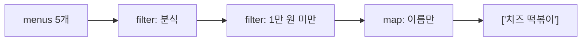

메뉴 배열에서 "분식 중 1만 원 미만인 메뉴 이름"만 뽑으려면 `for` 문에 `if`를 겹쳐 쓰고 결과 배열을 직접 만들어야 할까? `forEach`, `map`, `filter`를 쓰면 무엇을 할지만 적고, 어떻게 돌지는 배열에 맡길 수 있다.  
메뉴 5개짜리 배열로 세 함수를 하나씩 실행해 보고, 마지막에 `filter`와 `map`을 이어 붙이는 과정을 정리했다.

> **TL;DR**
> - 고차 함수는 함수를 매개변수로 받거나 함수를 반환하는 함수다. 배열의 `forEach`, `map`, `filter`는 콜백 함수를 받아 요소를 하나씩 처리한다.
> - `forEach`는 반환값이 없고, `map`은 콜백의 반환값으로 새 배열을 만들고, `filter`는 콜백이 `true`를 반환한 요소만 모아 새 배열을 만든다.
> - `filter`와 `map`은 새 배열을 반환하므로 `.filter().filter().map()`처럼 이어 쓸 수 있다.

환경: Node.js v24.20.0. 아래 코드는 모두 직접 실행해서 출력을 확인했다.

## 예제 데이터

메뉴 5개를 객체 배열로 만들었다. 이후 모든 예제가 이 배열을 사용한다.

```js
const menus = [
    {name: '치즈 떡볶이', category: '분식', price: 5000},
    {name: '제육 덮밥', category: '한식', price: 8000},
    {name: '돈까스', category: '양식', price: 9000},
    {name: '청국장', category: '한식', price: 6000},
    {name: '김치찜', category: '한식', price: 7000}
];
```

## 고차 함수는 왜 콜백을 받을까?

배열을 순회하는 코드는 늘 같은 모양이다. 달라지는 것은 요소마다 "무엇을 할지"뿐이다. 고차 함수는 이 반복 부분을 배열 메서드가 맡고, 달라지는 부분만 콜백 함수로 받는 구조다.

| 메서드 | 콜백이 받는 것 | 콜백의 반환값 | 메서드의 반환값 |
|--------|----------------|----------------|------------------|
| `forEach` | 요소 하나 | 사용하지 않음 | `undefined` |
| `map` | 요소 하나 | 새 배열에 담을 값 | 새 배열 |
| `filter` | 요소 하나 | `true` / `false` | 조건을 만족한 요소만 담은 새 배열 |

## forEach: 요소마다 실행만 하기

`forEach`는 요소 하나를 콜백에 넘겨 실행하기만 한다. 결과를 모아 주지 않으므로 출력처럼 바깥에 영향을 주는 작업에 쓴다.

```js
menus.forEach(menu => console.log(menu.name));
```

```text
치즈 떡볶이
제육 덮밥
돈까스
청국장
김치찜
```

## map: 요소를 다른 값으로 바꾸기

`map`은 콜백이 반환한 값을 모아 새 배열을 만든다. 원본 `menus`는 바뀌지 않는다.

```js
const names = menus.map(menu => menu.name);
console.log(names);
```

```text
[ '치즈 떡볶이', '제육 덮밥', '돈까스', '청국장', '김치찜' ]
```

## filter: 조건에 맞는 요소만 고르기

`filter`는 콜백이 `true`를 반환한 요소만 모아 새 배열을 만든다. 분식만 고르는 조건에 `===`를 썼다.

```js
const snacks = menus.filter(menu => menu.category === '분식');
console.log(snacks);
```

```text
[ { name: '치즈 떡볶이', category: '분식', price: 5000 } ]
```

가격이 1만 원 미만인 메뉴를 고르면 5개 모두 조건을 만족한다. 이때도 `filter`는 요소를 그대로 담은 새 배열을 돌려준다.

### == 와 === 는 뭐가 다를까?

조건식에서 `===`를 쓴 이유를 직접 비교해서 확인했다.

```js
console.log(`1=='1' : ${1 == '1'}`);
console.log(`1==='1' : ${1 === '1'}`);
```

```text
1=='1' : true
1==='1' : false
```

| 연산자 | 비교 방식 |
|--------|-----------|
| `==` | 타입이 다르면 암묵적으로 타입을 변환한 뒤 값을 비교한다 (동등 비교) |
| `===` | 값과 타입이 모두 같아야 `true`다 (일치 비교) |

## filter와 map 이어 쓰기

`filter`는 배열을 반환하므로 바로 뒤에 `.filter()`나 `.map()`을 붙일 수 있다. "분식 중 1만 원 미만인 메뉴 이름 목록"은 이렇게 만들었다.

```js
const result = menus
    .filter(menu => menu.category === '분식')
    .filter(menu => menu.price < 10000)
    .map(menu => menu.name);

console.log(result);
```

```text
[ '치즈 떡볶이' ]
```



### 처음 작성한 코드의 실수

처음에는 `price < 10000` 조건의 `filter`를 두 번 넣었고, 결과를 만들기만 하고 `console.log(result)`를 빼먹었다. 중복 필터는 결과를 바꾸지 않아서 오류 없이 돌아갔고, 출력이 없다는 점 때문에 뒤늦게 알아챘다.  
같은 조건의 `filter`를 두 번 쓰면 배열을 두 번 순회할 뿐 얻는 것이 없다. 체인을 쓸 때는 단계마다 조건이 서로 다른지 확인하는 편이 좋다.

## 정리

- 반환값이 필요 없으면 `forEach`, 값을 바꿔 새 배열이 필요하면 `map`, 조건으로 걸러내면 `filter`를 쓴다.
- `map`과 `filter`는 원본 배열을 바꾸지 않고 새 배열을 만든다.
- 조건 비교는 타입 변환이 없는 `===`를 쓴다.

## 더 학습하면 좋은 개념

- **`reduce`** — 배열을 값 하나로 합치는 고차 함수다. 합계나 그룹핑처럼 `map`과 `filter`로 표현하기 어려운 집계를 다룬다.
- **화살표 함수** — 콜백을 짧게 쓰는 문법이다. `this` 처리 방식이 일반 함수와 달라서 알아 두어야 한다.
- **일급 함수(First-class function)** — 함수를 값처럼 변수에 담고 전달할 수 있다는 성질이다. 고차 함수가 가능한 이유다.
- **불변성(Immutability)** — 원본을 바꾸지 않고 새 배열을 반환하는 방식이 왜 상태 관리에 유리한지 이해하는 데 필요하다.

## 참고 자료

- [MDN - Array.prototype.forEach()](https://developer.mozilla.org/en-US/docs/Web/JavaScript/Reference/Global_Objects/Array/forEach)
- [MDN - Array.prototype.map()](https://developer.mozilla.org/en-US/docs/Web/JavaScript/Reference/Global_Objects/Array/map)
- [MDN - Array.prototype.filter()](https://developer.mozilla.org/en-US/docs/Web/JavaScript/Reference/Global_Objects/Array/filter)
- [MDN - 동등 비교와 일치 비교](https://developer.mozilla.org/en-US/docs/Web/JavaScript/Equality_comparisons_and_sameness)
