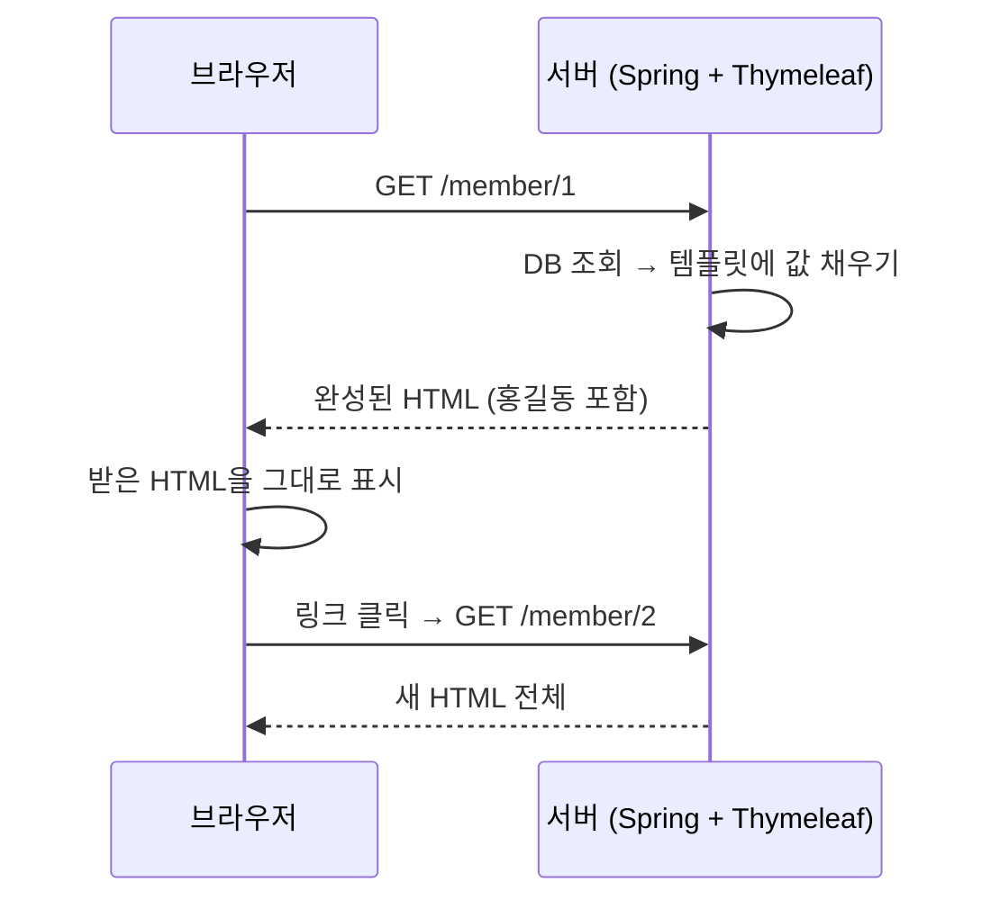
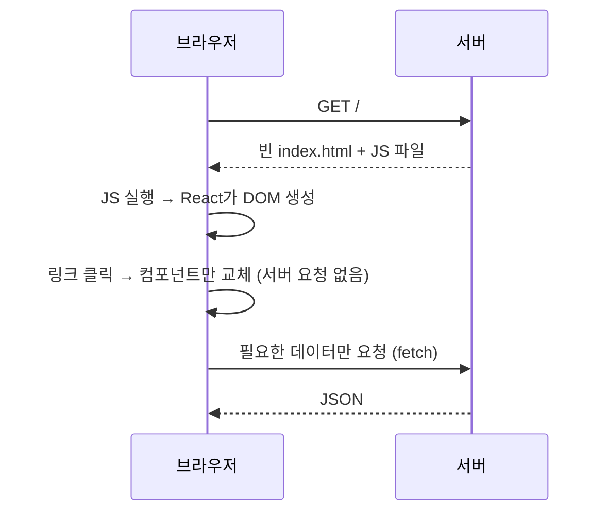
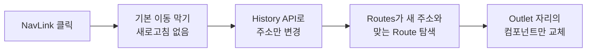

Thymeleaf로 만든 페이지에서 "페이지 소스 보기"를 누르면 회원 이름까지 다 채워진 HTML이 보인다. 그런데 Vite로 만든 React 앱에서 같은 버튼을 누르면 `<div id="root"></div>` 하나만 덩그러니 있다. 화면에는 메뉴와 본문이 다 보이는데, 그 내용은 대체 어디서 온 걸까?  
오늘 수업에서는 이 차이를 SSR과 CSR이라는 렌더링 방식으로 정리하고, React Router로 SPA를 직접 구성해 봤다. 라우터를 붙이다가 만난 오류와 해결 과정도 함께 남긴다.

> **TL;DR**
> - SSR(Server Side Rendering)은 서버가 완성된 HTML을 만들어 보내고, CSR(Client Side Rendering)은 서버가 빈 HTML과 JS를 보내면 브라우저가 화면을 만든다. Thymeleaf는 SSR, Vite로 만든 React 앱은 CSR이다.
> - SPA(Single Page Application)는 HTML 한 장을 받아 둔 뒤, 주소가 바뀌어도 새로고침 없이 컴포넌트만 바꿔 끼운다. React Router가 이 역할을 맡는다.
> - Next.js는 React 위에 만든 프레임워크로, 기본적으로 서버에서 HTML을 미리 만들어(SSR/SSG) 보낸 뒤 브라우저에서 React가 이어받는다.

환경: React 19.3, react-router-dom 7.18, Vite 8. `npm create vite`로 만든 `component-app` 프로젝트에서 실습했다.

## 렌더링은 "HTML을 누가 만드느냐"의 문제다

여기서 렌더링(rendering)은 데이터와 템플릿을 합쳐 화면에 보일 HTML을 만드는 일이다. SSR과 CSR은 이 일을 **서버가 하느냐, 브라우저가 하느냐**로 나뉜다.

### SSR: Thymeleaf는 서버가 HTML을 완성한다

[Thymeleaf 기본 문법]({{ site.baseurl }}/spring-thymeleaf-basics.html)에서 실습한 흐름을 다시 보면, 컨트롤러가 `Model`에 값을 담고 Thymeleaf가 `th:text` 자리에 그 값을 채운 뒤 **완성된 HTML**을 응답한다. 브라우저는 받은 HTML을 그대로 그리기만 한다.



링크를 누를 때마다 서버에 요청하고, 서버는 매번 페이지 전체를 새로 만들어 보낸다. 그래서 페이지를 옮길 때 화면이 한 번 하얗게 깜빡인다.

### CSR: React는 브라우저가 HTML을 만든다

Vite 프로젝트의 `index.html`에는 내용이 거의 없다. 빈 `div` 하나와 JS를 불러오는 `script` 태그가 전부다.

```html
<body>
  <div id="root"></div>
  <script type="module" src="/src/main.jsx"></script>
</body>
```

브라우저가 이 JS를 내려받아 실행하면, `main.jsx`가 `App` 컴포넌트를 `#root` 안에 그린다.

```jsx
import { createRoot } from 'react-dom/client'
import App from './App.jsx'

createRoot(document.getElementById('root')).render(<App />)
```



처음에 헷갈린 부분이 여기다. "페이지 소스 보기"는 **서버가 처음 보낸 HTML**을 보여 준다. React 앱에서는 서버가 빈 HTML을 보냈으니 소스에도 빈 `div`만 보인다. 실제로 그려진 요소는 개발자 도구의 Elements 탭에서 확인해야 한다.

### 두 방식 비교

| 비교 기준 | SSR (Thymeleaf) | CSR (React + Vite) |
|-----------|-----------------|--------------------|
| HTML을 만드는 곳 | 서버 | 브라우저 |
| 서버가 처음 보내는 것 | 완성된 HTML | 빈 HTML + JS 번들 |
| 첫 화면이 보이는 시점 | HTML을 받자마자 | JS를 내려받고 실행한 뒤 |
| 페이지 이동 | 매번 서버에 새 HTML 요청 | 브라우저에서 컴포넌트만 교체 |
| 검색엔진 수집(SEO) | 내용이 HTML에 있어 유리 | 빈 HTML만 보는 크롤러에는 불리 |
| 서버가 주로 보내는 데이터 | HTML | JSON (API 응답) |

어느 쪽이 무조건 낫다기보다, 첫 화면 속도와 검색 노출이 중요하면 SSR, 화면 전환이 잦은 앱 같은 서비스면 CSR이 잘 맞는다.

## SPA: 페이지는 하나, 화면은 여러 개

SPA(Single Page Application)는 이름 그대로 **HTML 페이지가 하나뿐인** 웹 애플리케이션이다. 처음에 `index.html`을 한 번 받은 뒤로는 HTML을 다시 받지 않는다. 주소창의 URL이 `/vite/intro`, `/vite/module`로 바뀌어도 서버에 새 페이지를 요청하지 않고, 자바스크립트가 주소에 맞는 컴포넌트를 골라 그린다.

### 동작 방식

이 역할을 하는 도구가 라우터다. 라우팅(routing)은 **요청한 URL 주소에 따라 보여 줄 컴포넌트를 정하는 것**이다. 수업에서는 `react-router-dom`을 썼다.

| 컴포넌트 | 역할 |
|----------|------|
| `BrowserRouter` | 라우팅을 적용할 범위를 지정한다 |
| `Routes` | 여러 `Route`를 묶고, 현재 주소와 맞는 것을 고른다 |
| `Route` | `path`(주소)와 `element`(컴포넌트)를 연결한다 |
| `Outlet` | 부모 컴포넌트 안에서 자식 `Route`의 컴포넌트가 들어갈 자리다 |
| `Link` / `NavLink` | 새로고침 없이 주소만 바꾸는 링크다. `NavLink`는 현재 주소와 일치하면 `isActive`가 `true`가 된다 |

메뉴를 클릭했을 때 일어나는 일을 순서대로 보면 이렇다.



일반 `<a href>`는 브라우저가 서버에 새 페이지를 요청한다. 반면 `NavLink`는 클릭 이벤트를 가로채서 브라우저의 History API로 주소만 바꾸고, React Router가 그 주소에 맞는 컴포넌트를 다시 그린다. 그래서 Navbar는 그대로 있고 본문만 바뀐다.

### 실습 구조: Layout 안에 페이지를 끼우기

실습 앱은 왼쪽에 메뉴(`Navbar`), 오른쪽에 본문이 있는 구조다. 메뉴는 모든 페이지에 공통이므로 `Layout` 컴포넌트에 두고, 본문 자리에 `Outlet`을 놓았다.

```jsx
// src/layouts/Layout.jsx
import { Outlet } from 'react-router-dom';
import Navbar from '../components/Navbar';
import styles from './Layout.module.css';

function Layout() {
    return (
        <div className={styles.layout}>
            <Navbar/>
            <main className={styles.content}>
                <Outlet/>
            </main>
        </div>
    );
}

export default Layout;
```

`Outlet`은 Thymeleaf의 fragment와 목적이 비슷하다(공통 영역 재사용). 다만 Thymeleaf는 서버가 HTML을 조립하고, `Outlet`은 브라우저에서 주소가 바뀔 때마다 그 자리만 바꿔 끼운다는 점이 다르다.

## 라우터를 붙이다 만난 오류

`App.jsx`에 라우터를 처음 작성했을 때 코드는 이랬다. 화면이 뜨지 않고 오류가 났다.

```jsx
// 오류가 난 App.jsx (주석은 생략)
import { BrowserRouter, Routes, Route } from 'react-router-dom'
import Hello from './module/01_intro/01_intro.jsx'
import UserInfo from './module/02_module/UserInfo.jsx'

import { BrowserRouter, Routes, Route } from 'react-router-dom'

function App() {
  <BrowserRouter>
    <Routes>
      <Route path='/' element={<Layout />} />
        <Route index element={<Main />} />
        <Route path='vite/intro' element={<Hello />} />
        <Route path='vite/module' element={<UserInfo />} />
    </Routes>
  </BrowserRouter>
}

export default App
```

원인은 한 가지가 아니라 네 가지였다.

| 번호 | 문제 | 왜 문제인가 |
|------|------|-------------|
| 1 | `react-router-dom` import가 두 번 있음 | 같은 이름(`BrowserRouter` 등)을 한 파일에서 두 번 선언하면 빌드 단계에서 문법 오류가 난다 |
| 2 | `Layout`, `Main`을 import하지 않음 | 쓰는 컴포넌트를 가져오지 않았으니 이름을 찾을 수 없다 |
| 3 | `return`이 없음 | 컴포넌트는 엘리먼트를 반환하는 함수인데, JSX를 쓰기만 하고 반환하지 않아서 그릴 것이 없다 |
| 4 | `<Route ... element={<Layout />} />`가 바로 닫힘 | 자식 `Route`들이 `Layout` 안에 들어가지 못해서 `Outlet` 자리에 아무것도 안 나온다 |

1번처럼 빌드 단계에서 막히는 오류가 있으면 화면이 아예 뜨지 않고, Vite가 브라우저에 에러 화면(오버레이)을 띄운다. 정확한 에러 메시지 원문은 기록해 두지 못해서 **확인 필요**로 남긴다.

### 해결

```jsx
import { BrowserRouter, Routes, Route } from 'react-router-dom'
import Layout from './layouts/Layout.jsx'
import Main from './pages/Main.jsx'
import Hello from './module/01_intro/01_intro.jsx'
import UserInfo from './module/02_module/UserInfo.jsx'

function App() {
  return (
    <BrowserRouter>
      <Routes>
        <Route path='/' element={<Layout />}>
          <Route index element={<Main />} />
          <Route path='vite/intro' element={<Hello />} />
          <Route path='vite/module' element={<UserInfo />} />
        </Route>
      </Routes>
    </BrowserRouter>
  )
}

export default App
```

1. 중복된 import 한 줄을 지웠다.
2. `Layout`과 `Main`의 import를 추가했다.
3. JSX 전체를 `return ( ... )`로 감쌌다.
4. `Layout` Route를 여는 태그와 닫는 태그로 나눠 자식 Route를 감쌌다.

4번이 가장 헷갈렸다. 처음 코드도 들여쓰기로는 자식 Route가 안쪽에 있는 것처럼 보인다. 하지만 JSX에서 부모-자식 관계는 **들여쓰기가 아니라 태그가 열리고 닫히는 위치**로 정해진다. `/>`로 바로 닫으면 네 개의 Route가 모두 같은 높이의 형제가 된다.

중첩 Route에서 자식의 `path`는 부모 경로에 이어 붙는다. 그래서 `vite/intro`는 `/vite/intro` 주소가 되고, 이때 화면은 `Layout`이 그려진 상태에서 `Outlet` 자리에 `Hello`가 들어간다. `index`가 붙은 Route는 부모 주소(`/`) 그대로일 때 `Outlet`에 들어갈 기본 화면이다.

| 주소 | 그려지는 구조 |
|------|---------------|
| `/` | `Layout` + `Outlet` 자리에 `Main` |
| `/vite/intro` | `Layout` + `Outlet` 자리에 `Hello` |
| `/vite/module` | `Layout` + `Outlet` 자리에 `UserInfo` |

수업 코드 주석에 있던 말처럼, React에서 오류가 나면 **import 구문부터 확인**하는 것이 빠르다. 이번 오류 네 개 중 두 개가 import 문제였다.

## (심화) React와 Next.js의 렌더링 차이

수업에서는 "React는 CSR, Next는 SSR"로 정리했다. 공식 문서를 찾아보니 조금 더 정확히 말할 수 있다.

- **React 자체는 라이브러리**다. Vite로 만든 React 앱이 CSR인 것은 그렇게 설정된 프로젝트이기 때문이다. React에도 서버에서 HTML을 만드는 API(`react-dom/server`)가 있다.
- **Next.js는 React 위에 만든 프레임워크**다. 기본적으로 페이지를 서버에서 미리 렌더링해 HTML을 보낸다. 미리 만드는 시점에 따라 두 가지로 나뉜다.

| 방식 | HTML을 만드는 시점 | 예시 |
|------|--------------------|------|
| SSG (Static Site Generation, 정적 생성) | 빌드할 때 한 번 | 블로그 글, 소개 페이지 |
| SSR (Server Side Rendering) | 요청이 올 때마다 | 로그인한 사용자별 화면 |
| CSR | 브라우저에서 | 클라이언트 컴포넌트의 상호작용 부분 |

Next.js는 서버가 만든 HTML을 먼저 보여 준 뒤, 브라우저에서 React가 그 HTML에 이벤트를 연결해 동작하게 만든다. 이 과정을 **하이드레이션**(hydration, 정적인 HTML에 상호작용을 입히는 것)이라고 한다. 그래서 첫 화면은 SSR처럼 빠르고 검색엔진에도 보이며, 그 뒤 페이지 이동은 SPA처럼 새로고침 없이 동작한다.

정리하면 "Next는 SSR"이라기보다 **"서버 렌더링을 기본으로 하고, 필요한 부분만 클라이언트에서 렌더링한다"**에 가깝다.

## 정리

- 렌더링 방식은 HTML을 누가 만드느냐로 나뉜다. Thymeleaf는 서버가 완성된 HTML을 보내는 SSR, Vite로 만든 React 앱은 브라우저가 HTML을 만드는 CSR이다.
- SPA는 HTML을 한 번만 받고, React Router가 주소에 맞는 컴포넌트를 `Outlet` 자리에 바꿔 끼운다. JSX의 부모-자식 관계는 들여쓰기가 아니라 태그를 여닫는 위치로 정해진다.
- Next.js는 서버에서 미리 렌더링한 HTML을 보내고 하이드레이션으로 React를 연결한다. 다음에는 Next.js 프로젝트를 만들어 "페이지 소스 보기" 결과를 직접 비교해 볼 것이다.

## 더 학습하면 좋은 개념

- **하이드레이션(Hydration)** — 서버가 만든 HTML에 React가 이벤트를 연결하는 과정이다. Next.js의 동작을 이해하려면 이 단계에서 무슨 일이 일어나는지 알아야 한다.
- **History API (`pushState`, `popstate`)** — React Router가 새로고침 없이 주소를 바꾸는 바탕이 되는 브라우저 기능이다. 직접 써 보면 SPA 라우팅의 원리가 보인다.
- **SPA의 새로고침 문제와 fallback 설정** — `/vite/intro`에서 새로고침하면 서버에는 그 경로의 파일이 없다. 배포할 때 모든 경로를 `index.html`로 돌려주는 설정이 왜 필요한지 알아 두면 좋다.
- **React Server Components** — Next.js App Router의 기본 컴포넌트다. 서버에서만 실행되는 컴포넌트가 CSR/SSR 구분을 어떻게 바꾸는지 보여 준다.
- **코드 분할(Code Splitting)과 지연 로딩(`lazy`)** — CSR의 약점인 첫 로딩 시간을 줄이는 방법이다. 페이지별로 JS를 나눠 받는다.

## 참고 자료

- [React Router 공식 문서 - Routing](https://reactrouter.com/start/declarative/routing)
- [React 공식 문서 - Server React DOM APIs](https://react.dev/reference/react-dom/server)
- [React 공식 문서 - hydrateRoot](https://react.dev/reference/react-dom/client/hydrateRoot)
- [Next.js 공식 문서 - Server and Client Components](https://nextjs.org/docs/app/getting-started/server-and-client-components)
- [MDN - SPA (Single-page application)](https://developer.mozilla.org/en-US/docs/Glossary/SPA)
- [MDN - History API](https://developer.mozilla.org/en-US/docs/Web/API/History_API)
- [Vite 공식 문서 - Getting Started](https://vite.dev/guide/)
